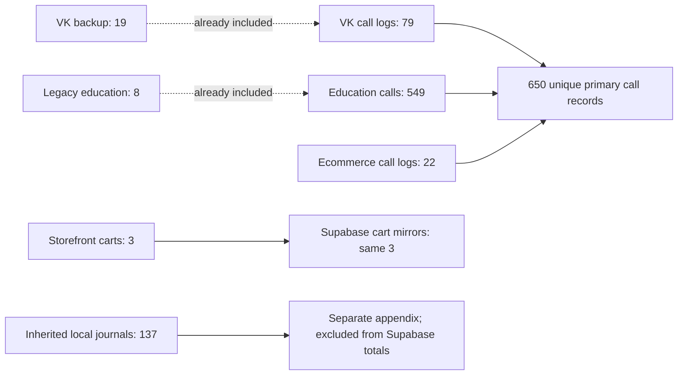

# Supabase Business Case Study

**Evidence-backed operating review · 4 November 2026 · UTC**

## Executive assessment

This server demonstrates three distinct data-bearing business deployments: a real-estate voice workflow, an event-reminder service and a storefront/cart-recovery service. Their records substantiate operational execution, recorded conversations, event reminders and cart synchronization. They do **not** substantiate realized sales uplift, paid enrolments, commercial ROI or investor-grade revenue growth.

The audit examined five distinct PostgreSQL clusters: three Supabase instances and two supporting/legacy PostgreSQL instances. One production Supabase instance was running; the other four source databases were stopped. Stopped data was copied and inspected in temporary isolated containers; original deployments were not restarted. Every primary call-table row was analyzed, not sampled. A migrated education database and the VK migration backup were checked for duplicate IDs before consolidation.

The main conclusions are:

- Education is **Learnapart’s Nivas event-reminder service**, not an evidenced admission/enrolment platform. A separately deployed “Learnbot” could not be established.
- Ecommerce includes **Kalamandir’s test storefront** and its synchronized cart-recovery voice workflow. Checkout rejects live payments unless test mode is enabled; even a future test order would not establish paid revenue.
- Volant is an overseas-education counselling voice template, but its configured Supabase URL is a placeholder. Historical local journals are covered separately and cannot be attributed to a current, verified Volant Supabase business.
- Recorded completion, connection evidence, reminder disposition and commercial conversion are separate concepts throughout this report.

### Snapshot overview

| Measure | Observed value |
| --- | --- |
| Primary unique call records | 650 |
| Call-attempt/execution records (definition below) | 520 |
| Queued education cancellations excluded from attempt denominator | 130 |
| Rows with connection evidence | 313 |
| Terminal completed status | 307 |
| Terminal failed status (can include connected failures) | 196 |
| Terminal cancelled status | 134 |
| No-answer disposition/label | 214 |
| No-answer label without connection evidence | 188 |
| Explicit rejected / busy labels | 0 / 0 |
| Unknown raw status / missing coded terminal outcome | 0 / 101 |
| Voicemail-labelled calls | 27 |
| Recorded valid duration (seconds) | 14,611.68 |
| Recorded valid calling hours | 4.06 |
| Project-scoped distinct attempted contact endpoints (not global people) | 278 |
| Verified commercial conversions found | None; missing attribution prevents a general conversion-rate claim |
| Verified paid revenue / ROI | N/A |

## 1. Discovery inventory and environment map

Discovery covered accessible application/configuration roots under `/home/ubuntu`, `/root`, `/srv` and relevant Docker volumes; Docker running/stopped containers; Supabase and PostgreSQL configuration; migration backups; schema/migration files; and application SQL/data access code. Credentials were used only where required for authorized local access and are not published. No identifiable hosted Supabase cloud project was found beyond placeholder examples. “Every” means these accessible server locations and discoverable configurations, not undisclosed external accounts or encrypted/deleted backups.

| Project / environment | Repository or deployment path | Instance / database | Accessible / available data | Treatment |
| --- | --- | --- | --- | --- |
| VK Realty | /home/ubuntu/vk-realty; /home/ubuntu/vk-realty-supabase | supabase-db / postgres + _supabase | Yes / primary calls, transcripts, operational tables | Primary real-estate environment |
| Learnapart / education | /home/ubuntu/speaksy-education; /home/ubuntu/learnapart-supabase | education-supabase-db / postgres + _supabase | Yes, isolated copy / reminders, leads, campaigns, telemetry | Primary education environment; stopped source |
| Education legacy | /home/ubuntu/speaksy-education | speaksy-education-db-1 / speaksy_education | Yes, isolated copy / historical subset | Deduplicated against newer Supabase instance |
| Kalamandir ecommerce | /home/ubuntu/speaksy-ecommerce/runtime; supabase | kalamandir-supabase-db / postgres + _supabase | Yes, isolated copy / calls and cart mirrors | Primary ecommerce voice/CRM environment; stopped source |
| Kalamandir storefront | /home/ubuntu/speaksy-ecommerce/storefront | kalamandir-store-db / kalamandir_shop | Yes, isolated copy / products, carts, outbox; orders empty | Supporting PostgreSQL, not an extra Supabase project |
| Volant Overseas | /home/ubuntu/volant | Placeholder hosted URL; no separate Supabase container | Supabase no / local tenancy and inherited journals yes | Local historical evidence only; no Supabase KPI claims |
| Learnbot (requested name) | No distinct configuration or deployment established | Unresolved | No separate instance established | Not assumed to be a second education business |
| Speaksy Core | /home/ubuntu/speaksy-core | Shared code; no business database deployment found | Source/schema available | Framework, not an extra customer project |
| Finance vertical | /home/ubuntu/speaksy-finance | Example PostgreSQL connection settings and schema files | No corresponding populated deployment found | Template; no live-data KPI claims |
| Healthcare vertical | /home/ubuntu/speaksy-healthcare | Example PostgreSQL connection settings and schema files | No corresponding populated deployment found | Template; no live-data KPI claims |
| Insurance vertical | /home/ubuntu/speaksy-insurance | Example PostgreSQL connection settings and schema files | No corresponding populated deployment found | Template; no live-data KPI claims |
| Real-estate vertical template | /home/ubuntu/speaksy-realestate | Example PostgreSQL connection settings and schema files | No corresponding populated deployment found | Template; no live-data KPI claims |
| Supabase upstream | /home/ubuntu/supabase-official | Upstream framework/local-development definitions | Source available; not a separate business instance | Excluded as a product; do not publish business metrics into upstream |
| Migration and repair copies | /home/ubuntu/migration-20260923; /srv/migration-20260923; vk-realty-repair-20261006 | Archived source and logical dumps | Relevant VK dump inspected | Backup/source duplicates, not extra projects |
| RB knowledge assets | /home/ubuntu/RB; /home/ubuntu/vk-realty/knowledge/rb | Knowledge documents; no separate PostgreSQL cluster found | Knowledge assets available | Not an additional customer database |

Three independent PostgreSQL system identifiers distinguish the Supabase clusters; two others distinguish the legacy education and storefront clusters. The `postgres` and `_supabase` databases within one cluster are not separate business projects. Duplicate `/home` and `/srv` migration paths, backups, gateway aliases, application workers and schema copies are not added as businesses. Shared historical IDs are deduplicated even when they live in distinct physical clusters.

### Snapshot times and dates

All report times are UTC. Timestamp-with-time-zone values are normalized to UTC. Calls in VK/ecommerce lack actual start/end columns: their `created_at` is shown as **recorded at**, never relabelled as pickup/start. Education uses `queued_at` for reporting periods and preserves actual `started_at`/`ended_at` where present. Daily/weekly/monthly tables therefore describe recorded/queued volume, not a reconstructed carrier billing calendar. Date-only fields and configured business time zones were not silently substituted for UTC.

| Source | Snapshot capture UTC | Meaning |
| --- | --- | --- |
| vk-realty | 2026-11-04T13:48:12Z | Single SQL MVCC snapshot of rows, counts and date ranges |
| ecommerce | 2026-11-04T13:48:12Z | Single SQL MVCC snapshot of rows, counts and date ranges |
| education | 2026-11-04T13:48:13Z | Single SQL MVCC snapshot of rows, counts and date ranges |
| education-legacy | 2026-11-04T13:48:13Z | Single SQL MVCC snapshot of rows, counts and date ranges |
| storefront | 2026-11-04T13:48:14Z | Single SQL MVCC snapshot of rows, counts and date ranges |

### Event lineage and duplicate boundaries

The active VK snapshot is historical as of its capture: new calls can arrive later. There is no distributed transaction spanning all five clusters. Catalog metadata was sampled separately and may reflect slightly different active-table counts; all business KPIs use the consistent business payload snapshots, not estimated `reltuples`.

## 2. Measurement contract and provenance

1. **Record**: one unique primary `public.call_logs.id` or `speaksy.calls.id` after source/backup deduplication. Transcripts, webhook events, active-call rows and cart sync outbox messages are not extra calls.
2. **Attempt denominator**: each primary call execution record, excluding education rows with `status=cancelled`, `outcome=campaign_stopped`, no dispatch ID and no start. Dispatcher code cancels these while still queued. This is a workflow-attempt denominator: a dispatched initialization/provider failure is included even if the carrier never dialled. An exact carrier-dial count cannot be reconstructed for every record.
3. **Connection evidence**: an explicit `extracted_info.diagnostics.connected=true`; or education `started_at`; or a completed row with positive duration and nonempty stored transcript, unless an explicit connected flag is false. This combines documented session evidence, not identical carrier receipts. Voicemail can be a connected transport session and is reported separately. Connected status does not prove a unique human answered or that a sale occurred.
4. **Completion/failure**: raw terminal `call_status`/`status`. These are retained independently of connection evidence: some calls connected before failing. No-answer, busy, rejected, cancelled, voicemail and review dispositions remain distinct; a verbal “cannot attend” is not SIP rejection.
5. **Duration**: finite, nonnegative stored `duration_seconds`, summed across eligible records. Zero is included in the eligible average and reported separately; missing values remain missing. Queue-to-end timestamps and null durations are not silently turned into billable talk time. Connected duration is the sum/mean of durations available for the connected subset, with its own eligibility denominator. Stored session time is not independently reconciled against carrier invoices.
6. **Contacts**: normalized 7–15-digit contact endpoints; invalid/non-numeric placeholders excluded. Project-scoped HMAC IDs prevent disclosure. Repeat-contact rate is endpoints with >1 attempted call / distinct attempted endpoints. A phone endpoint is not proof of one natural person; cross-business identity matching is not justified.
7. **Conversion**: a verified booking/order/payment/deal linkage or explicit validated business outcome. A reminder acknowledgement is a reminder outcome, not an enrolment. A callback claim in an AI summary is not a verified follow-up task. Model summaries/sentiment are qualitative annotations, not audited commercial evidence.
No coded terminal outcome means no terminal outcome code in the primary row; ecommerce has free-text AI outcome summaries, which are represented separately by response categories. It does not mean those rows lack all descriptive notes.

8. **Revenue**: supported settled-payment evidence in its original currency. Cart value is potential basket value, not revenue. Cost estimates are not paid invoices. No revenue or ROI is imputed.

| KPI / source fields | Calculation / limitation |
| --- | --- |
| Call counts: call_logs.id; calls.id | Distinct valid primary IDs, after source identity/room deduplication |
| Connection rate: diagnostics.connected; started_at; transcript; duration_seconds | Connection-evidence rows / attempted execution rows × 100; not a carrier-only answer rate |
| Rejection rate: call_status/status/outcome | Explicit rejected labels / attempts; absence of labels is not proof of no carrier rejection |
| Unique/repeat contacts: caller_phone/phone_number; calls.lead_id → leads.phone | Project-scoped distinct normalized endpoints; repeat endpoints / endpoints × 100 |
| Total/mean/median durations: duration_seconds | Sum / number of finite nonnegative durations; missing excluded and counted |
| Connected mean duration: connection rule + duration_seconds | Connected duration sum / connected rows with eligible duration |
| Education funnel: status, outcome, campaign_id, lead_id, dispatch_id | Queue, dispatch, started state and specific reminder outcomes retained independently |
| Bookings: calendar_bookings; call_logs.was_booked | Only populated verified records or explicit flags; no inferred bookings |
| Ecommerce: storefront.orders; carts; abandoned_carts.source_cart_id/recovered_at | Orders empty; three mirrored carts counted once; checkout is test-only |
| Revenue/ROI | N/A: no settled-payment source and attributable invoiced costs |
| QA markers | Explicit campaign/room-name markers or test-abandonment reasons only; no claim that unmarked rows are production |

## 3. Project case studies

### 3.1 VK Realty — real-estate enquiry voice operations

**Business objective.** Handle property enquiries and outbound contact, qualify interest and support follow-up/appointment workflows. Source code supports buyer/seller context, property knowledge, calendars and lead actions; capability is distinguished from observed use. Current RB source policy also restricts unverified inventory, bookings and callbacks, so unpopulated sales tables are not automatically a system failure.

**Observed funnel.** Primary call records → connection-evidenced sessions → completed sessions; no persisted lead qualification, calendar booking or recorded sale follows in the inspected tables. Inbound/outbound enquiries are evidenced by direction fields. Buyer-versus-seller segmentation is unavailable as a reliable structured outcome. Calls are not attributed to persisted campaign/agent IDs, despite those features existing in the schema.

| VK funnel stage | Observed count / interpretation |
| --- | --- |
| Call execution records | 79 |
| Connection evidence | 64 |
| Explicit diagnostics.connected=true | 56 |
| Terminal completed | 58 |
| Persisted leads / calendar bookings | 0 / 0 |
| Booking flags true | 0 of 79 |
| Appointments completed / sales / deal value | N/A: not captured |
| Agent/campaign attribution | Missing on all primary call rows |
| Recorded provider-cost estimates | USD 0.82204 across 55/79 rows; estimates only, no ROI |

The 56 explicit connection flags plus eight older completed/transcript/duration records support 64 connection-evidenced sessions. One of these is labelled voicemail. Five connected sessions end with failed status; counting only completed rows would hide those post-connect failures. Two completed connected rows have no stored transcript. These distinctions are retained in the quality section and individual ledger.

**Business interpretation.** The evidence supports a real-estate enquiry/voice execution capability with recorded conversation activity. It does not support a claim that calls generated qualified opportunities, booked visits or property revenue. The measurable next step is to persist consented lead stages and externally verified visit/deal events linked to the call ID, rather than infer them from sentiment or answer quality.

### 3.2 Learnapart — Nivas event-reminder operations

**Actual use case.** The education repository and database describe registered-attendee reminders for two profiles: day-before and pre-event. `student_enquiries` exists but is empty. It would be misleading to call reminder recipients enrolled students or to turn reminders into admissions conversions. The supplied name “Learnbot” has not been independently resolved to another deployment.

| Education funnel / operational stage | Count |
| --- | --- |
| Stored leads / registered-contact rows | 269 |
| Campaign records | 63 |
| Primary call records | 549 |
| Cancelled before dispatch (excluded from attempts) | 130 |
| Dispatched execution records | 419 |
| Connection evidence via started_at | 228 |
| Terminal completed | 228 |
| Calls with a nonempty user transcript | 170 |
| reminder_delivered | 117 |
| acknowledged | 40 |
| already_aware | 10 |
| voicemail_left | 26 |
| cannot_attend | 5 |
| do_not_call | 3 |
| worker_lost / needs review | 6 |
| Student enquiries / follow-up tasks | 0 / 0 |
| Paid enrolments / admission revenue | N/A |

Recorded acknowledgement/already-aware rate is **11.93% of dispatched execution records**, or **21.93% of connection-evidenced sessions**. This is an explicit reminder-response KPI, not commercial conversion. The delivery-disposition bundle (`reminder_delivered`, `acknowledged`, `already_aware`, `voicemail_left`) contains 193 records; including voicemail must be disclosed. Event attendance, registration creation and attendance conversion cannot be derived from these calls.

There are 208 `no_answer` outcomes, but 26 also have a started connection. The application labels this as “No response,” so the report does not claim all 208 were unanswered telephone calls. 130 cancellations were queue controls, not customer rejection. Six records require review; one completed row lacks a start timestamp. These are operational state semantics, not interchangeable sales outcomes.

**Business interpretation.** This is an operational reminder/call-state dataset with evidence of conversation and explicit acknowledgements. It does not prove all recipients are unique external customers: code/docs include real-provider RTC acceptance tests and explicit QA campaigns. Event attendance, admission outcomes and incremental uplift require external authoritative linkage. Audit trails and suppression records are useful operational controls; the data alone does not establish compliance or consent validity.

### 3.3 Kalamandir ecommerce — storefront to cart-recovery voice workflow

**Architecture.** The storefront PostgreSQL `carts`/`cart_items` tables feed a synchronization outbox, which mirrors baskets into Supabase `public.abandoned_carts`. Voice calls read that recovery context. The three mirrored `source_cart_id` values exactly match the three storefront cart IDs: these are three baskets, not six customers or six abandoned carts.

| Ecommerce measure | Observed evidence |
| --- | --- |
| Products | 10 |
| Storefront cart records / mirrored Supabase cart records | 3 / 3; same three IDs |
| Basket line items | 3 |
| Potential basket value | INR 3,428.00; line-item amounts reconcile with mirrored cart values |
| Storefront cart status | 3 abandoned |
| Supabase recovery status | 2 abandoned; 1 contacted |
| Cart IDs with last_call_id | 3 |
| Recovered_at / converted_at populated | 0 / 0 |
| Outbox messages | 14; all have sent_at; repeated versions are not separate baskets |
| Voice execution records | 22 |
| Completed, transcript-bearing, positive-duration calls | 21 |
| Orders / completed checkout records | 0 |
| Payment ledger / settled revenue | Unavailable; live checkout is not configured |
| Repeat purchasers / retention / AOV | N/A: no orders or authenticated customer lifecycle source |

Two carts explicitly carry test-abandonment markers. `storefront/app.py` rejects checkout when `TEST_MODE` is false and returns `test_order=true` when enabled. The empty orders table therefore means zero recorded test/commercial order rows in this snapshot; it cannot prove the retailer had zero off-platform sales. **Verified paid revenue is N/A**, not the basket value and not an estimated call-based amount.

The 22 call summaries indicate offer/discount questions, catalog-information gaps, checkout deferral and opt-out handling. These themes are coded from model-generated summaries only; no customer quotations or identifiers are published, and claimed callbacks are not treated as executed follow-up tasks. Structured confirmation would be required to demonstrate recovery effectiveness. A `contacted` basket is not a recovered sale.

**Business interpretation.** This is evidence of end-to-end basket synchronization and voice-assisted cart outreach, including test activity. It is suitable as a workflow demonstration, not a claim of incremental revenue or paid checkout performance. Enable an audited payment/order source and link orders to cart and call IDs before reporting recovery ROI.

### 3.4 Volant Overseas — education counselling, configuration gap

Repository evidence identifies Volant Overseas as an overseas-education counselling agent persona. The `.env` still points to `your_project.supabase.co`; no separate Supabase instance or non-placeholder cloud project for Volant was discovered. Local `tenancy.db` has one organization, one user and one membership; account credentials were not extracted or published and the database remains local, as instructed.

The repository contains 137 historical local call journals dated 5–15 August 2026 UTC, plus 131 local events labelled `call`. The README states it was cloned from another template; these journals predate that checkout/rebranding and lack verified Supabase attribution. They are **not added to current Volant business KPIs or the consolidated Supabase call total**. Appendix B inventories every journal anonymously, including incomplete ends and available stored durations. These are inherited local evidence, not 137 verified Volant customers, conversions or paid counselling sessions. Admissions, applications, countries/course interest, bookings and tuition revenue are unavailable from a verified Volant database.

### 3.5 Other discovered repositories

Finance, healthcare, insurance and real-estate verticals provide schema/seed/application scaffolding, but no corresponding populated server database cluster was found. Speaksy Core is a shared engine, not an additional tenant's event stream. RB is a knowledge corpus rather than an independent Supabase deployment. Upstream Supabase source is framework infrastructure, not a business project. These are architectural capabilities and discovery limitations, not zero-revenue operating businesses.

## 4. Cross-project operating comparison

| Metric | VK Realty | Learnapart | Ecommerce | Volant | Other templates |
| --- | --- | --- | --- | --- | --- |
| Raw application-table rows (not unique events) | 1317 | 13334 | 228 Supabase + 44 storefront | N/A | N/A |
| Unique primary call records | 79 | 549 | 22 | N/A | N/A |
| Attempt/execution records | 79 | 419 | 22 | N/A | N/A |
| Completed status | 58 | 228 | 21 | N/A | N/A |
| Connection evidence | 64 | 228 | 21 | N/A | N/A |
| Failed status | 14 | 181 | 1 | N/A | N/A |
| Cancelled status | 0 | 134 | 0 | N/A | N/A |
| No-answer label/outcome | 6 | 208 | 0 | N/A | N/A |
| No-answer without connection evidence | 6 | 182 | 0 | N/A | N/A |
| Stored valid duration, seconds | 5316 | 7,435.68 | 1860 | N/A | N/A |
| Distinct attempted contact endpoints | 6 | 269 | 3 | N/A | N/A |
| Connection-evidence rate | 81.01% | 54.42% | 95.45% | N/A | N/A |
| Explicit rejected / busy labels | 0 / 0 | 0 / 0 | 0 / 0 | N/A | N/A |
| Verified general sales conversion rate | N/A | N/A | N/A | N/A | N/A |
| Verified paid revenue | N/A | N/A | N/A | N/A | N/A |

These connection rates measure heterogeneous operational evidence under the documented common rule; they are not proof that one industry/product outperforms another. Time periods, lead populations, test coverage, answer evidence and deployed availability differ. Cross-project user identity matching is not established. The sum of project-scoped unique contact endpoints is reported as such; **a global distinct-customer count is N/A**.

No schema contains an audited pipeline linking these calls to settled payments, completed visits, enrolment or final sales. “No verified conversions found” is not equivalent to proof that no offline conversion occurred. General sales/ROI percentages remain unavailable. Explicit VK booking flags are false on all rows, and ecommerce has no converted/recovered cart timestamp, which are narrower recorded facts.

## 5. Call-level analytics and activity periods

### VK Realty

| Metric | Value |
| --- | --- |
| Records / attempted execution denominator | 79 / 79 |
| Recorded time range UTC | 2026-09-17T05:11:40Z → 2026-11-04T13:27:54Z |
| Duration eligibility / missing | 79 / 0 |
| Duration sum, seconds | 5316 |
| Calling hours | 1.48 |
| Average / median stored duration, seconds | 67.29 / 49 |
| Shortest / longest eligible duration, seconds | 0 / 311 |
| Connected duration sum, seconds | 5316 |
| Connected duration eligible / connected count | 64 / 64 |
| Average connected stored duration, seconds | 83.06 |
| Distinct attempted endpoints / repeat endpoints | 6 / 6 |
| Repeat-contact rate | 100.00% |
| Repeat call records after first contact | 72 |
| Missing/invalid contact identifiers on attempt rows | 1 |
| Explicit rejected / busy labels | 0 / 0 |
| Explicit rejection-label rate (coverage limited) | 0.00% |
| Unknown raw status / missing coded terminal outcome | 0 / 79 |
| Explicit QA-marker rows (minimum, not full classification) | 4 |
| Confirmed interest / qualification / booking completion / sales rate | N/A unless separately evidenced above |
| Calls per successful commercial conversion | N/A |

**Raw statuses and explicit outcomes**

| Type | Value | Records |
| --- | --- | --- |
| status | completed | 58 |
| status | failed | 14 |
| status | no_answer | 6 |
| status | voicemail | 1 |
| outcome | not_recorded | 79 |

**Customer-response annotations** (stored disposition/sentiment or explicitly coded model summary; not verified commercial outcomes)

| Category | Call records |
| --- | --- |
| negative | 3 |
| neutral | 48 |
| not_recorded | 2 |
| positive | 4 |
| unknown | 22 |

**Direction**

| Direction | Records |
| --- | --- |
| inbound | 19 |
| outbound | 60 |

**Daily recorded/queued volume (UTC)**

| Period | All primary records | Attempt/execution records | Connection evidence |
| --- | --- | --- | --- |
| 2026-09-17 | 10 | 10 | 8 |
| 2026-09-18 | 6 | 6 | 5 |
| 2026-09-20 | 2 | 2 | 2 |
| 2026-09-21 | 1 | 1 | 1 |
| 2026-09-23 | 2 | 2 | 1 |
| 2026-10-06 | 5 | 5 | 4 |
| 2026-10-28 | 9 | 9 | 8 |
| 2026-10-29 | 10 | 10 | 9 |
| 2026-11-01 | 25 | 25 | 17 |
| 2026-11-02 | 6 | 6 | 6 |
| 2026-11-03 | 1 | 1 | 1 |
| 2026-11-04 | 2 | 2 | 2 |

**ISO week volume (UTC)**

| Period | All primary records | Attempt/execution records | Connection evidence |
| --- | --- | --- | --- |
| 2026-W38 | 18 | 18 | 15 |
| 2026-W39 | 3 | 3 | 2 |
| 2026-W41 | 5 | 5 | 4 |
| 2026-W44 | 44 | 44 | 34 |
| 2026-W45 | 9 | 9 | 9 |

**Calendar month volume (UTC)**

| Period | All primary records | Attempt/execution records | Connection evidence |
| --- | --- | --- | --- |
| 2026-09 | 21 | 21 | 17 |
| 2026-10 | 24 | 24 | 21 |
| 2026-11 | 34 | 34 | 26 |

**Hourly distribution (UTC; recorded/queued time, not inferred pickup time)**

| Hour | Records |
| --- | --- |
| 4 | 3 |
| 5 | 8 |
| 8 | 2 |
| 9 | 8 |
| 10 | 8 |
| 11 | 12 |
| 12 | 8 |
| 13 | 7 |
| 14 | 4 |
| 15 | 3 |
| 16 | 5 |
| 17 | 2 |
| 18 | 4 |
| 19 | 2 |
| 20 | 3 |

**Campaign attribution**

| Anonymous campaign | Records | Attempt/execution records | Connection evidence |
| --- | --- | --- | --- |
| N/A | 79 | 79 | 64 |

**Agent/profile attribution**

| Agent/profile | Records |
| --- | --- |
| N/A | 79 |

**Calls per anonymous contact endpoint (attempted records only)**

| Contact endpoint | Attempt/execution records | Connection evidence |
| --- | --- | --- |
| CONTACT-466bbatpuz22 | 14 | 13 |
| CONTACT-6t3zk372yqu3 | 4 | 4 |
| CONTACT-ph3sm57rg32l | 10 | 10 |
| CONTACT-ugpym524ax7t | 4 | 3 |
| CONTACT-um2luupwt2ll | 42 | 33 |
| CONTACT-vjahnaysbdiv | 4 | 0 |

### Learnapart event reminders

| Metric | Value |
| --- | --- |
| Records / attempted execution denominator | 549 / 419 |
| Recorded time range UTC | 2026-09-24T13:22:51Z → 2026-09-29T05:24:28Z |
| Duration eligibility / missing | 224 / 325 |
| Duration sum, seconds | 7,435.68 |
| Calling hours | 2.07 |
| Average / median stored duration, seconds | 33.19 / 24.85 |
| Shortest / longest eligible duration, seconds | 6.74 / 186.18 |
| Connected duration sum, seconds | 7,435.68 |
| Connected duration eligible / connected count | 224 / 228 |
| Average connected stored duration, seconds | 33.19 |
| Distinct attempted endpoints / repeat endpoints | 269 / 105 |
| Repeat-contact rate | 39.03% |
| Repeat call records after first contact | 150 |
| Missing/invalid contact identifiers on attempt rows | 0 |
| Explicit rejected / busy labels | 0 / 0 |
| Explicit rejection-label rate (coverage limited) | 0.00% |
| Unknown raw status / missing coded terminal outcome | 0 / 0 |
| Explicit QA-marker rows (minimum, not full classification) | 5 |
| Confirmed interest / qualification / booking completion / sales rate | N/A unless separately evidenced above |
| Calls per successful commercial conversion | N/A |

**Raw statuses and explicit outcomes**

| Type | Value | Records |
| --- | --- | --- |
| status | cancelled | 134 |
| status | completed | 228 |
| status | failed | 181 |
| status | needs_review | 6 |
| outcome | acknowledged | 40 |
| outcome | already_aware | 10 |
| outcome | campaign_stopped | 130 |
| outcome | cannot_attend | 5 |
| outcome | disconnected | 2 |
| outcome | do_not_call | 3 |
| outcome | media_not_ready | 1 |
| outcome | no_answer | 208 |
| outcome | provider_failure | 1 |
| outcome | reminder_delivered | 117 |
| outcome | voicemail_left | 26 |
| outcome | worker_lost | 6 |

**Customer-response annotations** (stored disposition/sentiment or explicitly coded model summary; not verified commercial outcomes)

| Category | Call records |
| --- | --- |
| acknowledged | 40 |
| already_aware | 10 |
| campaign_stopped | 130 |
| cannot_attend | 5 |
| disconnected | 2 |
| do_not_call | 3 |
| media_not_ready | 1 |
| no_answer | 208 |
| provider_failure | 1 |
| reminder_delivered | 117 |
| voicemail_left | 26 |
| worker_lost | 6 |

**Direction**

| Direction | Records |
| --- | --- |
| outbound | 549 |

**Daily recorded/queued volume (UTC)**

| Period | All primary records | Attempt/execution records | Connection evidence |
| --- | --- | --- | --- |
| 2026-09-24 | 18 | 18 | 14 |
| 2026-09-25 | 192 | 143 | 95 |
| 2026-09-26 | 252 | 211 | 89 |
| 2026-09-27 | 84 | 44 | 30 |
| 2026-09-28 | 2 | 2 | 0 |
| 2026-09-29 | 1 | 1 | 0 |

**ISO week volume (UTC)**

| Period | All primary records | Attempt/execution records | Connection evidence |
| --- | --- | --- | --- |
| 2026-W39 | 546 | 416 | 228 |
| 2026-W40 | 3 | 3 | 0 |

**Calendar month volume (UTC)**

| Period | All primary records | Attempt/execution records | Connection evidence |
| --- | --- | --- | --- |
| 2026-09 | 549 | 419 | 228 |

**Hourly distribution (UTC; recorded/queued time, not inferred pickup time)**

| Hour | Records |
| --- | --- |
| 2 | 118 |
| 3 | 84 |
| 5 | 1 |
| 6 | 3 |
| 7 | 2 |
| 8 | 1 |
| 9 | 5 |
| 12 | 6 |
| 13 | 31 |
| 14 | 30 |
| 15 | 204 |
| 16 | 54 |
| 17 | 3 |
| 18 | 3 |
| 19 | 4 |

**Campaign attribution**

| Anonymous campaign | Records | Attempt/execution records | Connection evidence |
| --- | --- | --- | --- |
| CAM-2c2i4vzmlmh6 | 2 | 2 | 2 |
| CAM-2cunvxxwz4b5 | 1 | 1 | 1 |
| CAM-2g2ye43rj5km | 1 | 1 | 1 |
| CAM-4b5nejjocapm | 1 | 1 | 0 |
| CAM-4m3s7ynw7fgn | 1 | 1 | 1 |
| CAM-4qxuh5qpukff | 1 | 1 | 1 |
| CAM-4vihiy3yllfg | 1 | 1 | 1 |
| CAM-53k5rmdcqknq | 21 | 21 | 13 |
| CAM-5pa5qfnh3trf | 1 | 1 | 1 |
| CAM-63hlvf36iumc | 1 | 1 | 1 |
| CAM-6p6aefylpt62 | 21 | 21 | 12 |
| CAM-7yd6dbxhzsl2 | 1 | 1 | 1 |
| CAM-a4p4eovyyrut | 1 | 1 | 1 |
| CAM-agwn7t2qox5w | 1 | 1 | 0 |
| CAM-aqmhorydezg3 | 1 | 1 | 1 |
| CAM-atcj7zozwxgv | 1 | 1 | 1 |
| CAM-avbmdehs7235 | 1 | 1 | 0 |
| CAM-azu5yppqamzb | 1 | 1 | 1 |
| CAM-bscneuuabb7o | 1 | 1 | 1 |
| CAM-dpojz4zd73lj | 1 | 1 | 0 |
| CAM-dsscfmcz2pz3 | 19 | 19 | 10 |
| CAM-e6pmzatsoob3 | 1 | 1 | 1 |
| CAM-eyb7hcyx2o73 | 1 | 1 | 1 |
| CAM-fjgcywuzjpju | 1 | 1 | 1 |
| CAM-fxtrq5vuzaec | 1 | 1 | 1 |
| CAM-fz3ip7tjtiia | 1 | 1 | 1 |
| CAM-gf7k23itlf3e | 1 | 1 | 1 |
| CAM-giaiegenhtk3 | 21 | 21 | 14 |
| CAM-hq73t7hrub7u | 21 | 21 | 15 |
| CAM-i2om2tnxxwwh | 1 | 1 | 1 |
| CAM-i5gov3bzfilu | 1 | 1 | 0 |
| CAM-jaer7ljksuzm | 1 | 1 | 1 |
| CAM-jczkmxivgwfc | 1 | 1 | 1 |
| CAM-jeotk3lq3yll | 1 | 1 | 1 |
| CAM-jgovetl5ucmd | 118 | 118 | 28 |
| CAM-ji44k2adnrjz | 1 | 1 | 1 |
| CAM-jnupkjf7uwh5 | 49 | 21 | 9 |
| CAM-ld2f5qxaehzp | 1 | 1 | 1 |
| CAM-lghd3nbaxrns | 1 | 1 | 1 |
| CAM-mhb3s5g5n5ua | 32 | 29 | 23 |
| CAM-mhwj5xsfxky4 | 1 | 1 | 1 |
| CAM-n32xatmnqtb4 | 1 | 1 | 1 |
| CAM-ngg4cz2r7u7w | 1 | 1 | 1 |
| CAM-oyhkpp7ni43x | 1 | 1 | 1 |
| CAM-pawdr2zyqwqn | 22 | 0 | 0 |
| CAM-q3h5glechiho | 1 | 1 | 1 |
| CAM-q4jwpoakk7gg | 2 | 2 | 2 |
| CAM-qonlzladwdm2 | 35 | 35 | 27 |
| CAM-rgcuy4dlwikc | 47 | 26 | 16 |
| CAM-rnzrr76ygfrw | 1 | 1 | 1 |
| CAM-sayud5imk3kj | 1 | 1 | 1 |
| CAM-tmch4jei73qe | 1 | 1 | 0 |
| CAM-ubico25e2y6f | 1 | 1 | 1 |
| CAM-uqtmf2xxn6x4 | 20 | 2 | 1 |
| CAM-vdy2wkrbodkm | 1 | 1 | 0 |
| CAM-vgxpaf77wd6z | 31 | 5 | 1 |
| CAM-vqjeg6tu7thj | 20 | 15 | 9 |
| CAM-woecylivzcfb | 1 | 1 | 0 |
| CAM-wsgji6ajrohq | 1 | 1 | 0 |
| CAM-xb4eu5jka4ro | 22 | 15 | 9 |
| CAM-yhzpopak5vhk | 1 | 1 | 1 |
| CAM-yn25dcccljh2 | 1 | 1 | 1 |
| CAM-zfrawnkpi7ye | 1 | 1 | 1 |

**Agent/profile attribution**

| Agent/profile | Records |
| --- | --- |
| N/A | 5 |
| day_before_event_reminder | 339 |
| pre_event_reminder | 205 |

**Calls per anonymous contact endpoint (attempted records only)**

| Contact endpoint | Attempt/execution records | Connection evidence |
| --- | --- | --- |
| CONTACT-26noz4r5ioai | 1 | 1 |
| CONTACT-27wgo37djomx | 2 | 1 |
| CONTACT-2emlitw74w5l | 1 | 1 |
| CONTACT-2mzxtitin4m7 | 1 | 1 |
| CONTACT-2s4tw6n7jheg | 2 | 2 |
| CONTACT-2tigxlygjjgh | 2 | 0 |
| CONTACT-2unuohhg2bys | 2 | 2 |
| CONTACT-2vwwkx7qdisu | 1 | 1 |
| CONTACT-2y5n7ktgaq3q | 1 | 1 |
| CONTACT-2yyo7c3xe45z | 1 | 1 |
| CONTACT-325wvemzc2sn | 1 | 0 |
| CONTACT-32fzginh3hwg | 2 | 1 |
| CONTACT-36fm4tjkstsk | 1 | 1 |
| CONTACT-3feufrf5vyw4 | 1 | 0 |
| CONTACT-3gia7thhki6v | 1 | 1 |
| CONTACT-3idj7chtrixu | 1 | 0 |
| CONTACT-3mmkw6aisnnn | 1 | 1 |
| CONTACT-3v7p5ezgtd5d | 1 | 1 |
| CONTACT-3yybfrj3ysmf | 2 | 0 |
| CONTACT-3zblon3t2tnj | 1 | 1 |
| CONTACT-42byodncjcsz | 2 | 0 |
| CONTACT-43fu5myxc25e | 1 | 1 |
| CONTACT-456chqtew5ak | 2 | 1 |
| CONTACT-4gz4ahkcbav4 | 2 | 1 |
| CONTACT-4jjecztzog26 | 2 | 1 |
| CONTACT-4ntdj6dgskfx | 3 | 2 |
| CONTACT-4oicfb2f5tnn | 1 | 1 |
| CONTACT-4q5mq6jg4kvo | 1 | 0 |
| CONTACT-4ypr7zav4v7a | 1 | 1 |
| CONTACT-566akqspmfnp | 1 | 1 |
| CONTACT-5bm2axs5lhkt | 2 | 0 |
| CONTACT-5etsuwhxft3m | 1 | 0 |
| CONTACT-5mutps7kmxyk | 1 | 1 |
| CONTACT-5ox7gwrhkuck | 1 | 1 |
| CONTACT-5tuhxqycnt77 | 2 | 1 |
| CONTACT-5uahxdtmp522 | 2 | 0 |
| CONTACT-5uik52g63mhl | 2 | 0 |
| CONTACT-5wargc57tbqr | 1 | 1 |
| CONTACT-5xhbj6wspus4 | 2 | 1 |
| CONTACT-5ypymicbsjrp | 1 | 0 |
| CONTACT-6bze4inkhhvt | 2 | 0 |
| CONTACT-6fmwrkczqocy | 1 | 1 |
| CONTACT-6h2nvor24ibh | 1 | 0 |
| CONTACT-6pgb4qag7a4k | 1 | 1 |
| CONTACT-6prpyslriogy | 2 | 0 |
| CONTACT-6xaxenaswirv | 1 | 1 |
| CONTACT-6ygmsyyvzzcs | 1 | 1 |
| CONTACT-7bsy7oqnni6v | 1 | 1 |
| CONTACT-7cyadj537dqv | 1 | 0 |
| CONTACT-7trqctlegdk6 | 2 | 0 |
| CONTACT-7zfsmejbifoj | 1 | 0 |
| CONTACT-a6fzzmirorbn | 2 | 1 |
| CONTACT-abf5ixawaxt6 | 1 | 0 |
| CONTACT-akwtn2f6carn | 1 | 0 |
| CONTACT-alhdcg5b7c6g | 2 | 1 |
| CONTACT-ape6ycm7mcqk | 2 | 2 |
| CONTACT-auc62q2w64oi | 1 | 1 |
| CONTACT-av5otkvdnza4 | 2 | 2 |
| CONTACT-aw34julbvk2n | 2 | 0 |
| CONTACT-axrzps7eeofp | 1 | 1 |
| CONTACT-b6fiy4na4gmj | 1 | 1 |
| CONTACT-b6gu7agxmrho | 2 | 0 |
| CONTACT-bbw3smt34qyu | 2 | 0 |
| CONTACT-bi4rqcwzt3u5 | 1 | 1 |
| CONTACT-bju35evy7h6m | 1 | 0 |
| CONTACT-bphwwklssavk | 1 | 1 |
| CONTACT-bpltgfcoo7ts | 1 | 0 |
| CONTACT-bpxfq2rabus5 | 2 | 2 |
| CONTACT-bqzjnxq2qphh | 1 | 0 |
| CONTACT-bsf5fqscrpuv | 2 | 0 |
| CONTACT-bueorog3vcit | 8 | 8 |
| CONTACT-c3d3fq3zmq7v | 1 | 1 |
| CONTACT-c7q7bpivnjq7 | 2 | 0 |
| CONTACT-c7u3v4imxfnw | 1 | 0 |
| CONTACT-cckx4ngxxmg2 | 1 | 1 |
| CONTACT-cfwlgge3b5db | 1 | 1 |
| CONTACT-cjuuy6rvgc56 | 2 | 0 |
| CONTACT-cyglnegf34dt | 2 | 0 |
| CONTACT-czpuuuc5okuo | 1 | 1 |
| CONTACT-d2s2vxn3rcsr | 1 | 1 |
| CONTACT-d7jcgyygslf7 | 2 | 2 |
| CONTACT-ddstidzt6brm | 2 | 2 |
| CONTACT-dgjedlcexz5g | 2 | 0 |
| CONTACT-dj7cd4j464ud | 1 | 0 |
| CONTACT-dmuj5pgd3e7o | 1 | 1 |
| CONTACT-doblydvsj3sq | 1 | 0 |
| CONTACT-dpccq2rvruvz | 1 | 1 |
| CONTACT-dt3ez2oy23tu | 2 | 0 |
| CONTACT-dwq2bfcbiemk | 1 | 0 |
| CONTACT-dxseeef4fm4n | 1 | 1 |
| CONTACT-e265kk7wythl | 2 | 1 |
| CONTACT-e6euqgnopzem | 1 | 0 |
| CONTACT-eag6b2g6o76t | 1 | 1 |
| CONTACT-ebyft4g6qd3l | 1 | 1 |
| CONTACT-ecrybyd3l6td | 1 | 0 |
| CONTACT-ecryeitazuuz | 1 | 0 |
| CONTACT-efggkkw2gysa | 2 | 1 |
| CONTACT-eqbhg55nofem | 1 | 0 |
| CONTACT-fbmn4cg6qney | 2 | 2 |
| CONTACT-fjtcquq7kcey | 2 | 2 |
| CONTACT-flyukdx2hujy | 1 | 1 |
| CONTACT-fm7e6n5dmklw | 1 | 0 |
| CONTACT-fnrcb7ksimea | 1 | 1 |
| CONTACT-fpohsqc4se4q | 2 | 1 |
| CONTACT-fq3qrn6ooa5n | 5 | 5 |
| CONTACT-fzjtywp5n6ez | 1 | 1 |
| CONTACT-gf5mly7ilgtn | 2 | 2 |
| CONTACT-gmvcpssrvmsu | 1 | 1 |
| CONTACT-gy2p5aybaokz | 2 | 0 |
| CONTACT-gzibfzk6nzov | 2 | 0 |
| CONTACT-h7vdxhquo7zg | 1 | 1 |
| CONTACT-hcw5wo6afjos | 1 | 1 |
| CONTACT-henroky3omzf | 1 | 0 |
| CONTACT-hkjfgqhxmhvx | 2 | 0 |
| CONTACT-hnr2uixpfcxk | 1 | 1 |
| CONTACT-hqphlzjuaxmz | 1 | 1 |
| CONTACT-hr4xbed5lvr7 | 2 | 2 |
| CONTACT-htpenxji5mbv | 1 | 1 |
| CONTACT-hwkctu7ryvp3 | 1 | 1 |
| CONTACT-hx3hl5ou54rm | 1 | 0 |
| CONTACT-hyojifwyeube | 2 | 1 |
| CONTACT-i2febabqs36x | 1 | 1 |
| CONTACT-iiw3od3ufbrf | 1 | 1 |
| CONTACT-ilsfeifnz3ip | 1 | 0 |
| CONTACT-iqrslm5utgni | 1 | 0 |
| CONTACT-is55zcwnkicf | 1 | 1 |
| CONTACT-isvbrj45jcxa | 1 | 0 |
| CONTACT-iug5u7xyesuf | 1 | 0 |
| CONTACT-j2e5l3pkauqk | 1 | 0 |
| CONTACT-jcawfmkvalp7 | 1 | 1 |
| CONTACT-jesrtdlkezqz | 1 | 1 |
| CONTACT-jse4utlpy6ku | 3 | 3 |
| CONTACT-jumoybqvd6cc | 1 | 1 |
| CONTACT-k5j4lo3matiy | 1 | 1 |
| CONTACT-k5pku4zfw2oa | 1 | 0 |
| CONTACT-k6py2tgkfcbc | 3 | 2 |
| CONTACT-k6v2px3jvbrz | 1 | 1 |
| CONTACT-k75iydlfm2dj | 1 | 1 |
| CONTACT-kcltb3a7xutr | 1 | 1 |
| CONTACT-kdt6l24j7nwi | 1 | 1 |
| CONTACT-kjednsus464f | 1 | 1 |
| CONTACT-kkbatwxcxv7c | 1 | 0 |
| CONTACT-knxykkxwalmx | 2 | 0 |
| CONTACT-ktmdkkvuiwul | 2 | 0 |
| CONTACT-kyxrbvytwfoj | 1 | 1 |
| CONTACT-l3hcgwligqbw | 2 | 1 |
| CONTACT-l5nwwsc4gu72 | 2 | 1 |
| CONTACT-l67zlyxpi5oz | 2 | 2 |
| CONTACT-lg7xv5ejo2li | 1 | 0 |
| CONTACT-lht2r4erfmdl | 2 | 0 |
| CONTACT-llomzoo5eodc | 2 | 0 |
| CONTACT-llwtfy6nehar | 1 | 1 |
| CONTACT-lstf2i7d7r4y | 1 | 1 |
| CONTACT-lxc5cvcd3nn2 | 1 | 1 |
| CONTACT-m5dots5mpzwi | 2 | 0 |
| CONTACT-mdjsrfkct2gw | 1 | 1 |
| CONTACT-mdoao5g3asfm | 2 | 1 |
| CONTACT-mjefho3unpxe | 1 | 1 |
| CONTACT-mjmvfgnlhqbl | 1 | 1 |
| CONTACT-mjo5yfqppkgt | 2 | 0 |
| CONTACT-mprs5jdxgyf7 | 2 | 0 |
| CONTACT-n5foehwvnzqs | 1 | 1 |
| CONTACT-n66i7vhmljfw | 2 | 1 |
| CONTACT-nnxdf3uvdlhc | 2 | 0 |
| CONTACT-o244rjz2bpsc | 2 | 2 |
| CONTACT-o5mwppnf2lw4 | 1 | 1 |
| CONTACT-o6nwyytwtkoz | 2 | 2 |
| CONTACT-o6pfw7sp6bze | 2 | 2 |
| CONTACT-o7wqd5e4trmr | 1 | 1 |
| CONTACT-ob5oqcw4cdyu | 2 | 1 |
| CONTACT-oi6oqk4osi6a | 1 | 0 |
| CONTACT-onm4t2fs6rl4 | 2 | 1 |
| CONTACT-oo5l77iuujir | 2 | 0 |
| CONTACT-owv7gvcshnis | 2 | 2 |
| CONTACT-oz3jadel7bor | 1 | 0 |
| CONTACT-p2vt3gwzobjq | 1 | 1 |
| CONTACT-p336b3zp2rnw | 1 | 1 |
| CONTACT-p4coau5zkhgt | 1 | 1 |
| CONTACT-p7x2aj6a55f6 | 1 | 1 |
| CONTACT-pcqmendvkuij | 1 | 0 |
| CONTACT-pfkibrt4qg24 | 2 | 0 |
| CONTACT-pnxeffkkzrnv | 2 | 1 |
| CONTACT-prvbii5a7u3s | 1 | 0 |
| CONTACT-ps6lvo3uqeej | 1 | 0 |
| CONTACT-pu7n2hf4bjum | 1 | 0 |
| CONTACT-pyxkacfp4tef | 2 | 0 |
| CONTACT-pzmf3rjon7kj | 1 | 1 |
| CONTACT-q2gzpweccc26 | 2 | 0 |
| CONTACT-qogj65jhmn3d | 2 | 1 |
| CONTACT-qplj4kjyemwf | 1 | 1 |
| CONTACT-qpyajz7uoa6r | 1 | 1 |
| CONTACT-qscghp5r2gjf | 1 | 1 |
| CONTACT-qsdnlldwmjt3 | 2 | 1 |
| CONTACT-qw36hk7gaj7x | 1 | 1 |
| CONTACT-qwaimxubstw5 | 1 | 1 |
| CONTACT-r2wayhiim2q7 | 1 | 1 |
| CONTACT-retewemv6kzq | 1 | 0 |
| CONTACT-rhyfudpxma5o | 2 | 1 |
| CONTACT-ruf2d62kibpd | 1 | 0 |
| CONTACT-rv7crsyuwmkn | 2 | 2 |
| CONTACT-rzfpp36pyojz | 1 | 0 |
| CONTACT-s2mf3fzbsdlx | 1 | 0 |
| CONTACT-sbge43pwrlyp | 1 | 0 |
| CONTACT-sbi6gzpimshh | 1 | 1 |
| CONTACT-se4qkoqqui3h | 1 | 1 |
| CONTACT-skh273kxhuty | 2 | 0 |
| CONTACT-slqwazn75izr | 1 | 1 |
| CONTACT-ssxsm7wxtfjm | 2 | 1 |
| CONTACT-sszqhdqqfqoh | 1 | 0 |
| CONTACT-swmyb2bbxkkf | 1 | 0 |
| CONTACT-t644azsvmucm | 1 | 0 |
| CONTACT-tbez6lky6i6a | 1 | 0 |
| CONTACT-tfwdboz6wsje | 1 | 1 |
| CONTACT-thcbnqolwktq | 2 | 0 |
| CONTACT-tjfqhoon4hod | 2 | 2 |
| CONTACT-to4zvph4udze | 1 | 0 |
| CONTACT-tqjxj7fu33xr | 2 | 1 |
| CONTACT-tsgbtqfyilb4 | 2 | 0 |
| CONTACT-tsre3at5ydcr | 1 | 1 |
| CONTACT-tv4gr5n5gd6i | 1 | 0 |
| CONTACT-tvnr2ekstkbl | 1 | 0 |
| CONTACT-u6ulzxogtd3t | 2 | 0 |
| CONTACT-ulgqh5fnj7ch | 2 | 2 |
| CONTACT-utztfye7hxcu | 2 | 1 |
| CONTACT-v4pxvup625sv | 2 | 0 |
| CONTACT-vcajatv4ulm6 | 1 | 1 |
| CONTACT-vfhhpplr4or6 | 2 | 0 |
| CONTACT-vfuxcqxdok7a | 1 | 0 |
| CONTACT-vldmonm6q4yi | 2 | 0 |
| CONTACT-vov52ujp7mfe | 2 | 0 |
| CONTACT-vovcshldmksl | 1 | 1 |
| CONTACT-vremqcdtk4kc | 1 | 1 |
| CONTACT-vwk7l3dk26i3 | 1 | 0 |
| CONTACT-w2qlh64ia3rq | 1 | 1 |
| CONTACT-w5cvg6bhdlwe | 1 | 0 |
| CONTACT-w7sfrw56amic | 2 | 1 |
| CONTACT-waojdhnxerea | 1 | 1 |
| CONTACT-wcjn4eqsomsl | 1 | 1 |
| CONTACT-wqmhm2vfcr66 | 2 | 0 |
| CONTACT-wvckethw5vj5 | 1 | 1 |
| CONTACT-wxcyr5tlr3vx | 1 | 1 |
| CONTACT-wxu5bffvmoic | 1 | 0 |
| CONTACT-wz36vxh4sti7 | 1 | 0 |
| CONTACT-x3wu6x2uw4pg | 1 | 1 |
| CONTACT-xgcd42kjqtvu | 1 | 0 |
| CONTACT-xlml5q55dqt3 | 1 | 1 |
| CONTACT-xpjsqdu44a7m | 2 | 1 |
| CONTACT-xv252j4lq7ow | 1 | 1 |
| CONTACT-xvg7y2uu3x6y | 2 | 0 |
| CONTACT-xvmqtww46klw | 1 | 1 |
| CONTACT-y3dvqrq5n2ji | 2 | 2 |
| CONTACT-ycmregvhqslw | 35 | 27 |
| CONTACT-yeyoam5b7hti | 1 | 1 |
| CONTACT-yixkihh5tenz | 1 | 1 |
| CONTACT-yk5qm2fly67y | 2 | 2 |
| CONTACT-yu6gl6awjrsl | 1 | 0 |
| CONTACT-yxsi5nuvj3eb | 2 | 1 |
| CONTACT-yzlftf4bl4la | 2 | 1 |
| CONTACT-z456tbkzslhi | 1 | 1 |
| CONTACT-z7sbmkuhixx4 | 1 | 1 |
| CONTACT-zf3de3ocqbyt | 2 | 0 |
| CONTACT-zf4zlki7f76i | 1 | 0 |
| CONTACT-ziy2wbdmn2eh | 2 | 1 |
| CONTACT-zntvregavr66 | 1 | 0 |
| CONTACT-zpzq5fehzzrb | 1 | 1 |
| CONTACT-zq4ljdf2bzxk | 1 | 0 |
| CONTACT-zsfgdlaczkry | 2 | 1 |
| CONTACT-zwy47cwc5wqv | 2 | 2 |
| CONTACT-zzpbemztnri4 | 2 | 2 |

### Kalamandir ecommerce

| Metric | Value |
| --- | --- |
| Records / attempted execution denominator | 22 / 22 |
| Recorded time range UTC | 2026-10-08T18:28:55Z → 2026-10-28T09:18:32Z |
| Duration eligibility / missing | 22 / 0 |
| Duration sum, seconds | 1860 |
| Calling hours | 0.52 |
| Average / median stored duration, seconds | 84.55 / 83.50 |
| Shortest / longest eligible duration, seconds | 0 / 154 |
| Connected duration sum, seconds | 1860 |
| Connected duration eligible / connected count | 21 / 21 |
| Average connected stored duration, seconds | 88.57 |
| Distinct attempted endpoints / repeat endpoints | 3 / 3 |
| Repeat-contact rate | 100.00% |
| Repeat call records after first contact | 19 |
| Missing/invalid contact identifiers on attempt rows | 0 |
| Explicit rejected / busy labels | 0 / 0 |
| Explicit rejection-label rate (coverage limited) | 0.00% |
| Unknown raw status / missing coded terminal outcome | 0 / 22 |
| Explicit QA-marker rows (minimum, not full classification) | 0 |
| Confirmed interest / qualification / booking completion / sales rate | N/A unless separately evidenced above |
| Calls per successful commercial conversion | N/A |

**Raw statuses and explicit outcomes**

| Type | Value | Records |
| --- | --- | --- |
| status | completed | 21 |
| status | failed | 1 |
| outcome | not_recorded | 22 |

**Customer-response annotations** (stored disposition/sentiment or explicitly coded model summary; not verified commercial outcomes)

| Category | Call records |
| --- | --- |
| catalog_information_gap | 6 |
| opt_out_or_assistance_declined | 2 |
| price_or_offer_query | 6 |
| product_enquiry | 3 |
| purchase_not_completed | 2 |
| unclassified_summary | 3 |

**Direction**

| Direction | Records |
| --- | --- |
| outbound | 22 |

**Daily recorded/queued volume (UTC)**

| Period | All primary records | Attempt/execution records | Connection evidence |
| --- | --- | --- | --- |
| 2026-10-08 | 3 | 3 | 3 |
| 2026-10-09 | 1 | 1 | 1 |
| 2026-10-10 | 6 | 6 | 5 |
| 2026-10-13 | 6 | 6 | 6 |
| 2026-10-15 | 3 | 3 | 3 |
| 2026-10-28 | 3 | 3 | 3 |

**ISO week volume (UTC)**

| Period | All primary records | Attempt/execution records | Connection evidence |
| --- | --- | --- | --- |
| 2026-W41 | 10 | 10 | 9 |
| 2026-W42 | 9 | 9 | 9 |
| 2026-W44 | 3 | 3 | 3 |

**Calendar month volume (UTC)**

| Period | All primary records | Attempt/execution records | Connection evidence |
| --- | --- | --- | --- |
| 2026-10 | 22 | 22 | 21 |

**Hourly distribution (UTC; recorded/queued time, not inferred pickup time)**

| Hour | Records |
| --- | --- |
| 2 | 1 |
| 4 | 2 |
| 5 | 3 |
| 8 | 2 |
| 9 | 1 |
| 12 | 4 |
| 13 | 2 |
| 18 | 4 |
| 19 | 2 |
| 20 | 1 |

**Campaign attribution**

| Anonymous campaign | Records | Attempt/execution records | Connection evidence |
| --- | --- | --- | --- |
| N/A | 22 | 22 | 21 |

**Agent/profile attribution**

| Agent/profile | Records |
| --- | --- |
| N/A | 22 |

**Calls per anonymous contact endpoint (attempted records only)**

| Contact endpoint | Attempt/execution records | Connection evidence |
| --- | --- | --- |
| CONTACT-4zalfaqynn4u | 13 | 13 |
| CONTACT-jbkywgpefdw5 | 6 | 5 |
| CONTACT-s64pmsfookoo | 3 | 3 |

### Education interaction classifications and languages

The 500 stored turn rows include the following model/rule classifications. Counts are turns, not unique students or successful conversions; repeated acknowledgements can occur within a single call. Language labels indicate recorded handling, not independent pronunciation/quality validation.

| intent | Turn rows |
| --- | --- |
| ack | 159 |
| ai | 2 |
| already_aware | 11 |
| cannot_attend | 5 |
| date | 7 |
| event_question | 94 |
| goodbye | 18 |
| hello | 93 |
| language_request | 2 |
| off_topic | 10 |
| opt_out | 3 |
| repeat_opening | 9 |
| running_late | 1 |
| time | 8 |
| unclear | 16 |
| voicemail | 26 |
| wait | 1 |
| where | 22 |
| which | 2 |
| who | 11 |

| language | Turn rows |
| --- | --- |
| en | 256 |
| te | 244 |

### Persisted voice performance telemetry (not a fresh benchmark)

| Project | Source column | Eligible records | Mean ms | Interpretation |
| --- | --- | --- | --- | --- |
| VK Realty | felt_latency_p50_ms | 53 | 1,912.74 | Mean of stored per-call percentile estimates; not a population percentile |
| VK Realty | felt_latency_p95_ms | 53 | 2,599.04 | Mean of stored per-call percentile estimates; not a population percentile |
| Kalamandir ecommerce | felt_latency_p50_ms | 18 | 375.89 | Mean of stored per-call percentile estimates; not a population percentile |
| Kalamandir ecommerce | felt_latency_p95_ms | 18 | 801.83 | Mean of stored per-call percentile estimates; not a population percentile |
| Learnapart | classification_ms | 500 | 459.53 | Per-turn stored value; negative TTS observations excluded and disclosed |
| Learnapart | response_ms | 480 | 1,019.39 | Per-turn stored value; negative TTS observations excluded and disclosed |
| Learnapart | stt_delay_ms | 0 | N/A | Per-turn stored value; negative TTS observations excluded and disclosed |
| Learnapart | tts_ttfb_ms | 344 | 111.68 | Per-turn stored value; negative TTS observations excluded and disclosed |

Education response_ms is recorded at agent audio-output start relative to its local response timer in reminder_runtime.py; this is not remote handset playback. TTS/classification have different stage boundaries. The latency fields contain mixed operational/validation observations, not a representative production SLA. Missing STT timing is unavailable, not zero. Means of per-call p50/p95 values cannot be read as consolidated p50/p95 values.

## 6. Deduplication and financial integrity

- Primary-source total: 79 VK + 549 education + 22 ecommerce = **650 unique call records**.
- Legacy education: all 8 calls, 8 campaigns, 2 leads and 500 events overlap the current education database by primary ID; excluded from the consolidated count.
- Migration backup: 19 calls overlap VK by both ID and room; 231 transcript IDs also overlap. No backup-only call was found. The raw call-row total across the three primary sources plus those two historical sources is 677; 27 duplicated call rows are removed, yielding 650.
- VK's 65 `active_calls` rows all match persisted call-log rooms; they are a lifecycle projection, not 65 additional calls. Ten retain `active` status in the snapshot: this is stale-lifecycle evidence to review, not proof of ten simultaneous live calls.
- Education's 9,882 call events, 1,633 transcript entries and 500 turn entries describe the same call executions; they are not calls, customers or conversions. Repeated metrics/media events are valid telemetry, not deduplicated into new business activity.
- Ecommerce's three mirrored carts are the same three storefront carts. Fourteen outbox deliveries are basket versions/messages, not fourteen abandoned carts or transactions.
- Volant journals/local call-event files and copied knowledge/template data are excluded from Supabase consolidation; identity and environment attribution are not proved.
- The three INR baskets reconcile to INR 3,428.00 from minor-unit line prices × quantity. This is potential basket value only. No paid revenue total, average transaction value, campaign revenue, refund total or ROI can be computed from an absent payment ledger. There are no order rows in the storefront snapshot.
- VK's USD 0.82204 estimate is available for 55/79 rows only. It is not a provider invoice, does not cover all operational costs, and must not be compared directly with INR baskets or treated as a revenue/cost ROI denominator.

## 7. Data quality, exclusions and confidence

| Issue | Evidence / impact |
| --- | --- |
| Duplicate business identifiers | No duplicate primary call ID, room identifier or idempotency key within the inspected primary sources; historical overlaps excluded as above |
| Foreign keys | 169 application FK constraints checked across five source environments; 0 orphan references found. This does not prove integrity of unstructured JSON references. |
| Missing duration | Education 325/549; VK 0/79; ecommerce 0/22. Missing is not zero and not filled with queue elapsed time. |
| Zero/negative durations | VK has 15 zero durations; ecommerce 1; education none among non-null stored values. No negative stored duration found. |
| Negative TTS timings | Education has two negative tts_ttfb_ms values. They are flagged and excluded only from the latency summary, not discarded from the call counts. |
| Duration cap changes | Education maximum stored duration exceeds the current 60-second reminder cap; historical configurations differ. No historical row was silently capped or altered. |
| Connection semantics | VK has 56 explicit connection flags and eight older evidence-inferred connections; ecommerce has no explicit connection boolean and uses completed/transcript/duration evidence; education started_at indicates pickup state, not necessarily human engagement. |
| No-answer ambiguity | Education no_answer includes 26 started sessions, so it is not a pure unanswered-ringing disposition. |
| Raw failed versus connected | VK has five connected failed rows; failure and connection are not mutually exclusive dimensions. |
| Missing agent/campaign links | Every VK/ecommerce call lacks agent_id and managed campaign ID; persona/campaign performance cannot be attributed reliably. |
| Missing commercial outcome | Empty booking/lead/order/enrolment tables and absent paid-payment/deal sources prevent general conversion, retention and ROI claims. |
| QA versus production | Explicit markers are minimum QA evidence only. Two ecommerce carts carry test reasons; code includes RTC/provider tests; unmarked records are not certified external customer interactions. |
| Date validity | All selected call reporting timestamps parse as timezone-aware UTC; unavailable actual start/end times remain N/A. Per-table timestamp ranges and non-null counts are in the data dictionary. |
| Small observational populations | No causal control group, before/after sales baseline, representative sampling guarantee, or statistically supported uplift is present. |
| Stopped sources | Education/ecommerce databases are historical, from stopped sources; a read-only reconstructed copy is not proof that those services are currently available. |
| Supabase project scope | Only discovered accessible local instances and files were audited; unresolved external projects remain an access limitation rather than presumed empty businesses. |

## 8. Enterprise business narrative and next measurable outcomes

The strongest defensible case is **one reusable voice platform supporting three distinct operational workflows**, with persisted call histories, explicit reminder states, auditable basket synchronization and tenant-aware data models. Demonstrations can show recorded enquiry handling, reminder acknowledgements and cart-context transfer. They should disclose QA/test coverage and avoid translating workflow counts into customer acquisition or revenue uplift.

For real estate, link a consented lead ID to qualification, externally confirmed appointment and subsequent deal events. For event reminders, link calls to authoritative registration and actual attendance records rather than claim enrolment. For ecommerce, integrate live payment settlement, refunds and order-to-cart/call attribution; keep test and commercial channels separate. For Volant, establish a real tenant-specific database and exclude inherited histories before claiming overseas-admission performance.

The next reporting period should capture carrier attempt/answer/disposition IDs, human-versus-machine evidence, real start/end/talk duration, production/test flags, authoritative outcomes, clear currency and settled revenue, and invoiced costs. A comparable control/baseline would be needed for causal uplift or ROI. These are proposed evidence improvements, not results this audit has already observed.

## 9. Schema, sources and reproducibility

`DATA_DICTIONARY.md` catalogs every discovered schema/relation, exact snapshot row counts for materialized/base tables, columns/types, available date ranges, application foreign keys, indexes, function signatures and trigger relationships. System/credential tables are counted structurally only; no account rows, passwords, tokens, customer free text or recording links are published. Function signatures are cataloged rather than executing database business functions. The private review of set_updated_at, enforce_single_active_agent and sync_storefront_cart confirmed timestamp updates, one-active-agent-per-organization behavior, and version-guarded cart upsert/status mapping. The cart function preserves contacted state on a repeated abandoned snapshot and ignores older source versions; that business logic explains why two mirrored views can show contacted versus abandoned without representing different carts. Application-level behavior was checked against the code paths cited below.

| Source code / catalog | What it establishes |
| --- | --- |
| vk-realty/db.py; call_service.py; engine/post_call_export.py | Call logging, lifecycle semantics, booking and lead persistence boundaries |
| speaksy-education/README.md; reminder_runtime.py; call_details.py; docs/DEPLOYMENT.md | Actual reminder purpose, no-response labels, real/RTC validation distinction |
| speaksy-core/src/speaksy_core/api.py; runtime.py | Queued campaign cancellation and started_at connection-state update |
| speaksy-ecommerce/storefront/app.py; database.py; schema.sql | Test-only checkout, minor-unit amounts, basket IDs and outbox synchronization |
| volant/README.md; .env key presence only; local journal metadata | Overseas counselling identity, placeholder backend and inherited local artifacts |
| pg_namespace, pg_class, information_schema.columns, pg_constraint, pg_indexes, pg_proc, information_schema.triggers | Schema discovery, relationships, indexes, function signatures and triggers |
| PostgreSQL pg_control_system; filesystem PG_VERSION/pg_control headers | Cluster identity/backup deduplication; not disclosed as connection credentials |

The accompanying `METRICS.json`, `CALL_LEDGER.csv`, `TABLE_COUNTS.csv` and `PROVENANCE.json` are sanitized derived evidence, not raw customer exports. HMAC keys stay outside Git; IDs are stable for this audit/server key. The acquisition and reporting scripts are under `scripts/business_case_study/` in the VK repository. Re-run only against authorized read-only snapshots. Multiple repositories receive the same clearly labeled consolidated report; per-project copies are not new independent studies or additional datasets.

## Appendix A. Every primary call record

All 650 rows appear below. Start/end are actual stored fields only; `recorded_at` is queue/log time. Customer response is an allowlisted outcome or coded summary category, never a verbatim transcript. “Conversion N/A” means no validated commercial attribution; narrow booking/recovery facts remain in business_result. Follow-up “mentioned_in_summary_unverified” is not a created or completed task.

### VK Realty — individual calls

| Call ID | Campaign | Agent/profile | Direction | Contact | Recorded UTC | Start UTC | End UTC | Duration s | Status | Outcome | Connection evidence | Customer response | Conversion | Follow-up | Business result |
| --- | --- | --- | --- | --- | --- | --- | --- | --- | --- | --- | --- | --- | --- | --- | --- |
| CALL-m2dhk7fvql3q | N/A | N/A | outbound | CONTACT-um2luupwt2ll | 2026-09-17T05:11:40Z | N/A | N/A | 0 | failed | not_recorded | not established | unknown | N/A | not_recorded | booking_flag_false |
| CALL-vtn7xvqwfodj | N/A | N/A | outbound | CONTACT-um2luupwt2ll | 2026-09-17T05:18:33Z | N/A | N/A | 0 | failed | not_recorded | not established | not_recorded | N/A | not_recorded | booking_flag_false |
| CALL-3fg4cnsuu6lp | N/A | N/A | outbound | CONTACT-um2luupwt2ll | 2026-09-17T05:21:49Z | N/A | N/A | 42 | completed | not_recorded | yes | neutral | N/A | not_recorded | booking_flag_false |
| CALL-yls4jvbvmaks | N/A | N/A | outbound | CONTACT-um2luupwt2ll | 2026-09-17T13:27:25Z | N/A | N/A | 96 | completed | not_recorded | yes | neutral | N/A | not_recorded | booking_flag_false |
| CALL-odcy5xjcvcx3 | N/A | N/A | outbound | CONTACT-um2luupwt2ll | 2026-09-17T13:56:01Z | N/A | N/A | 272 | completed | not_recorded | yes | neutral | N/A | not_recorded | booking_flag_false |
| CALL-qgljk2fjxdxn | N/A | N/A | outbound | CONTACT-466bbatpuz22 | 2026-09-17T14:07:39Z | N/A | N/A | 166 | completed | not_recorded | yes | neutral | N/A | not_recorded | booking_flag_false |
| CALL-fwyjah4xhddi | N/A | N/A | outbound | CONTACT-um2luupwt2ll | 2026-09-17T15:23:46Z | N/A | N/A | 228 | completed | not_recorded | yes | neutral | N/A | not_recorded | booking_flag_false |
| CALL-ggt6szkvfced | N/A | N/A | outbound | CONTACT-um2luupwt2ll | 2026-09-17T16:43:34Z | N/A | N/A | 311 | completed | not_recorded | yes | neutral | N/A | not_recorded | booking_flag_false |
| CALL-66dkpaaq3noe | N/A | N/A | outbound | CONTACT-466bbatpuz22 | 2026-09-17T17:56:02Z | N/A | N/A | 190 | completed | not_recorded | yes | unknown | N/A | not_recorded | booking_flag_false |
| CALL-idjbrzx3xdrd | N/A | N/A | outbound | CONTACT-466bbatpuz22 | 2026-09-17T18:12:31Z | N/A | N/A | 12 | completed | not_recorded | yes | unknown | N/A | not_recorded | booking_flag_false |
| CALL-7kv4x3duetg5 | N/A | N/A | outbound | CONTACT-um2luupwt2ll | 2026-09-18T10:07:23Z | N/A | N/A | 0 | no_answer | not_recorded | not established | unknown | N/A | not_recorded | booking_flag_false |
| CALL-auzlokqd6p6r | N/A | N/A | outbound | CONTACT-466bbatpuz22 | 2026-09-18T10:07:39Z | N/A | N/A | 97 | failed | not_recorded | yes | unknown | N/A | not_recorded | booking_flag_false |
| CALL-5xbb3nwe3gjz | N/A | N/A | outbound | CONTACT-466bbatpuz22 | 2026-09-18T16:50:51Z | N/A | N/A | 8 | failed | not_recorded | yes | unknown | N/A | not_recorded | booking_flag_false |
| CALL-zj66irm2qfix | N/A | N/A | outbound | CONTACT-466bbatpuz22 | 2026-09-18T16:51:12Z | N/A | N/A | 14 | failed | not_recorded | yes | unknown | N/A | not_recorded | booking_flag_false |
| CALL-fghxdw2ikboq | N/A | N/A | outbound | CONTACT-466bbatpuz22 | 2026-09-18T16:51:41Z | N/A | N/A | 5 | voicemail | not_recorded | yes | unknown | N/A | not_recorded | booking_flag_false |
| CALL-4zqmwr3gmytu | N/A | N/A | outbound | CONTACT-466bbatpuz22 | 2026-09-18T16:52:24Z | N/A | N/A | 13 | failed | not_recorded | yes | unknown | N/A | not_recorded | booking_flag_false |
| CALL-ukjqnjbzg5z5 | N/A | N/A | outbound | CONTACT-466bbatpuz22 | 2026-09-20T08:41:18Z | N/A | N/A | 23 | completed | not_recorded | yes | neutral | N/A | not_recorded | booking_flag_false |
| CALL-yngvkxdbhqqg | N/A | N/A | outbound | CONTACT-466bbatpuz22 | 2026-09-20T08:41:55Z | N/A | N/A | 99 | completed | not_recorded | yes | neutral | N/A | not_recorded | booking_flag_false |
| CALL-oc2fy4jqd4ka | N/A | N/A | outbound | CONTACT-466bbatpuz22 | 2026-09-21T14:31:08Z | N/A | N/A | 129 | completed | not_recorded | yes | neutral | N/A | not_recorded | booking_flag_false |
| CALL-jgf67bvkoi2s | N/A | N/A | outbound | CONTACT-um2luupwt2ll | 2026-09-23T15:57:34Z | N/A | N/A | 0 | no_answer | not_recorded | not established | unknown | N/A | not_recorded | booking_flag_false |
| CALL-vnmvt6mvqsy7 | N/A | N/A | outbound | CONTACT-um2luupwt2ll | 2026-09-23T15:59:55Z | N/A | N/A | 27 | completed | not_recorded | yes | neutral | N/A | not_recorded | booking_flag_false |
| CALL-omqzapj442ra | N/A | N/A | outbound | CONTACT-um2luupwt2ll | 2026-10-06T12:24:46Z | N/A | N/A | 0 | failed | not_recorded | not established | unknown | N/A | not_recorded | booking_flag_false |
| CALL-2wdjg6cvzq4i | N/A | N/A | inbound | N/A | 2026-10-06T12:36:56Z | N/A | N/A | 51 | completed | not_recorded | yes | unknown | N/A | not_recorded | booking_flag_false |
| CALL-b4rjlxonz7sh | N/A | N/A | inbound | CONTACT-ph3sm57rg32l | 2026-10-06T12:39:57Z | N/A | N/A | 50 | completed | not_recorded | yes | neutral | N/A | not_recorded | booking_flag_false |
| CALL-rvojovnfsfjg | N/A | N/A | inbound | CONTACT-ph3sm57rg32l | 2026-10-06T12:47:16Z | N/A | N/A | 52 | completed | not_recorded | yes | neutral | N/A | not_recorded | booking_flag_false |
| CALL-n7m24jsswpk4 | N/A | N/A | inbound | CONTACT-ph3sm57rg32l | 2026-10-06T12:50:27Z | N/A | N/A | 53 | completed | not_recorded | yes | neutral | N/A | not_recorded | booking_flag_false |
| CALL-vmkobd5ofvxp | N/A | N/A | outbound | CONTACT-um2luupwt2ll | 2026-10-28T17:44:49Z | N/A | N/A | 21 | completed | not_recorded | yes | neutral | N/A | not_recorded | booking_flag_false |
| CALL-4v4v4zdtsuhk | N/A | N/A | outbound | CONTACT-um2luupwt2ll | 2026-10-28T18:08:55Z | N/A | N/A | 6 | completed | not_recorded | yes | neutral | N/A | not_recorded | booking_flag_false |
| CALL-pmrnfvqt43f2 | N/A | N/A | outbound | CONTACT-um2luupwt2ll | 2026-10-28T18:13:59Z | N/A | N/A | 43 | completed | not_recorded | yes | neutral | N/A | not_recorded | booking_flag_false |
| CALL-okw46deqnth6 | N/A | N/A | outbound | CONTACT-um2luupwt2ll | 2026-10-28T18:45:39Z | N/A | N/A | 102 | completed | not_recorded | yes | neutral | N/A | not_recorded | booking_flag_false |
| CALL-v6qbxwlsv57i | N/A | N/A | outbound | CONTACT-um2luupwt2ll | 2026-10-28T19:15:46Z | N/A | N/A | 20 | completed | not_recorded | yes | neutral | N/A | not_recorded | booking_flag_false |
| CALL-etfhl3fwp3p6 | N/A | N/A | outbound | CONTACT-um2luupwt2ll | 2026-10-28T19:33:11Z | N/A | N/A | 0 | failed | not_recorded | not established | not_recorded | N/A | not_recorded | booking_flag_false |
| CALL-uqwuam3vu7p3 | N/A | N/A | outbound | CONTACT-um2luupwt2ll | 2026-10-28T20:11:26Z | N/A | N/A | 81 | completed | not_recorded | yes | neutral | N/A | not_recorded | booking_flag_false |
| CALL-5ukhteptibw2 | N/A | N/A | outbound | CONTACT-um2luupwt2ll | 2026-10-28T20:27:13Z | N/A | N/A | 84 | completed | not_recorded | yes | neutral | N/A | not_recorded | booking_flag_false |
| CALL-xsxfh3y72cl2 | N/A | N/A | outbound | CONTACT-466bbatpuz22 | 2026-10-28T20:36:30Z | N/A | N/A | 112 | failed | not_recorded | yes | neutral | N/A | not_recorded | booking_flag_false |
| CALL-qzrv3i24v3gx | N/A | N/A | outbound | CONTACT-466bbatpuz22 | 2026-10-29T09:51:24Z | N/A | N/A | 0 | failed | not_recorded | not established | unknown | N/A | not_recorded | booking_flag_false |
| CALL-4g5z7wqn5tzq | N/A | N/A | outbound | CONTACT-466bbatpuz22 | 2026-10-29T09:51:45Z | N/A | N/A | 258 | completed | not_recorded | yes | positive | N/A | not_recorded | booking_flag_false |
| CALL-zwtyh3xctufe | N/A | N/A | outbound | CONTACT-um2luupwt2ll | 2026-10-29T11:06:34Z | N/A | N/A | 33 | completed | not_recorded | yes | neutral | N/A | not_recorded | booking_flag_false |
| CALL-brmthm7xmoa4 | N/A | N/A | outbound | CONTACT-um2luupwt2ll | 2026-10-29T11:26:21Z | N/A | N/A | 41 | completed | not_recorded | yes | neutral | N/A | not_recorded | booking_flag_false |
| CALL-lhdjoku7ponp | N/A | N/A | outbound | CONTACT-um2luupwt2ll | 2026-10-29T11:32:55Z | N/A | N/A | 20 | completed | not_recorded | yes | neutral | N/A | not_recorded | booking_flag_false |
| CALL-zcv724736tyr | N/A | N/A | outbound | CONTACT-um2luupwt2ll | 2026-10-29T11:57:17Z | N/A | N/A | 147 | completed | not_recorded | yes | positive | N/A | not_recorded | booking_flag_false |
| CALL-d5uzgzighz5q | N/A | N/A | outbound | CONTACT-um2luupwt2ll | 2026-10-29T13:04:19Z | N/A | N/A | 110 | completed | not_recorded | yes | positive | N/A | not_recorded | booking_flag_false |
| CALL-oabpqfo47y5t | N/A | N/A | outbound | CONTACT-ugpym524ax7t | 2026-10-29T13:29:22Z | N/A | N/A | 260 | completed | not_recorded | yes | neutral | N/A | not_recorded | booking_flag_false |
| CALL-bpoq4pkiolo2 | N/A | N/A | outbound | CONTACT-ugpym524ax7t | 2026-10-29T13:47:29Z | N/A | N/A | 15 | completed | not_recorded | yes | negative | N/A | not_recorded | booking_flag_false |
| CALL-v5nv66hq2u53 | N/A | N/A | outbound | CONTACT-ugpym524ax7t | 2026-10-29T13:48:15Z | N/A | N/A | 49 | completed | not_recorded | yes | neutral | N/A | not_recorded | booking_flag_false |
| CALL-5gauiu7dshuv | N/A | N/A | outbound | CONTACT-um2luupwt2ll | 2026-11-01T05:20:53Z | N/A | N/A | 0 | no_answer | not_recorded | not established | unknown | N/A | not_recorded | booking_flag_false |
| CALL-5qmjs2bw5tz6 | N/A | N/A | outbound | CONTACT-um2luupwt2ll | 2026-11-01T05:36:18Z | N/A | N/A | 0 | no_answer | not_recorded | not established | unknown | N/A | not_recorded | booking_flag_false |
| CALL-b4ism7bcyocw | N/A | N/A | outbound | CONTACT-um2luupwt2ll | 2026-11-01T05:42:04Z | N/A | N/A | 0 | no_answer | not_recorded | not established | unknown | N/A | not_recorded | booking_flag_false |
| CALL-hawkrw3xqxqe | N/A | N/A | outbound | CONTACT-um2luupwt2ll | 2026-11-01T05:46:56Z | N/A | N/A | 54 | completed | not_recorded | yes | neutral | N/A | not_recorded | booking_flag_false |
| CALL-wzi5yixmqmw7 | N/A | N/A | inbound | CONTACT-ph3sm57rg32l | 2026-11-01T09:04:26Z | N/A | N/A | 62 | completed | not_recorded | yes | neutral | N/A | not_recorded | booking_flag_false |
| CALL-rvyq3lqgxt3w | N/A | N/A | inbound | CONTACT-ph3sm57rg32l | 2026-11-01T09:10:12Z | N/A | N/A | 79 | completed | not_recorded | yes | neutral | N/A | not_recorded | booking_flag_false |
| CALL-kutbag34z3ab | N/A | N/A | inbound | CONTACT-6t3zk372yqu3 | 2026-11-01T09:33:30Z | N/A | N/A | 1 | completed | not_recorded | yes | unknown | N/A | not_recorded | booking_flag_false |
| CALL-7zuogn4plsp2 | N/A | N/A | inbound | CONTACT-6t3zk372yqu3 | 2026-11-01T09:36:55Z | N/A | N/A | 10 | completed | not_recorded | yes | neutral | N/A | not_recorded | booking_flag_false |
| CALL-yvcidklq57my | N/A | N/A | inbound | CONTACT-um2luupwt2ll | 2026-11-01T09:39:48Z | N/A | N/A | 113 | completed | not_recorded | yes | neutral | N/A | not_recorded | booking_flag_false |
| CALL-gcwxserqs7oo | N/A | N/A | inbound | CONTACT-ph3sm57rg32l | 2026-11-01T09:49:38Z | N/A | N/A | 76 | completed | not_recorded | yes | neutral | N/A | not_recorded | booking_flag_false |
| CALL-rb3nh4nc437m | N/A | N/A | inbound | CONTACT-ph3sm57rg32l | 2026-11-01T10:14:39Z | N/A | N/A | 76 | completed | not_recorded | yes | neutral | N/A | not_recorded | booking_flag_false |
| CALL-2nvru6ek4qos | N/A | N/A | inbound | CONTACT-ph3sm57rg32l | 2026-11-01T10:18:12Z | N/A | N/A | 78 | completed | not_recorded | yes | neutral | N/A | not_recorded | booking_flag_false |
| CALL-odttk6nd5cxq | N/A | N/A | outbound | CONTACT-um2luupwt2ll | 2026-11-01T10:22:39Z | N/A | N/A | 39 | completed | not_recorded | yes | neutral | N/A | not_recorded | booking_flag_false |
| CALL-cgexdpd3utsq | N/A | N/A | inbound | CONTACT-um2luupwt2ll | 2026-11-01T10:28:46Z | N/A | N/A | 47 | completed | not_recorded | yes | neutral | N/A | not_recorded | booking_flag_false |
| CALL-cqni4lu4oqtt | N/A | N/A | inbound | CONTACT-ph3sm57rg32l | 2026-11-01T10:43:55Z | N/A | N/A | 53 | completed | not_recorded | yes | neutral | N/A | not_recorded | booking_flag_false |
| CALL-pnyexr22fvo4 | N/A | N/A | inbound | CONTACT-ph3sm57rg32l | 2026-11-01T10:45:59Z | N/A | N/A | 32 | completed | not_recorded | yes | neutral | N/A | not_recorded | booking_flag_false |
| CALL-n64z5ejfo6a2 | N/A | N/A | outbound | CONTACT-vjahnaysbdiv | 2026-11-01T11:18:37Z | N/A | N/A | 0 | failed | not_recorded | not established | unknown | N/A | not_recorded | booking_flag_false |
| CALL-wtvr7ukmrrv3 | N/A | N/A | outbound | CONTACT-vjahnaysbdiv | 2026-11-01T11:19:11Z | N/A | N/A | 0 | failed | not_recorded | not established | unknown | N/A | not_recorded | booking_flag_false |
| CALL-nnvtz6urfqlj | N/A | N/A | outbound | CONTACT-ugpym524ax7t | 2026-11-01T11:19:33Z | N/A | N/A | 0 | no_answer | not_recorded | not established | unknown | N/A | not_recorded | booking_flag_false |
| CALL-emqim4psmnq3 | N/A | N/A | outbound | CONTACT-vjahnaysbdiv | 2026-11-01T11:20:47Z | N/A | N/A | 0 | failed | not_recorded | not established | unknown | N/A | not_recorded | booking_flag_false |
| CALL-qborom44rifu | N/A | N/A | outbound | CONTACT-vjahnaysbdiv | 2026-11-01T11:21:06Z | N/A | N/A | 0 | failed | not_recorded | not established | unknown | N/A | not_recorded | booking_flag_false |
| CALL-fpehlghcdx75 | N/A | N/A | inbound | CONTACT-6t3zk372yqu3 | 2026-11-01T11:49:56Z | N/A | N/A | 20 | completed | not_recorded | yes | neutral | N/A | not_recorded | booking_flag_false |
| CALL-2pgfuzvspdp2 | N/A | N/A | inbound | CONTACT-6t3zk372yqu3 | 2026-11-01T11:52:40Z | N/A | N/A | 18 | completed | not_recorded | yes | neutral | N/A | not_recorded | booking_flag_false |
| CALL-ynmzhabw6pen | N/A | N/A | outbound | CONTACT-um2luupwt2ll | 2026-11-01T12:01:25Z | N/A | N/A | 44 | completed | not_recorded | yes | negative | N/A | not_recorded | booking_flag_false |
| CALL-5fmfatdx4zky | N/A | N/A | outbound | CONTACT-um2luupwt2ll | 2026-11-01T12:02:35Z | N/A | N/A | 297 | completed | not_recorded | yes | neutral | N/A | not_recorded | booking_flag_false |
| CALL-3vt5ewtk422u | N/A | N/A | outbound | CONTACT-um2luupwt2ll | 2026-11-02T04:31:25Z | N/A | N/A | 71 | completed | not_recorded | yes | neutral | N/A | not_recorded | booking_flag_false |
| CALL-trj7uu4vn5xl | N/A | N/A | inbound | CONTACT-um2luupwt2ll | 2026-11-02T04:35:51Z | N/A | N/A | 56 | completed | not_recorded | yes | positive | N/A | not_recorded | booking_flag_false |
| CALL-455ppaojopqn | N/A | N/A | outbound | CONTACT-um2luupwt2ll | 2026-11-02T04:48:11Z | N/A | N/A | 125 | completed | not_recorded | yes | neutral | N/A | not_recorded | booking_flag_false |
| CALL-h7iq6sssnqwy | N/A | N/A | outbound | CONTACT-um2luupwt2ll | 2026-11-02T05:29:31Z | N/A | N/A | 108 | completed | not_recorded | yes | neutral | N/A | not_recorded | booking_flag_false |
| CALL-qiuz7eoydg2h | N/A | N/A | outbound | CONTACT-um2luupwt2ll | 2026-11-02T14:36:24Z | N/A | N/A | 90 | completed | not_recorded | yes | neutral | N/A | not_recorded | booking_flag_false |
| CALL-anflyf2fysuu | N/A | N/A | outbound | CONTACT-um2luupwt2ll | 2026-11-02T14:48:12Z | N/A | N/A | 115 | completed | not_recorded | yes | neutral | N/A | not_recorded | booking_flag_false |
| CALL-ieggaodiofvt | N/A | N/A | outbound | CONTACT-um2luupwt2ll | 2026-11-03T11:39:39Z | N/A | N/A | 50 | completed | not_recorded | yes | negative | N/A | not_recorded | booking_flag_false |
| CALL-zod6lwuotosg | N/A | N/A | outbound | CONTACT-um2luupwt2ll | 2026-11-04T12:15:20Z | N/A | N/A | 174 | completed | not_recorded | yes | neutral | N/A | not_recorded | booking_flag_false |
| CALL-kcbsoq6opowd | N/A | N/A | inbound | CONTACT-um2luupwt2ll | 2026-11-04T13:27:54Z | N/A | N/A | 88 | completed | not_recorded | yes | neutral | N/A | not_recorded | booking_flag_false |

### Learnapart event reminders — individual calls

| Call ID | Campaign | Agent/profile | Direction | Contact | Recorded UTC | Start UTC | End UTC | Duration s | Status | Outcome | Connection evidence | Customer response | Conversion | Follow-up | Business result |
| --- | --- | --- | --- | --- | --- | --- | --- | --- | --- | --- | --- | --- | --- | --- | --- |
| CALL-6l4qtttjzxc3 | CAM-avbmdehs7235 | N/A | outbound | CONTACT-ycmregvhqslw | 2026-09-24T13:22:51Z | N/A | 2026-09-24T13:22:52Z | N/A | failed | provider_failure | not established | provider_failure | N/A | not_recorded | no_verified_commercial_conversion |
| CALL-dvhea2o4n2wj | CAM-i5gov3bzfilu | N/A | outbound | CONTACT-ycmregvhqslw | 2026-09-24T13:24:37Z | N/A | 2026-09-24T13:24:57Z | N/A | failed | media_not_ready | not established | media_not_ready | N/A | not_recorded | no_verified_commercial_conversion |
| CALL-6svtkvthh43t | CAM-vdy2wkrbodkm | N/A | outbound | CONTACT-ycmregvhqslw | 2026-09-24T13:27:37Z | N/A | 2026-09-24T13:28:02Z | N/A | completed | disconnected | not established | disconnected | N/A | not_recorded | no_verified_commercial_conversion |
| CALL-t22gy6atrk5o | CAM-wsgji6ajrohq | N/A | outbound | CONTACT-ycmregvhqslw | 2026-09-24T13:29:11Z | N/A | 2026-09-24T13:31:12Z | N/A | needs_review | worker_lost | not established | worker_lost | N/A | not_recorded | no_verified_commercial_conversion |
| CALL-lyzrts3rd5op | CAM-a4p4eovyyrut | N/A | outbound | CONTACT-ycmregvhqslw | 2026-09-24T13:32:46Z | 2026-09-24T13:32:57Z | 2026-09-24T13:33:38Z | N/A | completed | disconnected | yes | disconnected | N/A | not_recorded | no_verified_commercial_conversion |
| CALL-2ajkxj3r2nps | CAM-oyhkpp7ni43x | day_before_event_reminder | outbound | CONTACT-ycmregvhqslw | 2026-09-24T14:45:01Z | 2026-09-24T14:45:11Z | 2026-09-24T14:45:42Z | N/A | completed | reminder_delivered | yes | reminder_delivered | N/A | not_recorded | reminder_delivery_disposition |
| CALL-hwlzraaqwisa | CAM-gf7k23itlf3e | day_before_event_reminder | outbound | CONTACT-fq3qrn6ooa5n | 2026-09-24T14:46:21Z | 2026-09-24T14:46:31Z | 2026-09-24T14:46:51Z | N/A | completed | reminder_delivered | yes | reminder_delivered | N/A | not_recorded | reminder_delivery_disposition |
| CALL-yca3vcm6s5z3 | CAM-ngg4cz2r7u7w | day_before_event_reminder | outbound | CONTACT-ycmregvhqslw | 2026-09-24T15:13:46Z | 2026-09-24T15:14:12Z | 2026-09-24T15:15:04Z | N/A | completed | reminder_delivered | yes | reminder_delivered | N/A | not_recorded | reminder_delivery_disposition |
| CALL-i2uo2giqmfba | CAM-azu5yppqamzb | day_before_event_reminder | outbound | CONTACT-ycmregvhqslw | 2026-09-24T17:28:20Z | 2026-09-24T17:28:54Z | 2026-09-24T17:29:10Z | 16.27 | completed | acknowledged | yes | acknowledged | N/A | not_recorded | reminder_acknowledged |
| CALL-qkx26jdmnsvp | CAM-yn25dcccljh2 | pre_event_reminder | outbound | CONTACT-ycmregvhqslw | 2026-09-24T17:31:21Z | 2026-09-24T17:31:32Z | 2026-09-24T17:32:13Z | 40.70 | completed | acknowledged | yes | acknowledged | N/A | not_recorded | reminder_acknowledged |
| CALL-thmf5xs4z37t | CAM-ubico25e2y6f | day_before_event_reminder | outbound | CONTACT-bueorog3vcit | 2026-09-24T17:33:31Z | 2026-09-24T17:33:42Z | 2026-09-24T17:34:00Z | 17.74 | completed | acknowledged | yes | acknowledged | N/A | not_recorded | reminder_acknowledged |
| CALL-e2gqdd76kjsc | CAM-lghd3nbaxrns | day_before_event_reminder | outbound | CONTACT-ycmregvhqslw | 2026-09-24T18:03:45Z | 2026-09-24T18:03:59Z | 2026-09-24T18:04:51Z | 51.96 | completed | reminder_delivered | yes | reminder_delivered | N/A | not_recorded | reminder_delivery_disposition |
| CALL-fdxruxouccgf | CAM-4m3s7ynw7fgn | day_before_event_reminder | outbound | CONTACT-ycmregvhqslw | 2026-09-24T18:14:27Z | 2026-09-24T18:14:38Z | 2026-09-24T18:15:32Z | 54.57 | completed | reminder_delivered | yes | reminder_delivered | N/A | not_recorded | reminder_delivery_disposition |
| CALL-i3zcxnboxpvd | CAM-7yd6dbxhzsl2 | day_before_event_reminder | outbound | CONTACT-ycmregvhqslw | 2026-09-24T18:53:41Z | 2026-09-24T18:53:52Z | 2026-09-24T18:54:13Z | 21.07 | completed | do_not_call | yes | do_not_call | N/A | not_recorded | no_verified_commercial_conversion |
| CALL-rgr67k2mvvvb | CAM-jaer7ljksuzm | day_before_event_reminder | outbound | CONTACT-ycmregvhqslw | 2026-09-24T19:24:35Z | 2026-09-24T19:25:12Z | 2026-09-24T19:26:01Z | 49.59 | completed | cannot_attend | yes | cannot_attend | N/A | not_recorded | no_verified_commercial_conversion |
| CALL-ams6z2z63no5 | CAM-q3h5glechiho | day_before_event_reminder | outbound | CONTACT-bueorog3vcit | 2026-09-24T19:26:59Z | 2026-09-24T19:27:19Z | 2026-09-24T19:27:35Z | 16.51 | completed | reminder_delivered | yes | reminder_delivered | N/A | not_recorded | reminder_delivery_disposition |
| CALL-35udbv3zhqu6 | CAM-sayud5imk3kj | day_before_event_reminder | outbound | CONTACT-bueorog3vcit | 2026-09-24T19:28:37Z | 2026-09-24T19:28:47Z | 2026-09-24T19:29:05Z | 17.92 | completed | reminder_delivered | yes | reminder_delivered | N/A | not_recorded | reminder_delivery_disposition |
| CALL-jyqnoxg32ylc | CAM-rnzrr76ygfrw | day_before_event_reminder | outbound | CONTACT-bueorog3vcit | 2026-09-24T19:35:02Z | 2026-09-24T19:35:12Z | 2026-09-24T19:36:08Z | 56.50 | completed | reminder_delivered | yes | reminder_delivered | N/A | not_recorded | reminder_delivery_disposition |
| CALL-mqt3pjplgoye | CAM-ji44k2adnrjz | pre_event_reminder | outbound | CONTACT-ycmregvhqslw | 2026-09-25T06:44:04Z | 2026-09-25T06:44:13Z | 2026-09-25T06:45:04Z | 50.65 | completed | reminder_delivered | yes | reminder_delivered | N/A | not_recorded | reminder_delivery_disposition |
| CALL-yhcb5lmwhq3p | CAM-jczkmxivgwfc | day_before_event_reminder | outbound | CONTACT-ycmregvhqslw | 2026-09-25T06:58:31Z | 2026-09-25T06:58:43Z | 2026-09-25T06:59:39Z | 55.92 | completed | reminder_delivered | yes | reminder_delivered | N/A | not_recorded | reminder_delivery_disposition |
| CALL-iuhdnuzmq5qk | CAM-aqmhorydezg3 | pre_event_reminder | outbound | CONTACT-ycmregvhqslw | 2026-09-25T06:59:54Z | 2026-09-25T07:00:08Z | 2026-09-25T07:01:06Z | 58.11 | completed | reminder_delivered | yes | reminder_delivered | N/A | not_recorded | reminder_delivery_disposition |
| CALL-fl45ilvempt2 | CAM-2c2i4vzmlmh6 | day_before_event_reminder | outbound | CONTACT-bueorog3vcit | 2026-09-25T07:13:00Z | 2026-09-25T07:13:10Z | 2026-09-25T07:14:07Z | 57.45 | completed | reminder_delivered | yes | reminder_delivered | N/A | not_recorded | reminder_delivery_disposition |
| CALL-xjxi3flrwde6 | CAM-2c2i4vzmlmh6 | day_before_event_reminder | outbound | CONTACT-fq3qrn6ooa5n | 2026-09-25T07:13:00Z | 2026-09-25T07:14:41Z | 2026-09-25T07:15:35Z | 53.58 | completed | reminder_delivered | yes | reminder_delivered | N/A | not_recorded | reminder_delivery_disposition |
| CALL-g7x7pwbv54bt | CAM-4vihiy3yllfg | day_before_event_reminder | outbound | CONTACT-ycmregvhqslw | 2026-09-25T08:47:02Z | 2026-09-25T08:47:12Z | 2026-09-25T08:48:46Z | 93.78 | completed | acknowledged | yes | acknowledged | N/A | not_recorded | reminder_acknowledged |
| CALL-53ytj7nmfnnx | CAM-q4jwpoakk7gg | day_before_event_reminder | outbound | CONTACT-bueorog3vcit | 2026-09-25T09:00:36Z | 2026-09-25T09:01:13Z | 2026-09-25T09:02:57Z | 104.08 | completed | reminder_delivered | yes | reminder_delivered | N/A | not_recorded | reminder_delivery_disposition |
| CALL-kv3vd3h5szfv | CAM-q4jwpoakk7gg | day_before_event_reminder | outbound | CONTACT-fq3qrn6ooa5n | 2026-09-25T09:00:36Z | 2026-09-25T09:03:27Z | 2026-09-25T09:04:27Z | 60.43 | completed | reminder_delivered | yes | reminder_delivered | N/A | not_recorded | reminder_delivery_disposition |
| CALL-km2nlqcin5as | CAM-e6pmzatsoob3 | day_before_event_reminder | outbound | CONTACT-ycmregvhqslw | 2026-09-25T09:28:22Z | 2026-09-25T09:28:33Z | 2026-09-25T09:29:21Z | 48.32 | completed | acknowledged | yes | acknowledged | N/A | not_recorded | reminder_acknowledged |
| CALL-g2o555m4t2ap | CAM-ld2f5qxaehzp | day_before_event_reminder | outbound | CONTACT-ycmregvhqslw | 2026-09-25T09:32:07Z | 2026-09-25T09:32:20Z | 2026-09-25T09:33:38Z | 78.40 | completed | do_not_call | yes | do_not_call | N/A | not_recorded | no_verified_commercial_conversion |
| CALL-zjjfa56uz5ue | CAM-fxtrq5vuzaec | day_before_event_reminder | outbound | CONTACT-bueorog3vcit | 2026-09-25T09:56:16Z | 2026-09-25T09:56:29Z | 2026-09-25T09:57:40Z | 70.72 | completed | reminder_delivered | yes | reminder_delivered | N/A | not_recorded | reminder_delivery_disposition |
| CALL-wznuednflt2t | CAM-5pa5qfnh3trf | day_before_event_reminder | outbound | CONTACT-bueorog3vcit | 2026-09-25T12:08:38Z | 2026-09-25T12:08:51Z | 2026-09-25T12:09:37Z | 45.69 | completed | reminder_delivered | yes | reminder_delivered | N/A | not_recorded | reminder_delivery_disposition |
| CALL-p2v47kbttzav | CAM-63hlvf36iumc | day_before_event_reminder | outbound | CONTACT-ycmregvhqslw | 2026-09-25T12:10:29Z | 2026-09-25T12:10:46Z | 2026-09-25T12:12:32Z | 105.55 | completed | acknowledged | yes | acknowledged | N/A | not_recorded | reminder_acknowledged |
| CALL-wqwai7myu633 | CAM-eyb7hcyx2o73 | day_before_event_reminder | outbound | CONTACT-ycmregvhqslw | 2026-09-25T12:32:58Z | 2026-09-25T12:33:12Z | 2026-09-25T12:33:38Z | 25.35 | completed | reminder_delivered | yes | reminder_delivered | N/A | not_recorded | reminder_delivery_disposition |
| CALL-fhgkajyyp45n | CAM-2g2ye43rj5km | day_before_event_reminder | outbound | CONTACT-ycmregvhqslw | 2026-09-25T12:42:10Z | 2026-09-25T12:42:21Z | 2026-09-25T12:43:22Z | 60.88 | completed | acknowledged | yes | acknowledged | N/A | not_recorded | reminder_acknowledged |
| CALL-pon7gxtwe2t4 | CAM-fz3ip7tjtiia | day_before_event_reminder | outbound | CONTACT-ycmregvhqslw | 2026-09-25T12:51:38Z | 2026-09-25T12:51:49Z | 2026-09-25T12:52:14Z | 24.90 | completed | no_answer | yes | no_answer | N/A | not_recorded | no_verified_commercial_conversion |
| CALL-qkej35wm5sii | CAM-2cunvxxwz4b5 | day_before_event_reminder | outbound | CONTACT-ycmregvhqslw | 2026-09-25T12:52:20Z | 2026-09-25T12:52:45Z | 2026-09-25T12:53:47Z | 61.81 | completed | reminder_delivered | yes | reminder_delivered | N/A | not_recorded | reminder_delivery_disposition |
| CALL-colnvmq2b4hb | CAM-tmch4jei73qe | day_before_event_reminder | outbound | CONTACT-k6py2tgkfcbc | 2026-09-25T13:00:07Z | N/A | 2026-09-25T13:00:35Z | N/A | failed | no_answer | not established | no_answer | N/A | not_recorded | no_verified_commercial_conversion |
| CALL-odnm6eulgdgg | CAM-i2om2tnxxwwh | day_before_event_reminder | outbound | CONTACT-k6py2tgkfcbc | 2026-09-25T13:02:47Z | 2026-09-25T13:02:58Z | 2026-09-25T13:03:38Z | 40.09 | completed | no_answer | yes | no_answer | N/A | not_recorded | no_verified_commercial_conversion |
| CALL-3uspitymwh6w | CAM-53k5rmdcqknq | day_before_event_reminder | outbound | CONTACT-zzpbemztnri4 | 2026-09-25T13:14:33Z | 2026-09-25T13:19:50Z | 2026-09-25T13:20:24Z | 34.56 | completed | no_answer | yes | no_answer | N/A | not_recorded | no_verified_commercial_conversion |
| CALL-62elkpj73jot | CAM-53k5rmdcqknq | day_before_event_reminder | outbound | CONTACT-ssxsm7wxtfjm | 2026-09-25T13:14:33Z | 2026-09-25T13:36:34Z | 2026-09-25T13:36:59Z | 24.64 | completed | voicemail_left | yes | voicemail_left | N/A | not_recorded | reminder_delivery_disposition |
| CALL-6evc2b3c75vz | CAM-53k5rmdcqknq | day_before_event_reminder | outbound | CONTACT-sbi6gzpimshh | 2026-09-25T13:14:33Z | 2026-09-25T13:34:22Z | 2026-09-25T13:35:04Z | 42.27 | completed | reminder_delivered | yes | reminder_delivered | N/A | not_recorded | reminder_delivery_disposition |
| CALL-7boq2ow2gbv7 | CAM-53k5rmdcqknq | day_before_event_reminder | outbound | CONTACT-aw34julbvk2n | 2026-09-25T13:14:33Z | N/A | 2026-09-25T13:23:27Z | N/A | failed | no_answer | not established | no_answer | N/A | not_recorded | no_verified_commercial_conversion |
| CALL-bzirzxexnr2x | CAM-53k5rmdcqknq | day_before_event_reminder | outbound | CONTACT-c7q7bpivnjq7 | 2026-09-25T13:14:33Z | N/A | 2026-09-25T13:27:08Z | N/A | failed | no_answer | not established | no_answer | N/A | not_recorded | no_verified_commercial_conversion |
| CALL-gt3krhv44ru5 | CAM-53k5rmdcqknq | day_before_event_reminder | outbound | CONTACT-o7wqd5e4trmr | 2026-09-25T13:14:33Z | 2026-09-25T13:24:03Z | 2026-09-25T13:24:23Z | 20.35 | completed | reminder_delivered | yes | reminder_delivered | N/A | not_recorded | reminder_delivery_disposition |
| CALL-gz2673xqfx7v | CAM-53k5rmdcqknq | day_before_event_reminder | outbound | CONTACT-iiw3od3ufbrf | 2026-09-25T13:14:33Z | 2026-09-25T13:18:58Z | 2026-09-25T13:19:18Z | 19.19 | completed | reminder_delivered | yes | reminder_delivered | N/A | not_recorded | reminder_delivery_disposition |
| CALL-hlvpw55t6nud | CAM-53k5rmdcqknq | day_before_event_reminder | outbound | CONTACT-ob5oqcw4cdyu | 2026-09-25T13:14:33Z | N/A | 2026-09-25T13:33:43Z | N/A | failed | no_answer | not established | no_answer | N/A | not_recorded | no_verified_commercial_conversion |
| CALL-imcwzoskmy6b | CAM-53k5rmdcqknq | day_before_event_reminder | outbound | CONTACT-5uahxdtmp522 | 2026-09-25T13:14:33Z | N/A | 2026-09-25T13:29:22Z | N/A | failed | no_answer | not established | no_answer | N/A | not_recorded | no_verified_commercial_conversion |
| CALL-mgcpopu3xkfh | CAM-53k5rmdcqknq | day_before_event_reminder | outbound | CONTACT-3v7p5ezgtd5d | 2026-09-25T13:14:33Z | 2026-09-25T13:20:58Z | 2026-09-25T13:21:11Z | 12.08 | completed | reminder_delivered | yes | reminder_delivered | N/A | not_recorded | reminder_delivery_disposition |
| CALL-ndzpbowhdvas | CAM-53k5rmdcqknq | day_before_event_reminder | outbound | CONTACT-gmvcpssrvmsu | 2026-09-25T13:14:33Z | 2026-09-25T13:25:00Z | 2026-09-25T13:25:09Z | 9.70 | completed | reminder_delivered | yes | reminder_delivered | N/A | not_recorded | reminder_delivery_disposition |
| CALL-oet7pumnwedk | CAM-53k5rmdcqknq | day_before_event_reminder | outbound | CONTACT-fjtcquq7kcey | 2026-09-25T13:14:33Z | 2026-09-25T13:21:58Z | 2026-09-25T13:22:33Z | 34.77 | completed | no_answer | yes | no_answer | N/A | not_recorded | no_verified_commercial_conversion |
| CALL-rpjxn7enml42 | CAM-53k5rmdcqknq | day_before_event_reminder | outbound | CONTACT-4ypr7zav4v7a | 2026-09-25T13:14:33Z | 2026-09-25T13:29:54Z | 2026-09-25T13:31:33Z | 99.44 | completed | reminder_delivered | yes | reminder_delivered | N/A | not_recorded | reminder_delivery_disposition |
| CALL-t2ldrzqnwsoc | CAM-53k5rmdcqknq | day_before_event_reminder | outbound | CONTACT-2unuohhg2bys | 2026-09-25T13:14:33Z | 2026-09-25T13:27:59Z | 2026-09-25T13:28:16Z | 16.65 | completed | voicemail_left | yes | voicemail_left | N/A | not_recorded | reminder_delivery_disposition |
| CALL-uwqvatkekaon | CAM-53k5rmdcqknq | day_before_event_reminder | outbound | CONTACT-onm4t2fs6rl4 | 2026-09-25T13:14:33Z | N/A | 2026-09-25T13:16:52Z | N/A | failed | no_answer | not established | no_answer | N/A | not_recorded | no_verified_commercial_conversion |
| CALL-v23mlwjqmyra | CAM-53k5rmdcqknq | day_before_event_reminder | outbound | CONTACT-gy2p5aybaokz | 2026-09-25T13:14:33Z | N/A | 2026-09-25T13:18:25Z | N/A | failed | no_answer | not established | no_answer | N/A | not_recorded | no_verified_commercial_conversion |
| CALL-wka2ntkuel6j | CAM-53k5rmdcqknq | day_before_event_reminder | outbound | CONTACT-5bm2axs5lhkt | 2026-09-25T13:14:33Z | N/A | 2026-09-25T13:35:55Z | N/A | failed | no_answer | not established | no_answer | N/A | not_recorded | no_verified_commercial_conversion |
| CALL-x4llbbdfql7l | CAM-53k5rmdcqknq | day_before_event_reminder | outbound | CONTACT-fpohsqc4se4q | 2026-09-25T13:14:33Z | 2026-09-25T13:32:07Z | 2026-09-25T13:32:37Z | 30.04 | completed | no_answer | yes | no_answer | N/A | not_recorded | no_verified_commercial_conversion |
| CALL-xaiapfsqceo2 | CAM-53k5rmdcqknq | day_before_event_reminder | outbound | CONTACT-lstf2i7d7r4y | 2026-09-25T13:14:33Z | 2026-09-25T13:15:21Z | 2026-09-25T13:15:45Z | 24.11 | completed | reminder_delivered | yes | reminder_delivered | N/A | not_recorded | reminder_delivery_disposition |
| CALL-xsrxzgptzris | CAM-53k5rmdcqknq | day_before_event_reminder | outbound | CONTACT-zsfgdlaczkry | 2026-09-25T13:14:33Z | N/A | 2026-09-25T13:17:57Z | N/A | failed | no_answer | not established | no_answer | N/A | not_recorded | no_verified_commercial_conversion |
| CALL-xvk33issvmzl | CAM-53k5rmdcqknq | day_before_event_reminder | outbound | CONTACT-hqphlzjuaxmz | 2026-09-25T13:14:33Z | 2026-09-25T13:25:53Z | 2026-09-25T13:26:05Z | 11.99 | completed | reminder_delivered | yes | reminder_delivered | N/A | not_recorded | reminder_delivery_disposition |
| CALL-2fj5iodikczr | CAM-6p6aefylpt62 | day_before_event_reminder | outbound | CONTACT-26noz4r5ioai | 2026-09-25T14:16:42Z | 2026-09-25T14:27:09Z | 2026-09-25T14:27:16Z | 6.86 | completed | reminder_delivered | yes | reminder_delivered | N/A | not_recorded | reminder_delivery_disposition |
| CALL-3alhjgw22h3z | CAM-6p6aefylpt62 | day_before_event_reminder | outbound | CONTACT-utztfye7hxcu | 2026-09-25T14:16:42Z | 2026-09-25T14:23:13Z | 2026-09-25T14:23:55Z | 42.55 | completed | no_answer | yes | no_answer | N/A | not_recorded | no_verified_commercial_conversion |
| CALL-3xgqyl2muhcu | CAM-6p6aefylpt62 | day_before_event_reminder | outbound | CONTACT-z456tbkzslhi | 2026-09-25T14:16:42Z | 2026-09-25T14:33:57Z | 2026-09-25T14:34:15Z | 18.60 | completed | reminder_delivered | yes | reminder_delivered | N/A | not_recorded | reminder_delivery_disposition |
| CALL-5lapjr47joh5 | CAM-6p6aefylpt62 | day_before_event_reminder | outbound | CONTACT-gzibfzk6nzov | 2026-09-25T14:16:42Z | N/A | 2026-09-25T14:29:28Z | N/A | failed | no_answer | not established | no_answer | N/A | not_recorded | no_verified_commercial_conversion |
| CALL-72wqtpnfzunn | CAM-6p6aefylpt62 | day_before_event_reminder | outbound | CONTACT-yk5qm2fly67y | 2026-09-25T14:16:42Z | 2026-09-25T14:24:32Z | 2026-09-25T14:25:02Z | 30.06 | completed | no_answer | yes | no_answer | N/A | not_recorded | no_verified_commercial_conversion |
| CALL-crn2s6rwpw5v | CAM-6p6aefylpt62 | day_before_event_reminder | outbound | CONTACT-ddstidzt6brm | 2026-09-25T14:16:42Z | 2026-09-25T14:18:21Z | 2026-09-25T14:18:38Z | 16.78 | completed | voicemail_left | yes | voicemail_left | N/A | not_recorded | reminder_delivery_disposition |
| CALL-evsmwozhinw5 | CAM-6p6aefylpt62 | day_before_event_reminder | outbound | CONTACT-tfwdboz6wsje | 2026-09-25T14:16:42Z | 2026-09-25T14:17:18Z | 2026-09-25T14:17:27Z | 9.25 | completed | reminder_delivered | yes | reminder_delivered | N/A | not_recorded | reminder_delivery_disposition |
| CALL-fhn3jyskoigh | CAM-6p6aefylpt62 | day_before_event_reminder | outbound | CONTACT-hyojifwyeube | 2026-09-25T14:16:42Z | N/A | 2026-09-25T14:28:22Z | N/A | failed | no_answer | not established | no_answer | N/A | not_recorded | no_verified_commercial_conversion |
| CALL-gpro3muff7pf | CAM-6p6aefylpt62 | day_before_event_reminder | outbound | CONTACT-bpxfq2rabus5 | 2026-09-25T14:16:42Z | 2026-09-25T14:31:52Z | 2026-09-25T14:32:13Z | 20.91 | completed | voicemail_left | yes | voicemail_left | N/A | not_recorded | reminder_delivery_disposition |
| CALL-hfngcgx42h5i | CAM-6p6aefylpt62 | day_before_event_reminder | outbound | CONTACT-4jjecztzog26 | 2026-09-25T14:16:42Z | N/A | 2026-09-25T14:29:58Z | N/A | failed | no_answer | not established | no_answer | N/A | not_recorded | no_verified_commercial_conversion |
| CALL-knepukkdtzx6 | CAM-6p6aefylpt62 | day_before_event_reminder | outbound | CONTACT-pfkibrt4qg24 | 2026-09-25T14:16:42Z | N/A | 2026-09-25T14:33:19Z | N/A | failed | no_answer | not established | no_answer | N/A | not_recorded | no_verified_commercial_conversion |
| CALL-lf7mbbzoc7np | CAM-6p6aefylpt62 | day_before_event_reminder | outbound | CONTACT-k6v2px3jvbrz | 2026-09-25T14:16:42Z | 2026-09-25T14:34:52Z | 2026-09-25T14:35:30Z | 38.24 | completed | acknowledged | yes | acknowledged | N/A | not_recorded | reminder_acknowledged |
| CALL-lwlhkguhgecf | CAM-6p6aefylpt62 | day_before_event_reminder | outbound | CONTACT-pyxkacfp4tef | 2026-09-25T14:16:42Z | N/A | 2026-09-25T14:31:04Z | N/A | failed | no_answer | not established | no_answer | N/A | not_recorded | no_verified_commercial_conversion |
| CALL-n2a2jal2ywnb | CAM-6p6aefylpt62 | day_before_event_reminder | outbound | CONTACT-owv7gvcshnis | 2026-09-25T14:16:42Z | 2026-09-25T14:20:51Z | 2026-09-25T14:21:11Z | 19.41 | completed | voicemail_left | yes | voicemail_left | N/A | not_recorded | reminder_delivery_disposition |
| CALL-njpwo2x54okp | CAM-6p6aefylpt62 | day_before_event_reminder | outbound | CONTACT-wxcyr5tlr3vx | 2026-09-25T14:16:42Z | 2026-09-25T14:25:36Z | 2026-09-25T14:25:54Z | 18.05 | completed | reminder_delivered | yes | reminder_delivered | N/A | not_recorded | reminder_delivery_disposition |
| CALL-qtyvslk3k4d3 | CAM-6p6aefylpt62 | day_before_event_reminder | outbound | CONTACT-vldmonm6q4yi | 2026-09-25T14:16:42Z | N/A | 2026-09-25T14:35:59Z | N/A | failed | no_answer | not established | no_answer | N/A | not_recorded | no_verified_commercial_conversion |
| CALL-rnmacikwxpya | CAM-6p6aefylpt62 | day_before_event_reminder | outbound | CONTACT-yixkihh5tenz | 2026-09-25T14:16:42Z | 2026-09-25T14:26:28Z | 2026-09-25T14:26:37Z | 8.90 | completed | cannot_attend | yes | cannot_attend | N/A | not_recorded | no_verified_commercial_conversion |
| CALL-ss5pfmzmctgs | CAM-6p6aefylpt62 | day_before_event_reminder | outbound | CONTACT-bsf5fqscrpuv | 2026-09-25T14:16:42Z | N/A | 2026-09-25T14:37:05Z | N/A | failed | no_answer | not established | no_answer | N/A | not_recorded | no_verified_commercial_conversion |
| CALL-tft2iuylattp | CAM-6p6aefylpt62 | day_before_event_reminder | outbound | CONTACT-456chqtew5ak | 2026-09-25T14:16:42Z | N/A | 2026-09-25T14:20:23Z | N/A | failed | no_answer | not established | no_answer | N/A | not_recorded | no_verified_commercial_conversion |
| CALL-vifutjfsshn7 | CAM-6p6aefylpt62 | day_before_event_reminder | outbound | CONTACT-e265kk7wythl | 2026-09-25T14:16:42Z | 2026-09-25T14:21:51Z | 2026-09-25T14:22:24Z | 33.13 | completed | no_answer | yes | no_answer | N/A | not_recorded | no_verified_commercial_conversion |
| CALL-xepzsqib4mws | CAM-6p6aefylpt62 | day_before_event_reminder | outbound | CONTACT-xvg7y2uu3x6y | 2026-09-25T14:16:42Z | N/A | 2026-09-25T14:19:35Z | N/A | failed | no_answer | not established | no_answer | N/A | not_recorded | no_verified_commercial_conversion |
| CALL-2a5esizhq2ym | CAM-qonlzladwdm2 | day_before_event_reminder | outbound | CONTACT-5ox7gwrhkuck | 2026-09-25T15:01:43Z | 2026-09-25T15:21:35Z | 2026-09-25T15:23:15Z | 100.24 | completed | acknowledged | yes | acknowledged | N/A | not_recorded | reminder_acknowledged |
| CALL-65cklsnes66j | CAM-qonlzladwdm2 | day_before_event_reminder | outbound | CONTACT-6pgb4qag7a4k | 2026-09-25T15:01:43Z | 2026-09-25T15:12:55Z | 2026-09-25T15:13:08Z | 12.83 | completed | reminder_delivered | yes | reminder_delivered | N/A | not_recorded | reminder_delivery_disposition |
| CALL-6twp2alvld2d | CAM-qonlzladwdm2 | day_before_event_reminder | outbound | CONTACT-av5otkvdnza4 | 2026-09-25T15:01:43Z | 2026-09-25T15:14:34Z | 2026-09-25T15:14:54Z | 20.14 | completed | voicemail_left | yes | voicemail_left | N/A | not_recorded | reminder_delivery_disposition |
| CALL-6ucqozlhkcnz | CAM-qonlzladwdm2 | day_before_event_reminder | outbound | CONTACT-2y5n7ktgaq3q | 2026-09-25T15:01:43Z | 2026-09-25T15:05:56Z | 2026-09-25T15:06:22Z | 26.66 | completed | already_aware | yes | already_aware | N/A | not_recorded | reminder_acknowledged |
| CALL-75272o543y2q | CAM-qonlzladwdm2 | day_before_event_reminder | outbound | CONTACT-xv252j4lq7ow | 2026-09-25T15:01:43Z | 2026-09-25T15:37:06Z | 2026-09-25T15:37:17Z | 10.41 | completed | reminder_delivered | yes | reminder_delivered | N/A | not_recorded | reminder_delivery_disposition |
| CALL-ajhg4ifbqivm | CAM-qonlzladwdm2 | day_before_event_reminder | outbound | CONTACT-2emlitw74w5l | 2026-09-25T15:01:43Z | 2026-09-25T15:03:49Z | 2026-09-25T15:04:07Z | 18.26 | completed | reminder_delivered | yes | reminder_delivered | N/A | not_recorded | reminder_delivery_disposition |
| CALL-bo4owy4cr53y | CAM-qonlzladwdm2 | day_before_event_reminder | outbound | CONTACT-r2wayhiim2q7 | 2026-09-25T15:01:43Z | 2026-09-25T15:15:35Z | 2026-09-25T15:15:47Z | 11.47 | completed | reminder_delivered | yes | reminder_delivered | N/A | not_recorded | reminder_delivery_disposition |
| CALL-d2vxlyruxgz7 | CAM-qonlzladwdm2 | day_before_event_reminder | outbound | CONTACT-5wargc57tbqr | 2026-09-25T15:01:43Z | 2026-09-25T15:12:05Z | 2026-09-25T15:12:23Z | 17.46 | completed | reminder_delivered | yes | reminder_delivered | N/A | not_recorded | reminder_delivery_disposition |
| CALL-fgjiw3vwc6yt | CAM-qonlzladwdm2 | day_before_event_reminder | outbound | CONTACT-qw36hk7gaj7x | 2026-09-25T15:01:43Z | 2026-09-25T15:07:02Z | 2026-09-25T15:07:20Z | 17.98 | completed | reminder_delivered | yes | reminder_delivered | N/A | not_recorded | reminder_delivery_disposition |
| CALL-g2zdesap6uk7 | CAM-qonlzladwdm2 | day_before_event_reminder | outbound | CONTACT-k75iydlfm2dj | 2026-09-25T15:01:43Z | 2026-09-25T15:26:56Z | 2026-09-25T15:27:20Z | 24.53 | completed | reminder_delivered | yes | reminder_delivered | N/A | not_recorded | reminder_delivery_disposition |
| CALL-i3avqsi2i7fb | CAM-qonlzladwdm2 | day_before_event_reminder | outbound | CONTACT-q2gzpweccc26 | 2026-09-25T15:01:43Z | N/A | 2026-09-25T15:02:29Z | N/A | failed | no_answer | not established | no_answer | N/A | not_recorded | no_verified_commercial_conversion |
| CALL-ijt4jyna7lqu | CAM-qonlzladwdm2 | day_before_event_reminder | outbound | CONTACT-tqjxj7fu33xr | 2026-09-25T15:01:43Z | 2026-09-25T15:08:56Z | 2026-09-25T15:09:19Z | 22.55 | completed | reminder_delivered | yes | reminder_delivered | N/A | not_recorded | reminder_delivery_disposition |
| CALL-jqs5h4fzbuz4 | CAM-qonlzladwdm2 | day_before_event_reminder | outbound | CONTACT-o6pfw7sp6bze | 2026-09-25T15:01:43Z | 2026-09-25T15:02:58Z | 2026-09-25T15:03:18Z | 19.49 | completed | voicemail_left | yes | voicemail_left | N/A | not_recorded | reminder_delivery_disposition |
| CALL-juflck3zlckk | CAM-qonlzladwdm2 | day_before_event_reminder | outbound | CONTACT-axrzps7eeofp | 2026-09-25T15:01:43Z | 2026-09-25T15:31:01Z | 2026-09-25T15:31:28Z | 27.79 | completed | already_aware | yes | already_aware | N/A | not_recorded | reminder_acknowledged |
| CALL-kd75n3smngz5 | CAM-qonlzladwdm2 | day_before_event_reminder | outbound | CONTACT-bi4rqcwzt3u5 | 2026-09-25T15:01:43Z | 2026-09-25T15:19:05Z | 2026-09-25T15:19:59Z | 53.92 | completed | already_aware | yes | already_aware | N/A | not_recorded | reminder_acknowledged |
| CALL-lsqrui6kg6he | CAM-qonlzladwdm2 | day_before_event_reminder | outbound | CONTACT-qwaimxubstw5 | 2026-09-25T15:01:43Z | 2026-09-25T15:04:44Z | 2026-09-25T15:04:58Z | 13.29 | completed | reminder_delivered | yes | reminder_delivered | N/A | not_recorded | reminder_delivery_disposition |
| CALL-mngoaldrtk6j | CAM-qonlzladwdm2 | day_before_event_reminder | outbound | CONTACT-3yybfrj3ysmf | 2026-09-25T15:01:43Z | N/A | 2026-09-25T15:32:34Z | N/A | failed | no_answer | not established | no_answer | N/A | not_recorded | no_verified_commercial_conversion |
| CALL-nrd6j45lg4fc | CAM-qonlzladwdm2 | day_before_event_reminder | outbound | CONTACT-y3dvqrq5n2ji | 2026-09-25T15:01:43Z | 2026-09-25T15:10:08Z | 2026-09-25T15:10:25Z | 17.03 | completed | voicemail_left | yes | voicemail_left | N/A | not_recorded | reminder_delivery_disposition |
| CALL-p44pos7r6o65 | CAM-qonlzladwdm2 | day_before_event_reminder | outbound | CONTACT-ape6ycm7mcqk | 2026-09-25T15:01:43Z | 2026-09-25T15:35:03Z | 2026-09-25T15:35:23Z | 19.69 | completed | voicemail_left | yes | voicemail_left | N/A | not_recorded | reminder_delivery_disposition |
| CALL-punpukxboqmh | CAM-qonlzladwdm2 | day_before_event_reminder | outbound | CONTACT-auc62q2w64oi | 2026-09-25T15:01:43Z | 2026-09-25T15:20:46Z | 2026-09-25T15:21:00Z | 14.49 | completed | reminder_delivered | yes | reminder_delivered | N/A | not_recorded | reminder_delivery_disposition |
| CALL-pwrjswvzx3tm | CAM-qonlzladwdm2 | day_before_event_reminder | outbound | CONTACT-mprs5jdxgyf7 | 2026-09-25T15:01:43Z | N/A | 2026-09-25T15:25:11Z | N/A | failed | no_answer | not established | no_answer | N/A | not_recorded | no_verified_commercial_conversion |
| CALL-qeutmwm2gih6 | CAM-qonlzladwdm2 | day_before_event_reminder | outbound | CONTACT-wqmhm2vfcr66 | 2026-09-25T15:01:43Z | N/A | 2026-09-25T15:11:31Z | N/A | failed | no_answer | not established | no_answer | N/A | not_recorded | no_verified_commercial_conversion |
| CALL-rrrbu5hgbxpg | CAM-qonlzladwdm2 | day_before_event_reminder | outbound | CONTACT-xvmqtww46klw | 2026-09-25T15:01:43Z | 2026-09-25T15:33:09Z | 2026-09-25T15:33:18Z | 9.71 | completed | cannot_attend | yes | cannot_attend | N/A | not_recorded | no_verified_commercial_conversion |
| CALL-rvhpoucvsvp6 | CAM-qonlzladwdm2 | day_before_event_reminder | outbound | CONTACT-rv7crsyuwmkn | 2026-09-25T15:01:43Z | 2026-09-25T15:23:44Z | 2026-09-25T15:24:20Z | 35.92 | completed | no_answer | yes | no_answer | N/A | not_recorded | no_verified_commercial_conversion |
| CALL-s3togxc2wa7e | CAM-qonlzladwdm2 | day_before_event_reminder | outbound | CONTACT-27wgo37djomx | 2026-09-25T15:01:43Z | N/A | 2026-09-25T15:28:22Z | N/A | failed | no_answer | not established | no_answer | N/A | not_recorded | no_verified_commercial_conversion |
| CALL-s5kv7sul3gje | CAM-qonlzladwdm2 | day_before_event_reminder | outbound | CONTACT-zpzq5fehzzrb | 2026-09-25T15:01:43Z | 2026-09-25T15:13:46Z | 2026-09-25T15:13:59Z | 12.79 | completed | reminder_delivered | yes | reminder_delivered | N/A | not_recorded | reminder_delivery_disposition |
| CALL-t3htjbxoqsms | CAM-qonlzladwdm2 | day_before_event_reminder | outbound | CONTACT-vremqcdtk4kc | 2026-09-25T15:01:43Z | 2026-09-25T15:08:00Z | 2026-09-25T15:08:21Z | 21.18 | completed | reminder_delivered | yes | reminder_delivered | N/A | not_recorded | reminder_delivery_disposition |
| CALL-udaw5jb7o2rc | CAM-qonlzladwdm2 | day_before_event_reminder | outbound | CONTACT-hwkctu7ryvp3 | 2026-09-25T15:01:43Z | 2026-09-25T15:37:51Z | 2026-09-25T15:38:04Z | 12.81 | completed | reminder_delivered | yes | reminder_delivered | N/A | not_recorded | reminder_delivery_disposition |
| CALL-vxgo2utq36q4 | CAM-qonlzladwdm2 | day_before_event_reminder | outbound | CONTACT-i2febabqs36x | 2026-09-25T15:01:43Z | 2026-09-25T15:30:02Z | 2026-09-25T15:30:22Z | 19.76 | completed | reminder_delivered | yes | reminder_delivered | N/A | not_recorded | reminder_delivery_disposition |
| CALL-w5jpfrmfrsan | CAM-qonlzladwdm2 | day_before_event_reminder | outbound | CONTACT-slqwazn75izr | 2026-09-25T15:01:43Z | 2026-09-25T15:17:33Z | 2026-09-25T15:18:29Z | 55.69 | completed | already_aware | yes | already_aware | N/A | not_recorded | reminder_acknowledged |
| CALL-wci3xloq6pkm | CAM-qonlzladwdm2 | day_before_event_reminder | outbound | CONTACT-thcbnqolwktq | 2026-09-25T15:01:43Z | N/A | 2026-09-25T15:16:53Z | N/A | failed | no_answer | not established | no_answer | N/A | not_recorded | no_verified_commercial_conversion |
| CALL-xj6c7w5gebuw | CAM-qonlzladwdm2 | day_before_event_reminder | outbound | CONTACT-3mmkw6aisnnn | 2026-09-25T15:01:43Z | 2026-09-25T15:36:04Z | 2026-09-25T15:36:17Z | 12.96 | completed | reminder_delivered | yes | reminder_delivered | N/A | not_recorded | reminder_delivery_disposition |
| CALL-xjjqnfhex5qt | CAM-qonlzladwdm2 | day_before_event_reminder | outbound | CONTACT-2tigxlygjjgh | 2026-09-25T15:01:43Z | N/A | 2026-09-25T15:34:14Z | N/A | failed | no_answer | not established | no_answer | N/A | not_recorded | no_verified_commercial_conversion |
| CALL-xk72g4wcp3tj | CAM-qonlzladwdm2 | day_before_event_reminder | outbound | CONTACT-hcw5wo6afjos | 2026-09-25T15:01:43Z | 2026-09-25T15:25:48Z | 2026-09-25T15:26:13Z | 24.80 | completed | reminder_delivered | yes | reminder_delivered | N/A | not_recorded | reminder_delivery_disposition |
| CALL-xtpx2eklzp5v | CAM-qonlzladwdm2 | day_before_event_reminder | outbound | CONTACT-u6ulzxogtd3t | 2026-09-25T15:01:43Z | N/A | 2026-09-25T15:29:28Z | N/A | failed | no_answer | not established | no_answer | N/A | not_recorded | no_verified_commercial_conversion |
| CALL-27uj7e4oggxf | CAM-jnupkjf7uwh5 | day_before_event_reminder | outbound | CONTACT-knxykkxwalmx | 2026-09-25T15:18:00Z | N/A | 2026-09-25T15:51:16Z | N/A | failed | no_answer | not established | no_answer | N/A | not_recorded | no_verified_commercial_conversion |
| CALL-43xvyuodr2ju | CAM-jnupkjf7uwh5 | day_before_event_reminder | outbound | CONTACT-llomzoo5eodc | 2026-09-25T15:18:00Z | N/A | 2026-09-25T15:47:55Z | N/A | failed | no_answer | not established | no_answer | N/A | not_recorded | no_verified_commercial_conversion |
| CALL-4jx6bm6lf3pm | CAM-jnupkjf7uwh5 | day_before_event_reminder | outbound | CONTACT-henroky3omzf | 2026-09-25T15:18:00Z | N/A | 2026-09-26T02:37:36Z | N/A | cancelled | campaign_stopped | not established | campaign_stopped | N/A | not_recorded | no_verified_commercial_conversion |
| CALL-5jvmblwly5ez | CAM-jnupkjf7uwh5 | day_before_event_reminder | outbound | CONTACT-tv4gr5n5gd6i | 2026-09-25T15:18:00Z | N/A | 2026-09-26T02:37:36Z | N/A | cancelled | campaign_stopped | not established | campaign_stopped | N/A | not_recorded | no_verified_commercial_conversion |
| CALL-6gulai6wwp5e | CAM-jnupkjf7uwh5 | day_before_event_reminder | outbound | CONTACT-ziy2wbdmn2eh | 2026-09-25T15:18:00Z | 2026-09-25T15:52:52Z | 2026-09-25T15:53:30Z | 37.22 | completed | no_answer | yes | no_answer | N/A | not_recorded | no_verified_commercial_conversion |
| CALL-6kiccoek223w | CAM-jnupkjf7uwh5 | day_before_event_reminder | outbound | CONTACT-wcjn4eqsomsl | 2026-09-25T15:18:00Z | N/A | 2026-09-26T02:37:36Z | N/A | cancelled | campaign_stopped | not established | campaign_stopped | N/A | not_recorded | no_verified_commercial_conversion |
| CALL-7a2bd6ceds7v | CAM-jnupkjf7uwh5 | day_before_event_reminder | outbound | CONTACT-sszqhdqqfqoh | 2026-09-25T15:18:00Z | N/A | 2026-09-26T02:37:36Z | N/A | cancelled | campaign_stopped | not established | campaign_stopped | N/A | not_recorded | no_verified_commercial_conversion |
| CALL-amyidceurhyt | CAM-jnupkjf7uwh5 | day_before_event_reminder | outbound | CONTACT-to4zvph4udze | 2026-09-25T15:18:00Z | N/A | 2026-09-26T02:37:36Z | N/A | cancelled | campaign_stopped | not established | campaign_stopped | N/A | not_recorded | no_verified_commercial_conversion |
| CALL-axje7jn3kgrm | CAM-jnupkjf7uwh5 | day_before_event_reminder | outbound | CONTACT-3gia7thhki6v | 2026-09-25T15:18:00Z | 2026-09-25T15:45:32Z | 2026-09-25T15:45:44Z | 11.52 | completed | reminder_delivered | yes | reminder_delivered | N/A | not_recorded | reminder_delivery_disposition |
| CALL-bpnzlc4ooemu | CAM-jnupkjf7uwh5 | day_before_event_reminder | outbound | CONTACT-jcawfmkvalp7 | 2026-09-25T15:18:00Z | 2026-09-25T15:59:41Z | 2026-09-25T15:59:58Z | 17.19 | completed | reminder_delivered | yes | reminder_delivered | N/A | not_recorded | reminder_delivery_disposition |
| CALL-bxdzzyj472mn | CAM-jnupkjf7uwh5 | day_before_event_reminder | outbound | CONTACT-5xhbj6wspus4 | 2026-09-25T15:18:00Z | 2026-09-25T15:39:31Z | 2026-09-25T15:39:54Z | 23.12 | completed | voicemail_left | yes | voicemail_left | N/A | not_recorded | reminder_delivery_disposition |
| CALL-e3l7khixnnwn | CAM-jnupkjf7uwh5 | day_before_event_reminder | outbound | CONTACT-qogj65jhmn3d | 2026-09-25T15:18:00Z | N/A | 2026-09-25T15:46:49Z | N/A | failed | no_answer | not established | no_answer | N/A | not_recorded | no_verified_commercial_conversion |
| CALL-ek2iuft6s4x2 | CAM-jnupkjf7uwh5 | day_before_event_reminder | outbound | CONTACT-5uik52g63mhl | 2026-09-25T15:18:00Z | N/A | 2026-09-25T15:40:44Z | N/A | failed | no_answer | not established | no_answer | N/A | not_recorded | no_verified_commercial_conversion |
| CALL-erqk57cm2g4q | CAM-jnupkjf7uwh5 | day_before_event_reminder | outbound | CONTACT-efggkkw2gysa | 2026-09-25T15:18:00Z | N/A | 2026-09-25T15:57:55Z | N/A | failed | no_answer | not established | no_answer | N/A | not_recorded | no_verified_commercial_conversion |
| CALL-eyon2qetgu42 | CAM-jnupkjf7uwh5 | day_before_event_reminder | outbound | CONTACT-xlml5q55dqt3 | 2026-09-25T15:18:00Z | N/A | 2026-09-26T02:37:36Z | N/A | cancelled | campaign_stopped | not established | campaign_stopped | N/A | not_recorded | no_verified_commercial_conversion |
| CALL-h6uosxnueqau | CAM-jnupkjf7uwh5 | day_before_event_reminder | outbound | CONTACT-pcqmendvkuij | 2026-09-25T15:18:00Z | N/A | 2026-09-26T02:37:36Z | N/A | cancelled | campaign_stopped | not established | campaign_stopped | N/A | not_recorded | no_verified_commercial_conversion |
| CALL-hbxmg7p5mvgn | CAM-jnupkjf7uwh5 | day_before_event_reminder | outbound | CONTACT-eqbhg55nofem | 2026-09-25T15:18:00Z | N/A | 2026-09-26T02:37:36Z | N/A | cancelled | campaign_stopped | not established | campaign_stopped | N/A | not_recorded | no_verified_commercial_conversion |
| CALL-hp6cu2a242o7 | CAM-jnupkjf7uwh5 | day_before_event_reminder | outbound | CONTACT-3idj7chtrixu | 2026-09-25T15:18:00Z | N/A | 2026-09-26T02:37:36Z | N/A | cancelled | campaign_stopped | not established | campaign_stopped | N/A | not_recorded | no_verified_commercial_conversion |
| CALL-i5xlfs4agcuc | CAM-jnupkjf7uwh5 | day_before_event_reminder | outbound | CONTACT-rzfpp36pyojz | 2026-09-25T15:18:00Z | N/A | 2026-09-26T02:37:36Z | N/A | cancelled | campaign_stopped | not established | campaign_stopped | N/A | not_recorded | no_verified_commercial_conversion |
| CALL-ibd37wwnxtmw | CAM-jnupkjf7uwh5 | day_before_event_reminder | outbound | CONTACT-5ypymicbsjrp | 2026-09-25T15:18:00Z | N/A | 2026-09-26T02:37:36Z | N/A | cancelled | campaign_stopped | not established | campaign_stopped | N/A | not_recorded | no_verified_commercial_conversion |
| CALL-jcyhomfj22kd | CAM-jnupkjf7uwh5 | day_before_event_reminder | outbound | CONTACT-w5cvg6bhdlwe | 2026-09-25T15:18:00Z | N/A | 2026-09-26T02:37:36Z | N/A | cancelled | campaign_stopped | not established | campaign_stopped | N/A | not_recorded | no_verified_commercial_conversion |
| CALL-jvukitgabp3b | CAM-jnupkjf7uwh5 | day_before_event_reminder | outbound | CONTACT-325wvemzc2sn | 2026-09-25T15:18:00Z | N/A | 2026-09-26T02:37:36Z | N/A | cancelled | campaign_stopped | not established | campaign_stopped | N/A | not_recorded | no_verified_commercial_conversion |
| CALL-klprnohe6ckw | CAM-jnupkjf7uwh5 | day_before_event_reminder | outbound | CONTACT-tsgbtqfyilb4 | 2026-09-25T15:18:00Z | N/A | 2026-09-25T15:42:53Z | N/A | failed | no_answer | not established | no_answer | N/A | not_recorded | no_verified_commercial_conversion |
| CALL-kp3bpmfxirhb | CAM-jnupkjf7uwh5 | day_before_event_reminder | outbound | CONTACT-tvnr2ekstkbl | 2026-09-25T15:18:00Z | N/A | 2026-09-26T02:37:36Z | N/A | cancelled | campaign_stopped | not established | campaign_stopped | N/A | not_recorded | no_verified_commercial_conversion |
| CALL-mkrodhpyuwav | CAM-jnupkjf7uwh5 | day_before_event_reminder | outbound | CONTACT-skh273kxhuty | 2026-09-25T15:18:00Z | N/A | 2026-09-25T15:43:40Z | N/A | failed | no_answer | not established | no_answer | N/A | not_recorded | no_verified_commercial_conversion |
| CALL-nrjligpxqm3y | CAM-jnupkjf7uwh5 | day_before_event_reminder | outbound | CONTACT-zf3de3ocqbyt | 2026-09-25T15:18:00Z | N/A | 2026-09-25T15:56:49Z | N/A | failed | no_answer | not established | no_answer | N/A | not_recorded | no_verified_commercial_conversion |
| CALL-nuti7oem33np | CAM-jnupkjf7uwh5 | day_before_event_reminder | outbound | CONTACT-vov52ujp7mfe | 2026-09-25T15:18:00Z | N/A | 2026-09-25T15:52:14Z | N/A | failed | no_answer | not established | no_answer | N/A | not_recorded | no_verified_commercial_conversion |
| CALL-oswfola42tv2 | CAM-jnupkjf7uwh5 | day_before_event_reminder | outbound | CONTACT-tqjxj7fu33xr | 2026-09-25T15:18:00Z | N/A | 2026-09-26T02:37:36Z | N/A | cancelled | campaign_stopped | not established | campaign_stopped | N/A | not_recorded | no_verified_commercial_conversion |
| CALL-pagduhg2epq6 | CAM-jnupkjf7uwh5 | day_before_event_reminder | outbound | CONTACT-p7x2aj6a55f6 | 2026-09-25T15:18:00Z | 2026-09-25T15:49:43Z | 2026-09-25T15:50:11Z | 27.83 | completed | reminder_delivered | yes | reminder_delivered | N/A | not_recorded | reminder_delivery_disposition |
| CALL-pdaevpzcqyyc | CAM-jnupkjf7uwh5 | day_before_event_reminder | outbound | CONTACT-zf4zlki7f76i | 2026-09-25T15:18:00Z | N/A | 2026-09-26T02:37:36Z | N/A | cancelled | campaign_stopped | not established | campaign_stopped | N/A | not_recorded | no_verified_commercial_conversion |
| CALL-pprj4imsfehn | CAM-jnupkjf7uwh5 | day_before_event_reminder | outbound | CONTACT-5etsuwhxft3m | 2026-09-25T15:18:00Z | N/A | 2026-09-26T02:37:36Z | N/A | cancelled | campaign_stopped | not established | campaign_stopped | N/A | not_recorded | no_verified_commercial_conversion |
| CALL-rgtqoovomvx3 | CAM-jnupkjf7uwh5 | day_before_event_reminder | outbound | CONTACT-ecrybyd3l6td | 2026-09-25T15:18:00Z | N/A | 2026-09-26T02:37:36Z | N/A | cancelled | campaign_stopped | not established | campaign_stopped | N/A | not_recorded | no_verified_commercial_conversion |
| CALL-rvpq6ss4iycj | CAM-jnupkjf7uwh5 | day_before_event_reminder | outbound | CONTACT-kdt6l24j7nwi | 2026-09-25T15:18:00Z | N/A | 2026-09-26T02:37:36Z | N/A | cancelled | campaign_stopped | not established | campaign_stopped | N/A | not_recorded | no_verified_commercial_conversion |
| CALL-skt64zg4leps | CAM-jnupkjf7uwh5 | day_before_event_reminder | outbound | CONTACT-7cyadj537dqv | 2026-09-25T15:18:00Z | N/A | 2026-09-26T02:37:36Z | N/A | cancelled | campaign_stopped | not established | campaign_stopped | N/A | not_recorded | no_verified_commercial_conversion |
| CALL-t3znz3vpulc6 | CAM-jnupkjf7uwh5 | day_before_event_reminder | outbound | CONTACT-hnr2uixpfcxk | 2026-09-25T15:18:00Z | N/A | 2026-09-26T02:37:36Z | N/A | cancelled | campaign_stopped | not established | campaign_stopped | N/A | not_recorded | no_verified_commercial_conversion |
| CALL-t4tjzlmekjpm | CAM-jnupkjf7uwh5 | day_before_event_reminder | outbound | CONTACT-yzlftf4bl4la | 2026-09-25T15:18:00Z | N/A | 2026-09-25T15:44:46Z | N/A | failed | no_answer | not established | no_answer | N/A | not_recorded | no_verified_commercial_conversion |
| CALL-tmbhv252jdmm | CAM-jnupkjf7uwh5 | day_before_event_reminder | outbound | CONTACT-vovcshldmksl | 2026-09-25T15:18:00Z | N/A | 2026-09-26T02:37:36Z | N/A | cancelled | campaign_stopped | not established | campaign_stopped | N/A | not_recorded | no_verified_commercial_conversion |
| CALL-tphm7ymscb4v | CAM-jnupkjf7uwh5 | day_before_event_reminder | outbound | CONTACT-b6gu7agxmrho | 2026-09-25T15:18:00Z | N/A | 2026-09-25T15:59:00Z | N/A | failed | no_answer | not established | no_answer | N/A | not_recorded | no_verified_commercial_conversion |
| CALL-tyjwa5ok36il | CAM-jnupkjf7uwh5 | day_before_event_reminder | outbound | CONTACT-xgcd42kjqtvu | 2026-09-25T15:18:00Z | N/A | 2026-09-26T02:37:36Z | N/A | cancelled | campaign_stopped | not established | campaign_stopped | N/A | not_recorded | no_verified_commercial_conversion |
| CALL-uatt53xsdz75 | CAM-jnupkjf7uwh5 | day_before_event_reminder | outbound | CONTACT-sbge43pwrlyp | 2026-09-25T15:18:00Z | N/A | 2026-09-26T02:37:36Z | N/A | cancelled | campaign_stopped | not established | campaign_stopped | N/A | not_recorded | no_verified_commercial_conversion |
| CALL-vackukuh5wev | CAM-jnupkjf7uwh5 | day_before_event_reminder | outbound | CONTACT-oi6oqk4osi6a | 2026-09-25T15:18:00Z | N/A | 2026-09-26T02:37:36Z | N/A | cancelled | campaign_stopped | not established | campaign_stopped | N/A | not_recorded | no_verified_commercial_conversion |
| CALL-vq5ubkswzidw | CAM-jnupkjf7uwh5 | day_before_event_reminder | outbound | CONTACT-pu7n2hf4bjum | 2026-09-25T15:18:00Z | N/A | 2026-09-26T02:37:36Z | N/A | cancelled | campaign_stopped | not established | campaign_stopped | N/A | not_recorded | no_verified_commercial_conversion |
| CALL-yay2w7mlouhk | CAM-jnupkjf7uwh5 | day_before_event_reminder | outbound | CONTACT-iqrslm5utgni | 2026-09-25T15:18:00Z | N/A | 2026-09-26T02:37:36Z | N/A | cancelled | campaign_stopped | not established | campaign_stopped | N/A | not_recorded | no_verified_commercial_conversion |
| CALL-yt5euw7nnj46 | CAM-jnupkjf7uwh5 | day_before_event_reminder | outbound | CONTACT-7trqctlegdk6 | 2026-09-25T15:18:00Z | N/A | 2026-09-25T15:41:50Z | N/A | failed | no_answer | not established | no_answer | N/A | not_recorded | no_verified_commercial_conversion |
| CALL-zf5jtixiguxl | CAM-jnupkjf7uwh5 | day_before_event_reminder | outbound | CONTACT-w2qlh64ia3rq | 2026-09-25T15:18:00Z | 2026-09-25T15:54:15Z | 2026-09-25T15:54:41Z | 26.13 | completed | acknowledged | yes | acknowledged | N/A | not_recorded | reminder_acknowledged |
| CALL-zkghv7achmrk | CAM-jnupkjf7uwh5 | day_before_event_reminder | outbound | CONTACT-p4coau5zkhgt | 2026-09-25T15:18:00Z | 2026-09-25T15:38:38Z | 2026-09-25T15:38:46Z | 8.28 | completed | reminder_delivered | yes | reminder_delivered | N/A | not_recorded | reminder_delivery_disposition |
| CALL-zkk63jwa3r7u | CAM-jnupkjf7uwh5 | day_before_event_reminder | outbound | CONTACT-c3d3fq3zmq7v | 2026-09-25T15:18:00Z | 2026-09-25T15:55:19Z | 2026-09-25T15:55:44Z | 25.07 | completed | acknowledged | yes | acknowledged | N/A | not_recorded | reminder_acknowledged |
| CALL-zzhzxua26jc5 | CAM-jnupkjf7uwh5 | day_before_event_reminder | outbound | CONTACT-zq4ljdf2bzxk | 2026-09-25T15:18:00Z | N/A | 2026-09-26T02:37:36Z | N/A | cancelled | campaign_stopped | not established | campaign_stopped | N/A | not_recorded | no_verified_commercial_conversion |
| CALL-zzkjhcswoj74 | CAM-jnupkjf7uwh5 | day_before_event_reminder | outbound | CONTACT-cckx4ngxxmg2 | 2026-09-25T15:18:00Z | 2026-09-25T15:48:31Z | 2026-09-25T15:49:04Z | 33.61 | completed | already_aware | yes | already_aware | N/A | not_recorded | reminder_acknowledged |
| CALL-4rd2ljuqrvep | CAM-rgcuy4dlwikc | day_before_event_reminder | outbound | CONTACT-hkjfgqhxmhvx | 2026-09-25T15:20:34Z | N/A | 2026-09-25T16:16:34Z | N/A | failed | no_answer | not established | no_answer | N/A | not_recorded | no_verified_commercial_conversion |
| CALL-57s7aepklwek | CAM-rgcuy4dlwikc | day_before_event_reminder | outbound | CONTACT-zntvregavr66 | 2026-09-25T15:20:34Z | N/A | 2026-09-26T02:37:36Z | N/A | cancelled | campaign_stopped | not established | campaign_stopped | N/A | not_recorded | no_verified_commercial_conversion |
| CALL-5dpwucor5mds | CAM-rgcuy4dlwikc | day_before_event_reminder | outbound | CONTACT-c7u3v4imxfnw | 2026-09-25T15:20:34Z | N/A | 2026-09-26T02:37:36Z | N/A | cancelled | campaign_stopped | not established | campaign_stopped | N/A | not_recorded | no_verified_commercial_conversion |
| CALL-62k6i4s5rxuw | CAM-rgcuy4dlwikc | day_before_event_reminder | outbound | CONTACT-bbw3smt34qyu | 2026-09-25T15:20:34Z | N/A | 2026-09-25T16:20:54Z | N/A | failed | no_answer | not established | no_answer | N/A | not_recorded | no_verified_commercial_conversion |
| CALL-63d3fjv55syi | CAM-rgcuy4dlwikc | day_before_event_reminder | outbound | CONTACT-43fu5myxc25e | 2026-09-25T15:20:34Z | 2026-09-25T16:15:16Z | 2026-09-25T16:15:28Z | 12.66 | completed | reminder_delivered | yes | reminder_delivered | N/A | not_recorded | reminder_delivery_disposition |
| CALL-67swqh7zy43v | CAM-rgcuy4dlwikc | day_before_event_reminder | outbound | CONTACT-bpltgfcoo7ts | 2026-09-25T15:20:34Z | N/A | 2026-09-26T02:37:36Z | N/A | cancelled | campaign_stopped | not established | campaign_stopped | N/A | not_recorded | no_verified_commercial_conversion |
| CALL-6kshrgjjpfn3 | CAM-rgcuy4dlwikc | day_before_event_reminder | outbound | CONTACT-mjo5yfqppkgt | 2026-09-25T15:20:34Z | N/A | 2026-09-25T16:14:40Z | N/A | failed | no_answer | not established | no_answer | N/A | not_recorded | no_verified_commercial_conversion |
| CALL-72nbnxbjix7i | CAM-rgcuy4dlwikc | day_before_event_reminder | outbound | CONTACT-lxc5cvcd3nn2 | 2026-09-25T15:20:34Z | 2026-09-25T16:18:37Z | 2026-09-25T16:19:48Z | 70.88 | completed | reminder_delivered | yes | reminder_delivered | N/A | not_recorded | reminder_delivery_disposition |
| CALL-7pyoumlmfxsr | CAM-rgcuy4dlwikc | day_before_event_reminder | outbound | CONTACT-waojdhnxerea | 2026-09-25T15:20:34Z | 2026-09-25T16:08:43Z | 2026-09-25T16:09:40Z | 57.27 | completed | reminder_delivered | yes | reminder_delivered | N/A | not_recorded | reminder_delivery_disposition |
| CALL-7vquxlhdfkiq | CAM-rgcuy4dlwikc | day_before_event_reminder | outbound | CONTACT-6prpyslriogy | 2026-09-25T15:20:34Z | N/A | 2026-09-25T16:17:40Z | N/A | failed | no_answer | not established | no_answer | N/A | not_recorded | no_verified_commercial_conversion |
| CALL-c63xzfi5pfbh | CAM-rgcuy4dlwikc | day_before_event_reminder | outbound | CONTACT-nnxdf3uvdlhc | 2026-09-25T15:20:34Z | N/A | 2026-09-25T16:12:37Z | N/A | failed | no_answer | not established | no_answer | N/A | not_recorded | no_verified_commercial_conversion |
| CALL-cbmunn5pyqph | CAM-rgcuy4dlwikc | day_before_event_reminder | outbound | CONTACT-wz36vxh4sti7 | 2026-09-25T15:20:34Z | N/A | 2026-09-26T02:37:36Z | N/A | cancelled | campaign_stopped | not established | campaign_stopped | N/A | not_recorded | no_verified_commercial_conversion |
| CALL-corj4h5qbejm | CAM-rgcuy4dlwikc | day_before_event_reminder | outbound | CONTACT-7zfsmejbifoj | 2026-09-25T15:20:34Z | N/A | 2026-09-26T02:37:36Z | N/A | cancelled | campaign_stopped | not established | campaign_stopped | N/A | not_recorded | no_verified_commercial_conversion |
| CALL-dfywiafopkkt | CAM-rgcuy4dlwikc | day_before_event_reminder | outbound | CONTACT-v4pxvup625sv | 2026-09-25T15:20:34Z | N/A | 2026-09-25T16:29:01Z | N/A | cancelled | no_answer | not established | no_answer | N/A | not_recorded | no_verified_commercial_conversion |
| CALL-eazrqevfqmpv | CAM-rgcuy4dlwikc | day_before_event_reminder | outbound | CONTACT-oo5l77iuujir | 2026-09-25T15:20:34Z | N/A | 2026-09-25T16:03:33Z | N/A | failed | no_answer | not established | no_answer | N/A | not_recorded | no_verified_commercial_conversion |
| CALL-ebcfe4nnyxdy | CAM-rgcuy4dlwikc | day_before_event_reminder | outbound | CONTACT-iug5u7xyesuf | 2026-09-25T15:20:34Z | N/A | 2026-09-26T02:37:36Z | N/A | cancelled | campaign_stopped | not established | campaign_stopped | N/A | not_recorded | no_verified_commercial_conversion |
| CALL-eljrlm4nupuc | CAM-rgcuy4dlwikc | day_before_event_reminder | outbound | CONTACT-s2mf3fzbsdlx | 2026-09-25T15:20:34Z | N/A | 2026-09-26T02:37:36Z | N/A | cancelled | campaign_stopped | not established | campaign_stopped | N/A | not_recorded | no_verified_commercial_conversion |
| CALL-f4fsacwslcsz | CAM-rgcuy4dlwikc | day_before_event_reminder | outbound | CONTACT-qpyajz7uoa6r | 2026-09-25T15:20:34Z | 2026-09-25T16:23:47Z | 2026-09-25T16:25:23Z | 95.80 | completed | reminder_delivered | yes | reminder_delivered | N/A | not_recorded | reminder_delivery_disposition |
| CALL-gax5uidl5ihl | CAM-rgcuy4dlwikc | day_before_event_reminder | outbound | CONTACT-kyxrbvytwfoj | 2026-09-25T15:20:34Z | 2026-09-25T16:06:37Z | 2026-09-25T16:06:59Z | 22.28 | completed | acknowledged | yes | acknowledged | N/A | not_recorded | reminder_acknowledged |
| CALL-hdztxn44ew5j | CAM-rgcuy4dlwikc | day_before_event_reminder | outbound | CONTACT-mdjsrfkct2gw | 2026-09-25T15:20:34Z | 2026-09-25T16:22:35Z | 2026-09-25T16:22:59Z | 23.73 | completed | reminder_delivered | yes | reminder_delivered | N/A | not_recorded | reminder_delivery_disposition |
| CALL-hwkmhz7mjz3f | CAM-rgcuy4dlwikc | day_before_event_reminder | outbound | CONTACT-k5pku4zfw2oa | 2026-09-25T15:20:34Z | N/A | 2026-09-26T02:37:36Z | N/A | cancelled | campaign_stopped | not established | campaign_stopped | N/A | not_recorded | no_verified_commercial_conversion |
| CALL-i36mpjfnsa2p | CAM-rgcuy4dlwikc | day_before_event_reminder | outbound | CONTACT-3feufrf5vyw4 | 2026-09-25T15:20:34Z | N/A | 2026-09-26T02:37:36Z | N/A | cancelled | campaign_stopped | not established | campaign_stopped | N/A | not_recorded | no_verified_commercial_conversion |
| CALL-im23gcthntpd | CAM-rgcuy4dlwikc | day_before_event_reminder | outbound | CONTACT-jumoybqvd6cc | 2026-09-25T15:20:34Z | 2026-09-25T16:13:19Z | 2026-09-25T16:13:34Z | 15.22 | completed | reminder_delivered | yes | reminder_delivered | N/A | not_recorded | reminder_delivery_disposition |
| CALL-iofuavzhk2ec | CAM-rgcuy4dlwikc | day_before_event_reminder | outbound | CONTACT-4q5mq6jg4kvo | 2026-09-25T15:20:34Z | N/A | 2026-09-26T02:37:36Z | N/A | cancelled | campaign_stopped | not established | campaign_stopped | N/A | not_recorded | no_verified_commercial_conversion |
| CALL-iuohahzy62dh | CAM-rgcuy4dlwikc | day_before_event_reminder | outbound | CONTACT-j2e5l3pkauqk | 2026-09-25T15:20:34Z | N/A | 2026-09-26T02:37:36Z | N/A | cancelled | campaign_stopped | not established | campaign_stopped | N/A | not_recorded | no_verified_commercial_conversion |
| CALL-ix6ahfbpqotv | CAM-rgcuy4dlwikc | day_before_event_reminder | outbound | CONTACT-akwtn2f6carn | 2026-09-25T15:20:34Z | N/A | 2026-09-26T02:37:36Z | N/A | cancelled | campaign_stopped | not established | campaign_stopped | N/A | not_recorded | no_verified_commercial_conversion |
| CALL-jcpqqif76lv4 | CAM-rgcuy4dlwikc | day_before_event_reminder | outbound | CONTACT-vfuxcqxdok7a | 2026-09-25T15:20:34Z | N/A | 2026-09-26T02:37:36Z | N/A | cancelled | campaign_stopped | not established | campaign_stopped | N/A | not_recorded | no_verified_commercial_conversion |
| CALL-letobki44mxn | CAM-rgcuy4dlwikc | day_before_event_reminder | outbound | CONTACT-doblydvsj3sq | 2026-09-25T15:20:34Z | N/A | 2026-09-26T02:37:36Z | N/A | cancelled | campaign_stopped | not established | campaign_stopped | N/A | not_recorded | no_verified_commercial_conversion |
| CALL-ol3p5j37itcf | CAM-rgcuy4dlwikc | day_before_event_reminder | outbound | CONTACT-2yyo7c3xe45z | 2026-09-25T15:20:34Z | 2026-09-25T16:00:35Z | 2026-09-25T16:00:42Z | 6.85 | completed | reminder_delivered | yes | reminder_delivered | N/A | not_recorded | reminder_delivery_disposition |
| CALL-oz2vrr23dwfx | CAM-rgcuy4dlwikc | day_before_event_reminder | outbound | CONTACT-kcltb3a7xutr | 2026-09-25T15:20:34Z | 2026-09-25T16:01:17Z | 2026-09-25T16:01:44Z | 26.87 | completed | reminder_delivered | yes | reminder_delivered | N/A | not_recorded | reminder_delivery_disposition |
| CALL-pq3l3aupempe | CAM-rgcuy4dlwikc | day_before_event_reminder | outbound | CONTACT-t644azsvmucm | 2026-09-25T15:20:34Z | N/A | 2026-09-26T02:37:36Z | N/A | cancelled | campaign_stopped | not established | campaign_stopped | N/A | not_recorded | no_verified_commercial_conversion |
| CALL-qf5jjx2xu6uh | CAM-rgcuy4dlwikc | day_before_event_reminder | outbound | CONTACT-qsdnlldwmjt3 | 2026-09-25T15:20:34Z | 2026-09-25T16:25:58Z | 2026-09-25T16:26:15Z | 17.09 | completed | voicemail_left | yes | voicemail_left | N/A | not_recorded | reminder_delivery_disposition |
| CALL-rmum32q7b2od | CAM-rgcuy4dlwikc | day_before_event_reminder | outbound | CONTACT-wxu5bffvmoic | 2026-09-25T15:20:34Z | N/A | 2026-09-26T02:37:36Z | N/A | cancelled | campaign_stopped | not established | campaign_stopped | N/A | not_recorded | no_verified_commercial_conversion |
| CALL-ru26sglxr7aj | CAM-rgcuy4dlwikc | day_before_event_reminder | outbound | CONTACT-tbez6lky6i6a | 2026-09-25T15:20:34Z | N/A | 2026-09-26T02:37:36Z | N/A | cancelled | campaign_stopped | not established | campaign_stopped | N/A | not_recorded | no_verified_commercial_conversion |
| CALL-swhx6hswkabu | CAM-rgcuy4dlwikc | day_before_event_reminder | outbound | CONTACT-4oicfb2f5tnn | 2026-09-25T15:20:34Z | 2026-09-25T16:28:18Z | 2026-09-25T16:28:35Z | 16.95 | completed | reminder_delivered | yes | reminder_delivered | N/A | not_recorded | reminder_delivery_disposition |
| CALL-sx73xpqgy3wq | CAM-rgcuy4dlwikc | day_before_event_reminder | outbound | CONTACT-bqzjnxq2qphh | 2026-09-25T15:20:34Z | N/A | 2026-09-26T02:37:36Z | N/A | cancelled | campaign_stopped | not established | campaign_stopped | N/A | not_recorded | no_verified_commercial_conversion |
| CALL-tu7r6rwr7ajk | CAM-rgcuy4dlwikc | day_before_event_reminder | outbound | CONTACT-566akqspmfnp | 2026-09-25T15:20:34Z | 2026-09-25T16:27:02Z | 2026-09-25T16:27:27Z | 24.50 | completed | reminder_delivered | yes | reminder_delivered | N/A | not_recorded | reminder_delivery_disposition |
| CALL-twtyylayev73 | CAM-rgcuy4dlwikc | day_before_event_reminder | outbound | CONTACT-swmyb2bbxkkf | 2026-09-25T15:20:34Z | N/A | 2026-09-26T02:37:36Z | N/A | cancelled | campaign_stopped | not established | campaign_stopped | N/A | not_recorded | no_verified_commercial_conversion |
| CALL-uf7nd7foh3ps | CAM-rgcuy4dlwikc | day_before_event_reminder | outbound | CONTACT-yxsi5nuvj3eb | 2026-09-25T15:20:34Z | 2026-09-25T16:05:20Z | 2026-09-25T16:05:52Z | 31.69 | completed | no_answer | yes | no_answer | N/A | not_recorded | no_verified_commercial_conversion |
| CALL-ujik7duywn3p | CAM-rgcuy4dlwikc | day_before_event_reminder | outbound | CONTACT-lht2r4erfmdl | 2026-09-25T15:20:34Z | N/A | 2026-09-25T16:11:30Z | N/A | failed | no_answer | not established | no_answer | N/A | not_recorded | no_verified_commercial_conversion |
| CALL-uv2gavxrzksa | CAM-rgcuy4dlwikc | day_before_event_reminder | outbound | CONTACT-6ygmsyyvzzcs | 2026-09-25T15:20:34Z | 2026-09-25T16:02:22Z | 2026-09-25T16:02:39Z | 17.25 | completed | reminder_delivered | yes | reminder_delivered | N/A | not_recorded | reminder_delivery_disposition |
| CALL-veohkt7gfyby | CAM-rgcuy4dlwikc | day_before_event_reminder | outbound | CONTACT-alhdcg5b7c6g | 2026-09-25T15:20:34Z | 2026-09-25T16:10:27Z | 2026-09-25T16:10:43Z | 16.29 | completed | voicemail_left | yes | voicemail_left | N/A | not_recorded | reminder_delivery_disposition |
| CALL-vjsnsdf2xqzn | CAM-rgcuy4dlwikc | day_before_event_reminder | outbound | CONTACT-retewemv6kzq | 2026-09-25T15:20:34Z | N/A | 2026-09-26T02:37:36Z | N/A | cancelled | campaign_stopped | not established | campaign_stopped | N/A | not_recorded | no_verified_commercial_conversion |
| CALL-w4ayssahhnkg | CAM-rgcuy4dlwikc | day_before_event_reminder | outbound | CONTACT-lg7xv5ejo2li | 2026-09-25T15:20:34Z | N/A | 2026-09-26T02:37:36Z | N/A | cancelled | campaign_stopped | not established | campaign_stopped | N/A | not_recorded | no_verified_commercial_conversion |
| CALL-wrpls5ejrtts | CAM-rgcuy4dlwikc | day_before_event_reminder | outbound | CONTACT-htpenxji5mbv | 2026-09-25T15:20:34Z | 2026-09-25T16:04:14Z | 2026-09-25T16:04:31Z | 17.64 | completed | reminder_delivered | yes | reminder_delivered | N/A | not_recorded | reminder_delivery_disposition |
| CALL-ynxkpzcemy6z | CAM-rgcuy4dlwikc | day_before_event_reminder | outbound | CONTACT-ktmdkkvuiwul | 2026-09-25T15:20:34Z | N/A | 2026-09-25T16:22:00Z | N/A | failed | no_answer | not established | no_answer | N/A | not_recorded | no_verified_commercial_conversion |
| CALL-yvft2azd4ska | CAM-rgcuy4dlwikc | day_before_event_reminder | outbound | CONTACT-dt3ez2oy23tu | 2026-09-25T15:20:34Z | N/A | 2026-09-25T16:08:06Z | N/A | failed | no_answer | not established | no_answer | N/A | not_recorded | no_verified_commercial_conversion |
| CALL-2klsxnvouwfc | CAM-jgovetl5ucmd | pre_event_reminder | outbound | CONTACT-v4pxvup625sv | 2026-09-26T02:37:36Z | N/A | 2026-09-26T03:49:17Z | N/A | failed | no_answer | not established | no_answer | N/A | not_recorded | no_verified_commercial_conversion |
| CALL-2leybollstbl | CAM-jgovetl5ucmd | pre_event_reminder | outbound | CONTACT-2tigxlygjjgh | 2026-09-26T02:37:36Z | N/A | 2026-09-26T03:16:34Z | N/A | failed | no_answer | not established | no_answer | N/A | not_recorded | no_verified_commercial_conversion |
| CALL-2nvspwc23lv7 | CAM-jgovetl5ucmd | pre_event_reminder | outbound | CONTACT-b6gu7agxmrho | 2026-09-26T02:37:36Z | N/A | 2026-09-26T03:36:27Z | N/A | failed | no_answer | not established | no_answer | N/A | not_recorded | no_verified_commercial_conversion |
| CALL-2w32zl2wkanq | CAM-jgovetl5ucmd | pre_event_reminder | outbound | CONTACT-thcbnqolwktq | 2026-09-26T02:37:36Z | N/A | 2026-09-26T03:09:49Z | N/A | failed | no_answer | not established | no_answer | N/A | not_recorded | no_verified_commercial_conversion |
| CALL-3ka3xtyvzo2f | CAM-jgovetl5ucmd | pre_event_reminder | outbound | CONTACT-pyxkacfp4tef | 2026-09-26T02:37:36Z | N/A | 2026-09-26T03:03:00Z | N/A | failed | no_answer | not established | no_answer | N/A | not_recorded | no_verified_commercial_conversion |
| CALL-3neaxti3zzoa | CAM-jgovetl5ucmd | pre_event_reminder | outbound | CONTACT-yzlftf4bl4la | 2026-09-26T02:37:36Z | 2026-09-26T03:22:08Z | 2026-09-26T03:22:24Z | 15.98 | completed | voicemail_left | yes | voicemail_left | N/A | not_recorded | reminder_delivery_disposition |
| CALL-3r2zm7vaihem | CAM-jgovetl5ucmd | pre_event_reminder | outbound | CONTACT-henroky3omzf | 2026-09-26T02:37:36Z | N/A | 2026-09-26T03:41:38Z | N/A | failed | no_answer | not established | no_answer | N/A | not_recorded | no_verified_commercial_conversion |
| CALL-4t4fpkc4h4hq | CAM-jgovetl5ucmd | pre_event_reminder | outbound | CONTACT-skh273kxhuty | 2026-09-26T02:37:36Z | N/A | 2026-09-26T03:35:30Z | N/A | failed | no_answer | not established | no_answer | N/A | not_recorded | no_verified_commercial_conversion |
| CALL-5grtqcrkratu | CAM-jgovetl5ucmd | pre_event_reminder | outbound | CONTACT-y3dvqrq5n2ji | 2026-09-26T02:37:36Z | 2026-09-26T03:15:16Z | 2026-09-26T03:15:28Z | 12.38 | completed | voicemail_left | yes | voicemail_left | N/A | not_recorded | reminder_delivery_disposition |
| CALL-5ldv36pzam2m | CAM-jgovetl5ucmd | pre_event_reminder | outbound | CONTACT-5etsuwhxft3m | 2026-09-26T02:37:36Z | N/A | 2026-09-26T03:25:25Z | N/A | failed | no_answer | not established | no_answer | N/A | not_recorded | no_verified_commercial_conversion |
| CALL-5s6jwm5exv7t | CAM-jgovetl5ucmd | pre_event_reminder | outbound | CONTACT-j2e5l3pkauqk | 2026-09-26T02:37:36Z | N/A | 2026-09-26T04:00:24Z | N/A | failed | no_answer | not established | no_answer | N/A | not_recorded | no_verified_commercial_conversion |
| CALL-67y2hadao4pa | CAM-jgovetl5ucmd | pre_event_reminder | outbound | CONTACT-eqbhg55nofem | 2026-09-26T02:37:36Z | N/A | 2026-09-26T03:37:44Z | N/A | failed | no_answer | not established | no_answer | N/A | not_recorded | no_verified_commercial_conversion |
| CALL-6am2lltlvrah | CAM-jgovetl5ucmd | pre_event_reminder | outbound | CONTACT-gy2p5aybaokz | 2026-09-26T02:37:36Z | N/A | 2026-09-26T02:48:15Z | N/A | failed | no_answer | not established | no_answer | N/A | not_recorded | no_verified_commercial_conversion |
| CALL-6km5elg6ngsm | CAM-jgovetl5ucmd | pre_event_reminder | outbound | CONTACT-zsfgdlaczkry | 2026-09-26T02:37:36Z | 2026-09-26T02:51:16Z | 2026-09-26T02:51:33Z | 17.30 | completed | voicemail_left | yes | voicemail_left | N/A | not_recorded | reminder_delivery_disposition |
| CALL-6rfryj5di6yn | CAM-jgovetl5ucmd | pre_event_reminder | outbound | CONTACT-o6pfw7sp6bze | 2026-09-26T02:37:36Z | 2026-09-26T03:11:23Z | 2026-09-26T03:11:37Z | 13.69 | completed | voicemail_left | yes | voicemail_left | N/A | not_recorded | reminder_delivery_disposition |
| CALL-6tqnp7tnothw | CAM-jgovetl5ucmd | pre_event_reminder | outbound | CONTACT-5uik52g63mhl | 2026-09-26T02:37:36Z | N/A | 2026-09-26T03:38:34Z | N/A | failed | no_answer | not established | no_answer | N/A | not_recorded | no_verified_commercial_conversion |
| CALL-7bxqtcbvaccm | CAM-jgovetl5ucmd | pre_event_reminder | outbound | CONTACT-ecrybyd3l6td | 2026-09-26T02:37:36Z | N/A | 2026-09-26T03:40:20Z | N/A | failed | no_answer | not established | no_answer | N/A | not_recorded | no_verified_commercial_conversion |
| CALL-7c3mg7cuimbb | CAM-jgovetl5ucmd | pre_event_reminder | outbound | CONTACT-wxu5bffvmoic | 2026-09-26T02:37:36Z | N/A | 2026-09-26T03:53:09Z | N/A | failed | no_answer | not established | no_answer | N/A | not_recorded | no_verified_commercial_conversion |
| CALL-7n6o7s5mbjqi | CAM-jgovetl5ucmd | pre_event_reminder | outbound | CONTACT-3yybfrj3ysmf | 2026-09-26T02:37:36Z | N/A | 2026-09-26T03:19:47Z | N/A | failed | no_answer | not established | no_answer | N/A | not_recorded | no_verified_commercial_conversion |
| CALL-a64eyg2xoogm | CAM-jgovetl5ucmd | pre_event_reminder | outbound | CONTACT-5uahxdtmp522 | 2026-09-26T02:37:36Z | N/A | 2026-09-26T02:40:40Z | N/A | failed | no_answer | not established | no_answer | N/A | not_recorded | no_verified_commercial_conversion |
| CALL-agwznq3kmthq | CAM-jgovetl5ucmd | pre_event_reminder | outbound | CONTACT-alhdcg5b7c6g | 2026-09-26T02:37:36Z | N/A | 2026-09-26T03:46:43Z | N/A | failed | no_answer | not established | no_answer | N/A | not_recorded | no_verified_commercial_conversion |
| CALL-avyxdyqusxl4 | CAM-jgovetl5ucmd | pre_event_reminder | outbound | CONTACT-tv4gr5n5gd6i | 2026-09-26T02:37:36Z | N/A | 2026-09-26T03:36:53Z | N/A | failed | no_answer | not established | no_answer | N/A | not_recorded | no_verified_commercial_conversion |
| CALL-b7o4a73cowh7 | CAM-jgovetl5ucmd | pre_event_reminder | outbound | CONTACT-fpohsqc4se4q | 2026-09-26T02:37:36Z | N/A | 2026-09-26T02:45:18Z | N/A | failed | no_answer | not established | no_answer | N/A | not_recorded | no_verified_commercial_conversion |
| CALL-biuaghxszntc | CAM-jgovetl5ucmd | pre_event_reminder | outbound | CONTACT-tbez6lky6i6a | 2026-09-26T02:37:36Z | N/A | 2026-09-26T03:50:34Z | N/A | failed | no_answer | not established | no_answer | N/A | not_recorded | no_verified_commercial_conversion |
| CALL-bnik7a7xoa3g | CAM-jgovetl5ucmd | pre_event_reminder | outbound | CONTACT-vovcshldmksl | 2026-09-26T02:37:36Z | 2026-09-26T03:20:29Z | 2026-09-26T03:20:46Z | 16.70 | completed | reminder_delivered | yes | reminder_delivered | N/A | not_recorded | reminder_delivery_disposition |
| CALL-bp26svyygzzg | CAM-jgovetl5ucmd | pre_event_reminder | outbound | CONTACT-ssxsm7wxtfjm | 2026-09-26T02:37:36Z | N/A | 2026-09-26T02:47:08Z | N/A | failed | no_answer | not established | no_answer | N/A | not_recorded | no_verified_commercial_conversion |
| CALL-ca2k4hyefadb | CAM-jgovetl5ucmd | pre_event_reminder | outbound | CONTACT-knxykkxwalmx | 2026-09-26T02:37:36Z | N/A | 2026-09-26T03:26:11Z | N/A | failed | no_answer | not established | no_answer | N/A | not_recorded | no_verified_commercial_conversion |
| CALL-cbhwdqnte5sr | CAM-jgovetl5ucmd | pre_event_reminder | outbound | CONTACT-4q5mq6jg4kvo | 2026-09-26T02:37:36Z | N/A | 2026-09-26T03:52:43Z | N/A | failed | no_answer | not established | no_answer | N/A | not_recorded | no_verified_commercial_conversion |
| CALL-ccenmsnltnd5 | CAM-jgovetl5ucmd | pre_event_reminder | outbound | CONTACT-hkjfgqhxmhvx | 2026-09-26T02:37:36Z | N/A | 2026-09-26T03:57:25Z | N/A | failed | no_answer | not established | no_answer | N/A | not_recorded | no_verified_commercial_conversion |
| CALL-czdygxhfvpeq | CAM-jgovetl5ucmd | pre_event_reminder | outbound | CONTACT-mprs5jdxgyf7 | 2026-09-26T02:37:36Z | N/A | 2026-09-26T03:13:33Z | N/A | failed | no_answer | not established | no_answer | N/A | not_recorded | no_verified_commercial_conversion |
| CALL-d6du7tfsqtlk | CAM-jgovetl5ucmd | pre_event_reminder | outbound | CONTACT-oo5l77iuujir | 2026-09-26T02:37:36Z | N/A | 2026-09-26T03:48:26Z | N/A | failed | no_answer | not established | no_answer | N/A | not_recorded | no_verified_commercial_conversion |
| CALL-dxtrg5twjnje | CAM-jgovetl5ucmd | pre_event_reminder | outbound | CONTACT-7zfsmejbifoj | 2026-09-26T02:37:36Z | N/A | 2026-09-26T03:56:59Z | N/A | failed | no_answer | not established | no_answer | N/A | not_recorded | no_verified_commercial_conversion |
| CALL-e2hum7em2zk5 | CAM-jgovetl5ucmd | pre_event_reminder | outbound | CONTACT-to4zvph4udze | 2026-09-26T02:37:36Z | N/A | 2026-09-26T03:30:04Z | N/A | failed | no_answer | not established | no_answer | N/A | not_recorded | no_verified_commercial_conversion |
| CALL-e6hrhvsmumdo | CAM-jgovetl5ucmd | pre_event_reminder | outbound | CONTACT-aw34julbvk2n | 2026-09-26T02:37:36Z | N/A | 2026-09-26T02:50:26Z | N/A | failed | no_answer | not established | no_answer | N/A | not_recorded | no_verified_commercial_conversion |
| CALL-e73rnxkxvns4 | CAM-jgovetl5ucmd | pre_event_reminder | outbound | CONTACT-onm4t2fs6rl4 | 2026-09-26T02:37:36Z | 2026-09-26T02:38:45Z | 2026-09-26T02:39:34Z | 49.24 | completed | reminder_delivered | yes | reminder_delivered | N/A | not_recorded | reminder_delivery_disposition |
| CALL-el4hiqqc7o35 | CAM-jgovetl5ucmd | pre_event_reminder | outbound | CONTACT-bbw3smt34qyu | 2026-09-26T02:37:36Z | N/A | 2026-09-26T03:55:43Z | N/A | failed | no_answer | not established | no_answer | N/A | not_recorded | no_verified_commercial_conversion |
| CALL-emjiehsgchkt | CAM-jgovetl5ucmd | pre_event_reminder | outbound | CONTACT-nnxdf3uvdlhc | 2026-09-26T02:37:36Z | N/A | 2026-09-26T03:49:43Z | N/A | failed | no_answer | not established | no_answer | N/A | not_recorded | no_verified_commercial_conversion |
| CALL-eottujz3malw | CAM-jgovetl5ucmd | pre_event_reminder | outbound | CONTACT-sszqhdqqfqoh | 2026-09-26T02:37:36Z | N/A | 2026-09-26T03:44:36Z | N/A | failed | no_answer | not established | no_answer | N/A | not_recorded | no_verified_commercial_conversion |
| CALL-eqbqvyu62ccw | CAM-jgovetl5ucmd | pre_event_reminder | outbound | CONTACT-tsgbtqfyilb4 | 2026-09-26T02:37:36Z | N/A | 2026-09-26T03:39:51Z | N/A | failed | no_answer | not established | no_answer | N/A | not_recorded | no_verified_commercial_conversion |
| CALL-etbmvq56dyri | CAM-jgovetl5ucmd | pre_event_reminder | outbound | CONTACT-owv7gvcshnis | 2026-09-26T02:37:36Z | 2026-09-26T02:59:12Z | 2026-09-26T02:59:30Z | 17.14 | completed | voicemail_left | yes | voicemail_left | N/A | not_recorded | reminder_delivery_disposition |
| CALL-eyffe6y4e63e | CAM-jgovetl5ucmd | pre_event_reminder | outbound | CONTACT-swmyb2bbxkkf | 2026-09-26T02:37:36Z | N/A | 2026-09-26T03:48:52Z | N/A | failed | no_answer | not established | no_answer | N/A | not_recorded | no_verified_commercial_conversion |
| CALL-feahkqcecfb7 | CAM-jgovetl5ucmd | pre_event_reminder | outbound | CONTACT-5ypymicbsjrp | 2026-09-26T02:37:36Z | N/A | 2026-09-26T03:44:11Z | N/A | failed | no_answer | not established | no_answer | N/A | not_recorded | no_verified_commercial_conversion |
| CALL-fj3hqz4rkm56 | CAM-jgovetl5ucmd | pre_event_reminder | outbound | CONTACT-6prpyslriogy | 2026-09-26T02:37:36Z | N/A | 2026-09-26T03:58:15Z | N/A | failed | no_answer | not established | no_answer | N/A | not_recorded | no_verified_commercial_conversion |
| CALL-fnenfmqmxrka | CAM-jgovetl5ucmd | pre_event_reminder | outbound | CONTACT-zf4zlki7f76i | 2026-09-26T02:37:36Z | N/A | 2026-09-26T03:34:35Z | N/A | failed | no_answer | not established | no_answer | N/A | not_recorded | no_verified_commercial_conversion |
| CALL-glgz5zjajvbi | CAM-jgovetl5ucmd | pre_event_reminder | outbound | CONTACT-325wvemzc2sn | 2026-09-26T02:37:36Z | N/A | 2026-09-26T03:29:00Z | N/A | failed | no_answer | not established | no_answer | N/A | not_recorded | no_verified_commercial_conversion |
| CALL-gntyqu3tlequ | CAM-jgovetl5ucmd | pre_event_reminder | outbound | CONTACT-efggkkw2gysa | 2026-09-26T02:37:36Z | 2026-09-26T03:21:25Z | 2026-09-26T03:21:39Z | 14.57 | completed | reminder_delivered | yes | reminder_delivered | N/A | not_recorded | reminder_delivery_disposition |
| CALL-gnwhaudybnh4 | CAM-jgovetl5ucmd | pre_event_reminder | outbound | CONTACT-ddstidzt6brm | 2026-09-26T02:37:36Z | 2026-09-26T02:55:41Z | 2026-09-26T02:55:57Z | 15.26 | completed | voicemail_left | yes | voicemail_left | N/A | not_recorded | reminder_delivery_disposition |
| CALL-h4evg6nqfnqt | CAM-jgovetl5ucmd | pre_event_reminder | outbound | CONTACT-zf3de3ocqbyt | 2026-09-26T02:37:36Z | N/A | 2026-09-26T03:33:13Z | N/A | failed | no_answer | not established | no_answer | N/A | not_recorded | no_verified_commercial_conversion |
| CALL-hft5a2rnosc2 | CAM-jgovetl5ucmd | pre_event_reminder | outbound | CONTACT-s2mf3fzbsdlx | 2026-09-26T02:37:36Z | N/A | 2026-09-26T03:59:32Z | N/A | failed | no_answer | not established | no_answer | N/A | not_recorded | no_verified_commercial_conversion |
| CALL-hkvizbtbw66m | CAM-jgovetl5ucmd | pre_event_reminder | outbound | CONTACT-tqjxj7fu33xr | 2026-09-26T02:37:36Z | N/A | 2026-09-26T03:45:27Z | N/A | failed | no_answer | not established | no_answer | N/A | not_recorded | no_verified_commercial_conversion |
| CALL-hpye3jx3pxgh | CAM-jgovetl5ucmd | pre_event_reminder | outbound | CONTACT-xlml5q55dqt3 | 2026-09-26T02:37:36Z | 2026-09-26T03:30:42Z | 2026-09-26T03:30:59Z | 16.25 | completed | reminder_delivered | yes | reminder_delivered | N/A | not_recorded | reminder_delivery_disposition |
| CALL-hrntumnjnrxm | CAM-jgovetl5ucmd | pre_event_reminder | outbound | CONTACT-zzpbemztnri4 | 2026-09-26T02:37:36Z | 2026-09-26T02:45:52Z | 2026-09-26T02:46:03Z | 11.03 | completed | reminder_delivered | yes | reminder_delivered | N/A | not_recorded | reminder_delivery_disposition |
| CALL-hyilnndm3epz | CAM-jgovetl5ucmd | pre_event_reminder | outbound | CONTACT-ape6ycm7mcqk | 2026-09-26T02:37:36Z | 2026-09-26T03:18:11Z | 2026-09-26T03:18:41Z | 29.90 | completed | no_answer | yes | no_answer | N/A | not_recorded | no_verified_commercial_conversion |
| CALL-hz7dlq4tszqk | CAM-jgovetl5ucmd | pre_event_reminder | outbound | CONTACT-qogj65jhmn3d | 2026-09-26T02:37:36Z | 2026-09-26T03:31:40Z | 2026-09-26T03:32:48Z | 67.50 | completed | reminder_delivered | yes | reminder_delivered | N/A | not_recorded | reminder_delivery_disposition |
| CALL-i2ukcufxw4lg | CAM-jgovetl5ucmd | pre_event_reminder | outbound | CONTACT-zntvregavr66 | 2026-09-26T02:37:36Z | N/A | 2026-09-26T03:54:52Z | N/A | failed | no_answer | not established | no_answer | N/A | not_recorded | no_verified_commercial_conversion |
| CALL-ie6bb2ppughw | CAM-jgovetl5ucmd | pre_event_reminder | outbound | CONTACT-yxsi5nuvj3eb | 2026-09-26T02:37:36Z | N/A | 2026-09-26T03:51:25Z | N/A | failed | no_answer | not established | no_answer | N/A | not_recorded | no_verified_commercial_conversion |
| CALL-ipg335amsg7q | CAM-jgovetl5ucmd | pre_event_reminder | outbound | CONTACT-rv7crsyuwmkn | 2026-09-26T02:37:36Z | 2026-09-26T03:08:12Z | 2026-09-26T03:08:43Z | 31.10 | completed | no_answer | yes | no_answer | N/A | not_recorded | no_verified_commercial_conversion |
| CALL-iua5spnpkgb2 | CAM-jgovetl5ucmd | pre_event_reminder | outbound | CONTACT-wqmhm2vfcr66 | 2026-09-26T02:37:36Z | N/A | 2026-09-26T03:10:55Z | N/A | failed | no_answer | not established | no_answer | N/A | not_recorded | no_verified_commercial_conversion |
| CALL-jgxexs2ug3si | CAM-jgovetl5ucmd | pre_event_reminder | outbound | CONTACT-456chqtew5ak | 2026-09-26T02:37:36Z | 2026-09-26T02:58:26Z | 2026-09-26T02:58:43Z | 17.84 | completed | voicemail_left | yes | voicemail_left | N/A | not_recorded | reminder_delivery_disposition |
| CALL-jzhj4bhwwz4h | CAM-jgovetl5ucmd | pre_event_reminder | outbound | CONTACT-4jjecztzog26 | 2026-09-26T02:37:36Z | 2026-09-26T02:54:08Z | 2026-09-26T02:54:51Z | 43.43 | completed | reminder_delivered | yes | reminder_delivered | N/A | not_recorded | reminder_delivery_disposition |
| CALL-kghoicnc2ngo | CAM-jgovetl5ucmd | pre_event_reminder | outbound | CONTACT-t644azsvmucm | 2026-09-26T02:37:36Z | N/A | 2026-09-26T03:47:35Z | N/A | failed | no_answer | not established | no_answer | N/A | not_recorded | no_verified_commercial_conversion |
| CALL-kqezx4rjne2a | CAM-jgovetl5ucmd | pre_event_reminder | outbound | CONTACT-k6py2tgkfcbc | 2026-09-26T02:37:36Z | 2026-09-26T02:37:45Z | 2026-09-26T02:38:00Z | 15.24 | completed | voicemail_left | yes | voicemail_left | N/A | not_recorded | reminder_delivery_disposition |
| CALL-kzsbn7ydcrxu | CAM-jgovetl5ucmd | pre_event_reminder | outbound | CONTACT-vfuxcqxdok7a | 2026-09-26T02:37:36Z | N/A | 2026-09-26T03:59:58Z | N/A | failed | no_answer | not established | no_answer | N/A | not_recorded | no_verified_commercial_conversion |
| CALL-lbjhstpksmbs | CAM-jgovetl5ucmd | pre_event_reminder | outbound | CONTACT-q2gzpweccc26 | 2026-09-26T02:37:36Z | N/A | 2026-09-26T03:12:43Z | N/A | failed | no_answer | not established | no_answer | N/A | not_recorded | no_verified_commercial_conversion |
| CALL-mg7hcgbz4am3 | CAM-jgovetl5ucmd | pre_event_reminder | outbound | CONTACT-hyojifwyeube | 2026-09-26T02:37:36Z | 2026-09-26T03:00:50Z | 2026-09-26T03:01:04Z | 14.59 | completed | reminder_delivered | yes | reminder_delivered | N/A | not_recorded | reminder_delivery_disposition |
| CALL-mkinoejykd5w | CAM-jgovetl5ucmd | pre_event_reminder | outbound | CONTACT-c7q7bpivnjq7 | 2026-09-26T02:37:36Z | N/A | 2026-09-26T02:49:20Z | N/A | failed | no_answer | not established | no_answer | N/A | not_recorded | no_verified_commercial_conversion |
| CALL-mnlricem7gjb | CAM-jgovetl5ucmd | pre_event_reminder | outbound | CONTACT-llomzoo5eodc | 2026-09-26T02:37:36Z | N/A | 2026-09-26T03:43:46Z | N/A | failed | no_answer | not established | no_answer | N/A | not_recorded | no_verified_commercial_conversion |
| CALL-n4jxuxtvcmv2 | CAM-jgovetl5ucmd | pre_event_reminder | outbound | CONTACT-yk5qm2fly67y | 2026-09-26T02:37:36Z | 2026-09-26T03:03:44Z | 2026-09-26T03:04:12Z | 27.78 | completed | reminder_delivered | yes | reminder_delivered | N/A | not_recorded | reminder_delivery_disposition |
| CALL-niuz3ke73bzm | CAM-jgovetl5ucmd | pre_event_reminder | outbound | CONTACT-utztfye7hxcu | 2026-09-26T02:37:36Z | N/A | 2026-09-26T02:53:31Z | N/A | failed | no_answer | not established | no_answer | N/A | not_recorded | no_verified_commercial_conversion |
| CALL-nkhdmedk6acb | CAM-jgovetl5ucmd | pre_event_reminder | outbound | CONTACT-retewemv6kzq | 2026-09-26T02:37:36Z | N/A | 2026-09-26T03:53:59Z | N/A | failed | no_answer | not established | no_answer | N/A | not_recorded | no_verified_commercial_conversion |
| CALL-nll6b5kxl7eh | CAM-jgovetl5ucmd | pre_event_reminder | outbound | CONTACT-lht2r4erfmdl | 2026-09-26T02:37:36Z | N/A | 2026-09-26T03:46:18Z | N/A | failed | no_answer | not established | no_answer | N/A | not_recorded | no_verified_commercial_conversion |
| CALL-nvp7h6t6ukhc | CAM-jgovetl5ucmd | pre_event_reminder | outbound | CONTACT-oi6oqk4osi6a | 2026-09-26T02:37:36Z | N/A | 2026-09-26T03:35:03Z | N/A | failed | no_answer | not established | no_answer | N/A | not_recorded | no_verified_commercial_conversion |
| CALL-nwj7bvisfkbd | CAM-jgovetl5ucmd | pre_event_reminder | outbound | CONTACT-ktmdkkvuiwul | 2026-09-26T02:37:36Z | N/A | 2026-09-26T03:58:40Z | N/A | failed | no_answer | not established | no_answer | N/A | not_recorded | no_verified_commercial_conversion |
| CALL-o5lteevzx6o5 | CAM-jgovetl5ucmd | pre_event_reminder | outbound | CONTACT-c7u3v4imxfnw | 2026-09-26T02:37:36Z | N/A | 2026-09-26T03:51:50Z | N/A | failed | no_answer | not established | no_answer | N/A | not_recorded | no_verified_commercial_conversion |
| CALL-osh6soamn4d2 | CAM-jgovetl5ucmd | pre_event_reminder | outbound | CONTACT-ziy2wbdmn2eh | 2026-09-26T02:37:36Z | N/A | 2026-09-26T03:45:52Z | N/A | failed | no_answer | not established | no_answer | N/A | not_recorded | no_verified_commercial_conversion |
| CALL-ovyvqbzhaboh | CAM-jgovetl5ucmd | pre_event_reminder | outbound | CONTACT-xgcd42kjqtvu | 2026-09-26T02:37:36Z | N/A | 2026-09-26T03:39:26Z | N/A | failed | no_answer | not established | no_answer | N/A | not_recorded | no_verified_commercial_conversion |
| CALL-pfo6zgv3hnxe | CAM-jgovetl5ucmd | pre_event_reminder | outbound | CONTACT-dt3ez2oy23tu | 2026-09-26T02:37:36Z | N/A | 2026-09-26T03:47:09Z | N/A | failed | no_answer | not established | no_answer | N/A | not_recorded | no_verified_commercial_conversion |
| CALL-pgdwio2doeru | CAM-jgovetl5ucmd | pre_event_reminder | outbound | CONTACT-akwtn2f6carn | 2026-09-26T02:37:36Z | N/A | 2026-09-26T03:53:34Z | N/A | failed | no_answer | not established | no_answer | N/A | not_recorded | no_verified_commercial_conversion |
| CALL-ppndzqqylw4d | CAM-jgovetl5ucmd | pre_event_reminder | outbound | CONTACT-lg7xv5ejo2li | 2026-09-26T02:37:36Z | N/A | 2026-09-26T03:56:09Z | N/A | failed | no_answer | not established | no_answer | N/A | not_recorded | no_verified_commercial_conversion |
| CALL-pvzp5k6ru7a2 | CAM-jgovetl5ucmd | pre_event_reminder | outbound | CONTACT-bpxfq2rabus5 | 2026-09-26T02:37:36Z | 2026-09-26T02:56:32Z | 2026-09-26T02:56:52Z | 19.88 | completed | reminder_delivered | yes | reminder_delivered | N/A | not_recorded | reminder_delivery_disposition |
| CALL-q5p25u6m7cya | CAM-jgovetl5ucmd | pre_event_reminder | outbound | CONTACT-rzfpp36pyojz | 2026-09-26T02:37:36Z | N/A | 2026-09-26T03:33:39Z | N/A | failed | no_answer | not established | no_answer | N/A | not_recorded | no_verified_commercial_conversion |
| CALL-qenysbavhi3u | CAM-jgovetl5ucmd | pre_event_reminder | outbound | CONTACT-sbge43pwrlyp | 2026-09-26T02:37:36Z | N/A | 2026-09-26T03:34:07Z | N/A | failed | no_answer | not established | no_answer | N/A | not_recorded | no_verified_commercial_conversion |
| CALL-r2wbtwjxi6vg | CAM-jgovetl5ucmd | pre_event_reminder | outbound | CONTACT-pcqmendvkuij | 2026-09-26T02:37:36Z | N/A | 2026-09-26T03:23:30Z | N/A | failed | no_answer | not established | no_answer | N/A | not_recorded | no_verified_commercial_conversion |
| CALL-r4clftxrtx6d | CAM-jgovetl5ucmd | pre_event_reminder | outbound | CONTACT-xvg7y2uu3x6y | 2026-09-26T02:37:36Z | N/A | 2026-09-26T03:00:17Z | N/A | failed | no_answer | not established | no_answer | N/A | not_recorded | no_verified_commercial_conversion |
| CALL-rbrk3t7zpheu | CAM-jgovetl5ucmd | pre_event_reminder | outbound | CONTACT-wcjn4eqsomsl | 2026-09-26T02:37:36Z | 2026-09-26T03:24:03Z | 2026-09-26T03:24:20Z | 17.03 | completed | reminder_delivered | yes | reminder_delivered | N/A | not_recorded | reminder_delivery_disposition |
| CALL-rhcnbp6hmlxm | CAM-jgovetl5ucmd | pre_event_reminder | outbound | CONTACT-qsdnlldwmjt3 | 2026-09-26T02:37:36Z | N/A | 2026-09-26T03:52:16Z | N/A | failed | no_answer | not established | no_answer | N/A | not_recorded | no_verified_commercial_conversion |
| CALL-roq4qvkl2fxb | CAM-jgovetl5ucmd | pre_event_reminder | outbound | CONTACT-27wgo37djomx | 2026-09-26T02:37:36Z | 2026-09-26T03:07:28Z | 2026-09-26T03:07:43Z | 15.39 | completed | reminder_delivered | yes | reminder_delivered | N/A | not_recorded | reminder_delivery_disposition |
| CALL-rpgzn3lwucno | CAM-jgovetl5ucmd | pre_event_reminder | outbound | CONTACT-iqrslm5utgni | 2026-09-26T02:37:36Z | N/A | 2026-09-26T03:42:30Z | N/A | failed | no_answer | not established | no_answer | N/A | not_recorded | no_verified_commercial_conversion |
| CALL-s64ktkasnv4s | CAM-jgovetl5ucmd | pre_event_reminder | outbound | CONTACT-fjtcquq7kcey | 2026-09-26T02:37:36Z | 2026-09-26T02:41:28Z | 2026-09-26T02:42:16Z | 48.05 | completed | already_aware | yes | already_aware | N/A | not_recorded | reminder_acknowledged |
| CALL-szl25lwn4bod | CAM-jgovetl5ucmd | pre_event_reminder | outbound | CONTACT-vov52ujp7mfe | 2026-09-26T02:37:36Z | N/A | 2026-09-26T03:45:02Z | N/A | failed | no_answer | not established | no_answer | N/A | not_recorded | no_verified_commercial_conversion |
| CALL-t7rxaao4hhma | CAM-jgovetl5ucmd | pre_event_reminder | outbound | CONTACT-pu7n2hf4bjum | 2026-09-26T02:37:36Z | N/A | 2026-09-26T03:42:04Z | N/A | failed | no_answer | not established | no_answer | N/A | not_recorded | no_verified_commercial_conversion |
| CALL-tnmtey343pax | CAM-jgovetl5ucmd | pre_event_reminder | outbound | CONTACT-ob5oqcw4cdyu | 2026-09-26T02:37:36Z | 2026-09-26T02:43:07Z | 2026-09-26T02:43:25Z | 17.49 | completed | reminder_delivered | yes | reminder_delivered | N/A | not_recorded | reminder_delivery_disposition |
| CALL-tqf6lky7a6io | CAM-jgovetl5ucmd | pre_event_reminder | outbound | CONTACT-k5pku4zfw2oa | 2026-09-26T02:37:36Z | N/A | 2026-09-26T03:54:26Z | N/A | failed | no_answer | not established | no_answer | N/A | not_recorded | no_verified_commercial_conversion |
| CALL-txc3jkdsdi6g | CAM-jgovetl5ucmd | pre_event_reminder | outbound | CONTACT-w5cvg6bhdlwe | 2026-09-26T02:37:36Z | N/A | 2026-09-26T03:39:00Z | N/A | failed | no_answer | not established | no_answer | N/A | not_recorded | no_verified_commercial_conversion |
| CALL-u3k5qubumy3x | CAM-jgovetl5ucmd | pre_event_reminder | outbound | CONTACT-bsf5fqscrpuv | 2026-09-26T02:37:36Z | N/A | 2026-09-26T03:02:10Z | N/A | failed | no_answer | not established | no_answer | N/A | not_recorded | no_verified_commercial_conversion |
| CALL-v2dcwc2zimgf | CAM-jgovetl5ucmd | pre_event_reminder | outbound | CONTACT-7cyadj537dqv | 2026-09-26T02:37:36Z | N/A | 2026-09-26T03:42:55Z | N/A | failed | no_answer | not established | no_answer | N/A | not_recorded | no_verified_commercial_conversion |
| CALL-v4fiahgbu53h | CAM-jgovetl5ucmd | pre_event_reminder | outbound | CONTACT-zq4ljdf2bzxk | 2026-09-26T02:37:36Z | N/A | 2026-09-26T03:40:46Z | N/A | failed | no_answer | not established | no_answer | N/A | not_recorded | no_verified_commercial_conversion |
| CALL-v7xvgw42z7kq | CAM-jgovetl5ucmd | pre_event_reminder | outbound | CONTACT-pfkibrt4qg24 | 2026-09-26T02:37:36Z | N/A | 2026-09-26T03:06:23Z | N/A | failed | no_answer | not established | no_answer | N/A | not_recorded | no_verified_commercial_conversion |
| CALL-vyffwom5uumw | CAM-jgovetl5ucmd | pre_event_reminder | outbound | CONTACT-wz36vxh4sti7 | 2026-09-26T02:37:36Z | N/A | 2026-09-26T03:50:59Z | N/A | failed | no_answer | not established | no_answer | N/A | not_recorded | no_verified_commercial_conversion |
| CALL-w44ap65j3t2k | CAM-jgovetl5ucmd | pre_event_reminder | outbound | CONTACT-7trqctlegdk6 | 2026-09-26T02:37:36Z | N/A | 2026-09-26T03:37:19Z | N/A | failed | no_answer | not established | no_answer | N/A | not_recorded | no_verified_commercial_conversion |
| CALL-w7xpxb6ib5eb | CAM-jgovetl5ucmd | pre_event_reminder | outbound | CONTACT-e265kk7wythl | 2026-09-26T02:37:36Z | N/A | 2026-09-26T02:57:42Z | N/A | failed | no_answer | not established | no_answer | N/A | not_recorded | no_verified_commercial_conversion |
| CALL-wlvvdjcmn6tq | CAM-jgovetl5ucmd | pre_event_reminder | outbound | CONTACT-hnr2uixpfcxk | 2026-09-26T02:37:36Z | 2026-09-26T03:26:42Z | 2026-09-26T03:27:01Z | 18.18 | completed | reminder_delivered | yes | reminder_delivered | N/A | not_recorded | reminder_delivery_disposition |
| CALL-wm4afy7tycqo | CAM-jgovetl5ucmd | pre_event_reminder | outbound | CONTACT-2unuohhg2bys | 2026-09-26T02:37:36Z | 2026-09-26T02:52:08Z | 2026-09-26T02:52:26Z | 18.08 | completed | reminder_delivered | yes | reminder_delivered | N/A | not_recorded | reminder_delivery_disposition |
| CALL-wn2biq5vlejo | CAM-jgovetl5ucmd | pre_event_reminder | outbound | CONTACT-3idj7chtrixu | 2026-09-26T02:37:36Z | N/A | 2026-09-26T03:35:58Z | N/A | failed | no_answer | not established | no_answer | N/A | not_recorded | no_verified_commercial_conversion |
| CALL-wnwi5ms4hs6b | CAM-jgovetl5ucmd | pre_event_reminder | outbound | CONTACT-gzibfzk6nzov | 2026-09-26T02:37:36Z | N/A | 2026-09-26T03:05:18Z | N/A | failed | no_answer | not established | no_answer | N/A | not_recorded | no_verified_commercial_conversion |
| CALL-wop3xqk4aboh | CAM-jgovetl5ucmd | pre_event_reminder | outbound | CONTACT-bpltgfcoo7ts | 2026-09-26T02:37:36Z | N/A | 2026-09-26T03:55:18Z | N/A | failed | no_answer | not established | no_answer | N/A | not_recorded | no_verified_commercial_conversion |
| CALL-xa3ebelky6y5 | CAM-jgovetl5ucmd | pre_event_reminder | outbound | CONTACT-kdt6l24j7nwi | 2026-09-26T02:37:36Z | 2026-09-26T03:27:37Z | 2026-09-26T03:27:54Z | 17.83 | completed | reminder_delivered | yes | reminder_delivered | N/A | not_recorded | reminder_delivery_disposition |
| CALL-xkj4jtln7xfm | CAM-jgovetl5ucmd | pre_event_reminder | outbound | CONTACT-3feufrf5vyw4 | 2026-09-26T02:37:36Z | N/A | 2026-09-26T03:59:06Z | N/A | failed | no_answer | not established | no_answer | N/A | not_recorded | no_verified_commercial_conversion |
| CALL-xmg54gnmdcvu | CAM-jgovetl5ucmd | pre_event_reminder | outbound | CONTACT-bqzjnxq2qphh | 2026-09-26T02:37:36Z | N/A | 2026-09-26T03:48:00Z | N/A | failed | no_answer | not established | no_answer | N/A | not_recorded | no_verified_commercial_conversion |
| CALL-xnwddszoa3vb | CAM-jgovetl5ucmd | pre_event_reminder | outbound | CONTACT-mjo5yfqppkgt | 2026-09-26T02:37:36Z | N/A | 2026-09-26T03:57:50Z | N/A | failed | no_answer | not established | no_answer | N/A | not_recorded | no_verified_commercial_conversion |
| CALL-xoww4szcef2t | CAM-jgovetl5ucmd | pre_event_reminder | outbound | CONTACT-u6ulzxogtd3t | 2026-09-26T02:37:36Z | N/A | 2026-09-26T03:14:26Z | N/A | failed | no_answer | not established | no_answer | N/A | not_recorded | no_verified_commercial_conversion |
| CALL-xrkqgcevudab | CAM-jgovetl5ucmd | pre_event_reminder | outbound | CONTACT-doblydvsj3sq | 2026-09-26T02:37:36Z | N/A | 2026-09-26T03:50:09Z | N/A | failed | no_answer | not established | no_answer | N/A | not_recorded | no_verified_commercial_conversion |
| CALL-xvhszplh6jvn | CAM-jgovetl5ucmd | pre_event_reminder | outbound | CONTACT-5bm2axs5lhkt | 2026-09-26T02:37:36Z | N/A | 2026-09-26T02:44:30Z | N/A | failed | no_answer | not established | no_answer | N/A | not_recorded | no_verified_commercial_conversion |
| CALL-xw76yuukl6a2 | CAM-jgovetl5ucmd | pre_event_reminder | outbound | CONTACT-vldmonm6q4yi | 2026-09-26T02:37:36Z | N/A | 2026-09-26T03:06:52Z | N/A | failed | no_answer | not established | no_answer | N/A | not_recorded | no_verified_commercial_conversion |
| CALL-xwxybyaeropc | CAM-jgovetl5ucmd | pre_event_reminder | outbound | CONTACT-iug5u7xyesuf | 2026-09-26T02:37:36Z | N/A | 2026-09-26T03:56:34Z | N/A | failed | no_answer | not established | no_answer | N/A | not_recorded | no_verified_commercial_conversion |
| CALL-ydkp4paaws5s | CAM-jgovetl5ucmd | pre_event_reminder | outbound | CONTACT-av5otkvdnza4 | 2026-09-26T02:37:36Z | 2026-09-26T03:17:10Z | 2026-09-26T03:17:39Z | 29.34 | completed | no_answer | yes | no_answer | N/A | not_recorded | no_verified_commercial_conversion |
| CALL-zcqffujxwpa7 | CAM-jgovetl5ucmd | pre_event_reminder | outbound | CONTACT-5xhbj6wspus4 | 2026-09-26T02:37:36Z | N/A | 2026-09-26T03:41:13Z | N/A | failed | no_answer | not established | no_answer | N/A | not_recorded | no_verified_commercial_conversion |
| CALL-zdioiq4chruw | CAM-jgovetl5ucmd | pre_event_reminder | outbound | CONTACT-tvnr2ekstkbl | 2026-09-26T02:37:36Z | N/A | 2026-09-26T03:43:20Z | N/A | failed | no_answer | not established | no_answer | N/A | not_recorded | no_verified_commercial_conversion |
| CALL-siraa7bt4f5e | CAM-mhwj5xsfxky4 | day_before_event_reminder | outbound | CONTACT-ycmregvhqslw | 2026-09-26T13:09:24Z | 2026-09-26T13:09:35Z | 2026-09-26T13:10:18Z | 43.02 | completed | no_answer | yes | no_answer | N/A | not_recorded | no_verified_commercial_conversion |
| CALL-4bzhmrf7ghmr | CAM-atcj7zozwxgv | day_before_event_reminder | outbound | CONTACT-ycmregvhqslw | 2026-09-26T13:54:23Z | 2026-09-26T13:54:39Z | 2026-09-26T13:54:50Z | 10.69 | completed | cannot_attend | yes | cannot_attend | N/A | not_recorded | no_verified_commercial_conversion |
| CALL-wewwosp7wixs | CAM-n32xatmnqtb4 | day_before_event_reminder | outbound | CONTACT-ycmregvhqslw | 2026-09-26T13:55:04Z | 2026-09-26T13:55:22Z | 2026-09-26T13:55:59Z | 36.74 | completed | reminder_delivered | yes | reminder_delivered | N/A | not_recorded | reminder_delivery_disposition |
| CALL-lfoo6v4yfxdo | CAM-yhzpopak5vhk | day_before_event_reminder | outbound | CONTACT-ycmregvhqslw | 2026-09-26T14:09:57Z | 2026-09-26T14:10:10Z | 2026-09-26T14:11:40Z | 89.93 | completed | acknowledged | yes | acknowledged | N/A | not_recorded | reminder_acknowledged |
| CALL-ecztgdprvb44 | CAM-bscneuuabb7o | day_before_event_reminder | outbound | CONTACT-ycmregvhqslw | 2026-09-26T14:34:10Z | 2026-09-26T14:34:25Z | 2026-09-26T14:35:04Z | 38.47 | completed | reminder_delivered | yes | reminder_delivered | N/A | not_recorded | reminder_delivery_disposition |
| CALL-r5cqap6uhe2b | CAM-4b5nejjocapm | day_before_event_reminder | outbound | CONTACT-ycmregvhqslw | 2026-09-26T14:39:14Z | N/A | 2026-09-26T14:39:18Z | N/A | failed | no_answer | not established | no_answer | N/A | not_recorded | no_verified_commercial_conversion |
| CALL-5dqv7ghmkoa7 | CAM-zfrawnkpi7ye | day_before_event_reminder | outbound | CONTACT-ycmregvhqslw | 2026-09-26T14:40:06Z | 2026-09-26T14:40:20Z | 2026-09-26T14:41:30Z | 70.41 | completed | acknowledged | yes | acknowledged | N/A | not_recorded | reminder_acknowledged |
| CALL-uoxdqawsztiy | CAM-jeotk3lq3yll | day_before_event_reminder | outbound | CONTACT-fq3qrn6ooa5n | 2026-09-26T14:41:57Z | 2026-09-26T14:42:11Z | 2026-09-26T14:43:07Z | 55.85 | completed | reminder_delivered | yes | reminder_delivered | N/A | not_recorded | reminder_delivery_disposition |
| CALL-wrtwkqtlnapd | CAM-fjgcywuzjpju | day_before_event_reminder | outbound | CONTACT-ycmregvhqslw | 2026-09-26T15:05:45Z | 2026-09-26T15:06:01Z | 2026-09-26T15:06:55Z | 54.37 | completed | acknowledged | yes | acknowledged | N/A | not_recorded | reminder_acknowledged |
| CALL-biqdlqdk7uvn | CAM-4qxuh5qpukff | day_before_event_reminder | outbound | CONTACT-fq3qrn6ooa5n | 2026-09-26T15:07:10Z | 2026-09-26T15:07:32Z | 2026-09-26T15:08:33Z | 60.85 | completed | acknowledged | yes | acknowledged | N/A | not_recorded | reminder_acknowledged |
| CALL-2difx2c2okmq | CAM-vgxpaf77wd6z | day_before_event_reminder | outbound | CONTACT-d7jcgyygslf7 | 2026-09-26T15:15:05Z | N/A | 2026-09-26T15:20:04Z | N/A | cancelled | campaign_stopped | not established | campaign_stopped | N/A | not_recorded | no_verified_commercial_conversion |
| CALL-2rdet2rrynqr | CAM-vgxpaf77wd6z | day_before_event_reminder | outbound | CONTACT-w7sfrw56amic | 2026-09-26T15:15:05Z | N/A | 2026-09-26T15:20:04Z | N/A | cancelled | campaign_stopped | not established | campaign_stopped | N/A | not_recorded | no_verified_commercial_conversion |
| CALL-3wlfahgdh2b4 | CAM-vgxpaf77wd6z | day_before_event_reminder | outbound | CONTACT-5tuhxqycnt77 | 2026-09-26T15:15:05Z | N/A | 2026-09-26T15:20:04Z | N/A | cancelled | campaign_stopped | not established | campaign_stopped | N/A | not_recorded | no_verified_commercial_conversion |
| CALL-42mynofem62y | CAM-vgxpaf77wd6z | day_before_event_reminder | outbound | CONTACT-o6nwyytwtkoz | 2026-09-26T15:15:05Z | N/A | 2026-09-26T15:20:04Z | N/A | cancelled | campaign_stopped | not established | campaign_stopped | N/A | not_recorded | no_verified_commercial_conversion |
| CALL-4wlwsa4oueob | CAM-vgxpaf77wd6z | day_before_event_reminder | outbound | CONTACT-n66i7vhmljfw | 2026-09-26T15:15:05Z | N/A | 2026-09-26T15:20:04Z | N/A | cancelled | campaign_stopped | not established | campaign_stopped | N/A | not_recorded | no_verified_commercial_conversion |
| CALL-4yjibu3cdyjh | CAM-vgxpaf77wd6z | day_before_event_reminder | outbound | CONTACT-xpjsqdu44a7m | 2026-09-26T15:15:05Z | N/A | 2026-09-26T15:20:04Z | N/A | cancelled | campaign_stopped | not established | campaign_stopped | N/A | not_recorded | no_verified_commercial_conversion |
| CALL-62e3xmcdsb7e | CAM-vgxpaf77wd6z | day_before_event_reminder | outbound | CONTACT-dgjedlcexz5g | 2026-09-26T15:15:05Z | N/A | 2026-09-26T15:19:20Z | N/A | failed | no_answer | not established | no_answer | N/A | not_recorded | no_verified_commercial_conversion |
| CALL-6ltz4u77i6vb | CAM-vgxpaf77wd6z | day_before_event_reminder | outbound | CONTACT-vfhhpplr4or6 | 2026-09-26T15:15:05Z | N/A | 2026-09-26T15:20:04Z | N/A | cancelled | campaign_stopped | not established | campaign_stopped | N/A | not_recorded | no_verified_commercial_conversion |
| CALL-6oiupiou6oar | CAM-vgxpaf77wd6z | day_before_event_reminder | outbound | CONTACT-4ntdj6dgskfx | 2026-09-26T15:15:05Z | N/A | 2026-09-26T15:20:04Z | N/A | cancelled | campaign_stopped | not established | campaign_stopped | N/A | not_recorded | no_verified_commercial_conversion |
| CALL-be5kt3vjzdet | CAM-vgxpaf77wd6z | day_before_event_reminder | outbound | CONTACT-cjuuy6rvgc56 | 2026-09-26T15:15:05Z | N/A | 2026-09-26T15:20:04Z | N/A | cancelled | campaign_stopped | not established | campaign_stopped | N/A | not_recorded | no_verified_commercial_conversion |
| CALL-c464t3ekkbxg | CAM-vgxpaf77wd6z | day_before_event_reminder | outbound | CONTACT-4gz4ahkcbav4 | 2026-09-26T15:15:05Z | N/A | 2026-09-26T15:20:04Z | N/A | cancelled | campaign_stopped | not established | campaign_stopped | N/A | not_recorded | no_verified_commercial_conversion |
| CALL-cmdcrnmm5ykj | CAM-vgxpaf77wd6z | day_before_event_reminder | outbound | CONTACT-6bze4inkhhvt | 2026-09-26T15:15:05Z | N/A | 2026-09-26T15:20:04Z | N/A | cancelled | campaign_stopped | not established | campaign_stopped | N/A | not_recorded | no_verified_commercial_conversion |
| CALL-dkefrzubvhil | CAM-vgxpaf77wd6z | day_before_event_reminder | outbound | CONTACT-ulgqh5fnj7ch | 2026-09-26T15:15:05Z | N/A | 2026-09-26T15:20:04Z | N/A | cancelled | campaign_stopped | not established | campaign_stopped | N/A | not_recorded | no_verified_commercial_conversion |
| CALL-e4hh5ufjqaey | CAM-vgxpaf77wd6z | day_before_event_reminder | outbound | CONTACT-gf5mly7ilgtn | 2026-09-26T15:15:05Z | N/A | 2026-09-26T15:20:04Z | N/A | cancelled | campaign_stopped | not established | campaign_stopped | N/A | not_recorded | no_verified_commercial_conversion |
| CALL-eirosop3cuka | CAM-vgxpaf77wd6z | day_before_event_reminder | outbound | CONTACT-jse4utlpy6ku | 2026-09-26T15:15:05Z | 2026-09-26T15:20:02Z | 2026-09-26T15:20:19Z | 17.16 | cancelled | no_answer | yes | no_answer | N/A | not_recorded | no_verified_commercial_conversion |
| CALL-gqwig6un3ozg | CAM-vgxpaf77wd6z | day_before_event_reminder | outbound | CONTACT-42byodncjcsz | 2026-09-26T15:15:05Z | N/A | 2026-09-26T15:20:04Z | N/A | cancelled | campaign_stopped | not established | campaign_stopped | N/A | not_recorded | no_verified_commercial_conversion |
| CALL-i2ik5x54xoy7 | CAM-vgxpaf77wd6z | day_before_event_reminder | outbound | CONTACT-m5dots5mpzwi | 2026-09-26T15:15:05Z | N/A | 2026-09-26T15:17:03Z | N/A | failed | no_answer | not established | no_answer | N/A | not_recorded | no_verified_commercial_conversion |
| CALL-j4oi25ptehmp | CAM-vgxpaf77wd6z | day_before_event_reminder | outbound | CONTACT-o244rjz2bpsc | 2026-09-26T15:15:05Z | N/A | 2026-09-26T15:20:04Z | N/A | cancelled | campaign_stopped | not established | campaign_stopped | N/A | not_recorded | no_verified_commercial_conversion |
| CALL-k6mt3bsiyg23 | CAM-vgxpaf77wd6z | day_before_event_reminder | outbound | CONTACT-mdoao5g3asfm | 2026-09-26T15:15:05Z | N/A | 2026-09-26T15:20:04Z | N/A | cancelled | campaign_stopped | not established | campaign_stopped | N/A | not_recorded | no_verified_commercial_conversion |
| CALL-lknjzinntky4 | CAM-vgxpaf77wd6z | day_before_event_reminder | outbound | CONTACT-cyglnegf34dt | 2026-09-26T15:15:05Z | N/A | 2026-09-26T15:18:11Z | N/A | failed | no_answer | not established | no_answer | N/A | not_recorded | no_verified_commercial_conversion |
| CALL-odmvbcrj35dn | CAM-vgxpaf77wd6z | day_before_event_reminder | outbound | CONTACT-2s4tw6n7jheg | 2026-09-26T15:15:05Z | N/A | 2026-09-26T15:20:04Z | N/A | cancelled | campaign_stopped | not established | campaign_stopped | N/A | not_recorded | no_verified_commercial_conversion |
| CALL-racniqmy7vc6 | CAM-vgxpaf77wd6z | day_before_event_reminder | outbound | CONTACT-fbmn4cg6qney | 2026-09-26T15:15:05Z | N/A | 2026-09-26T15:20:04Z | N/A | cancelled | campaign_stopped | not established | campaign_stopped | N/A | not_recorded | no_verified_commercial_conversion |
| CALL-rhc7j7eqzjlq | CAM-vgxpaf77wd6z | day_before_event_reminder | outbound | CONTACT-l5nwwsc4gu72 | 2026-09-26T15:15:05Z | N/A | 2026-09-26T15:20:04Z | N/A | cancelled | campaign_stopped | not established | campaign_stopped | N/A | not_recorded | no_verified_commercial_conversion |
| CALL-rldcaqle43oj | CAM-vgxpaf77wd6z | day_before_event_reminder | outbound | CONTACT-32fzginh3hwg | 2026-09-26T15:15:05Z | N/A | 2026-09-26T15:20:04Z | N/A | cancelled | campaign_stopped | not established | campaign_stopped | N/A | not_recorded | no_verified_commercial_conversion |
| CALL-s5wl4phxe2cz | CAM-vgxpaf77wd6z | day_before_event_reminder | outbound | CONTACT-l67zlyxpi5oz | 2026-09-26T15:15:05Z | N/A | 2026-09-26T15:20:04Z | N/A | cancelled | campaign_stopped | not established | campaign_stopped | N/A | not_recorded | no_verified_commercial_conversion |
| CALL-tgasebx3thqq | CAM-vgxpaf77wd6z | day_before_event_reminder | outbound | CONTACT-pnxeffkkzrnv | 2026-09-26T15:15:05Z | N/A | 2026-09-26T15:20:04Z | N/A | cancelled | campaign_stopped | not established | campaign_stopped | N/A | not_recorded | no_verified_commercial_conversion |
| CALL-tjpzqfkquqem | CAM-vgxpaf77wd6z | day_before_event_reminder | outbound | CONTACT-zwy47cwc5wqv | 2026-09-26T15:15:05Z | N/A | 2026-09-26T15:20:04Z | N/A | cancelled | campaign_stopped | not established | campaign_stopped | N/A | not_recorded | no_verified_commercial_conversion |
| CALL-vnn6lnj7dxab | CAM-vgxpaf77wd6z | day_before_event_reminder | outbound | CONTACT-a6fzzmirorbn | 2026-09-26T15:15:05Z | N/A | 2026-09-26T15:20:04Z | N/A | cancelled | campaign_stopped | not established | campaign_stopped | N/A | not_recorded | no_verified_commercial_conversion |
| CALL-xty6ntd6mhq3 | CAM-vgxpaf77wd6z | day_before_event_reminder | outbound | CONTACT-rhyfudpxma5o | 2026-09-26T15:15:05Z | N/A | 2026-09-26T15:15:53Z | N/A | failed | no_answer | not established | no_answer | N/A | not_recorded | no_verified_commercial_conversion |
| CALL-yqw5dvo5fkva | CAM-vgxpaf77wd6z | day_before_event_reminder | outbound | CONTACT-hr4xbed5lvr7 | 2026-09-26T15:15:05Z | N/A | 2026-09-26T15:20:04Z | N/A | cancelled | campaign_stopped | not established | campaign_stopped | N/A | not_recorded | no_verified_commercial_conversion |
| CALL-z4ydchxsyima | CAM-vgxpaf77wd6z | day_before_event_reminder | outbound | CONTACT-cfwlgge3b5db | 2026-09-26T15:15:05Z | N/A | 2026-09-26T15:20:04Z | N/A | cancelled | campaign_stopped | not established | campaign_stopped | N/A | not_recorded | no_verified_commercial_conversion |
| CALL-4n3kybn75bnf | CAM-dsscfmcz2pz3 | day_before_event_reminder | outbound | CONTACT-jse4utlpy6ku | 2026-09-26T15:21:00Z | 2026-09-26T15:25:26Z | 2026-09-26T15:26:11Z | 45.02 | completed | acknowledged | yes | acknowledged | N/A | not_recorded | reminder_acknowledged |
| CALL-67lnordagkzo | CAM-dsscfmcz2pz3 | day_before_event_reminder | outbound | CONTACT-5tuhxqycnt77 | 2026-09-26T15:21:00Z | 2026-09-26T15:32:28Z | 2026-09-26T15:35:34Z | 186.18 | completed | acknowledged | yes | acknowledged | N/A | not_recorded | reminder_acknowledged |
| CALL-67spzescw2ee | CAM-dsscfmcz2pz3 | day_before_event_reminder | outbound | CONTACT-w7sfrw56amic | 2026-09-26T15:21:00Z | N/A | 2026-09-26T15:39:01Z | N/A | failed | no_answer | not established | no_answer | N/A | not_recorded | no_verified_commercial_conversion |
| CALL-7oobscepjxyr | CAM-dsscfmcz2pz3 | day_before_event_reminder | outbound | CONTACT-rhyfudpxma5o | 2026-09-26T15:21:00Z | 2026-09-26T15:21:14Z | 2026-09-26T15:21:30Z | 15.22 | completed | already_aware | yes | already_aware | N/A | not_recorded | reminder_acknowledged |
| CALL-d6agvobvymy5 | CAM-dsscfmcz2pz3 | day_before_event_reminder | outbound | CONTACT-42byodncjcsz | 2026-09-26T15:21:00Z | N/A | 2026-09-26T15:30:40Z | N/A | failed | no_answer | not established | no_answer | N/A | not_recorded | no_verified_commercial_conversion |
| CALL-dgg3kwtmsj6r | CAM-dsscfmcz2pz3 | day_before_event_reminder | outbound | CONTACT-n66i7vhmljfw | 2026-09-26T15:21:00Z | N/A | 2026-09-26T15:42:11Z | N/A | failed | no_answer | not established | no_answer | N/A | not_recorded | no_verified_commercial_conversion |
| CALL-fnjkt4rofwqb | CAM-dsscfmcz2pz3 | day_before_event_reminder | outbound | CONTACT-mdoao5g3asfm | 2026-09-26T15:21:00Z | N/A | 2026-09-26T15:36:43Z | N/A | failed | no_answer | not established | no_answer | N/A | not_recorded | no_verified_commercial_conversion |
| CALL-hb4aaix2kmxx | CAM-dsscfmcz2pz3 | day_before_event_reminder | outbound | CONTACT-xpjsqdu44a7m | 2026-09-26T15:21:00Z | N/A | 2026-09-26T15:37:52Z | N/A | failed | no_answer | not established | no_answer | N/A | not_recorded | no_verified_commercial_conversion |
| CALL-hffsausj5qmk | CAM-dsscfmcz2pz3 | day_before_event_reminder | outbound | CONTACT-zwy47cwc5wqv | 2026-09-26T15:21:00Z | 2026-09-26T15:26:53Z | 2026-09-26T15:27:37Z | 44.07 | completed | acknowledged | yes | acknowledged | N/A | not_recorded | reminder_acknowledged |
| CALL-hfuvr4gyzxfa | CAM-dsscfmcz2pz3 | day_before_event_reminder | outbound | CONTACT-dgjedlcexz5g | 2026-09-26T15:21:00Z | N/A | 2026-09-26T15:24:45Z | N/A | failed | no_answer | not established | no_answer | N/A | not_recorded | no_verified_commercial_conversion |
| CALL-hqxwmuqwivp3 | CAM-dsscfmcz2pz3 | day_before_event_reminder | outbound | CONTACT-cyglnegf34dt | 2026-09-26T15:21:00Z | N/A | 2026-09-26T15:23:37Z | N/A | failed | no_answer | not established | no_answer | N/A | not_recorded | no_verified_commercial_conversion |
| CALL-ki5upp3sv5tg | CAM-dsscfmcz2pz3 | day_before_event_reminder | outbound | CONTACT-cfwlgge3b5db | 2026-09-26T15:21:00Z | 2026-09-26T15:40:57Z | 2026-09-26T15:41:12Z | 14.70 | completed | do_not_call | yes | do_not_call | N/A | not_recorded | no_verified_commercial_conversion |
| CALL-knufr6yztius | CAM-dsscfmcz2pz3 | day_before_event_reminder | outbound | CONTACT-m5dots5mpzwi | 2026-09-26T15:21:00Z | N/A | 2026-09-26T15:22:28Z | N/A | failed | no_answer | not established | no_answer | N/A | not_recorded | no_verified_commercial_conversion |
| CALL-ohyyaozydf5i | CAM-dsscfmcz2pz3 | day_before_event_reminder | outbound | CONTACT-4gz4ahkcbav4 | 2026-09-26T15:21:00Z | N/A | 2026-09-26T15:43:19Z | N/A | failed | no_answer | not established | no_answer | N/A | not_recorded | no_verified_commercial_conversion |
| CALL-pwrlmrsdgrdh | CAM-dsscfmcz2pz3 | day_before_event_reminder | outbound | CONTACT-l67zlyxpi5oz | 2026-09-26T15:21:00Z | 2026-09-26T15:44:08Z | 2026-09-26T15:44:19Z | 11.32 | completed | reminder_delivered | yes | reminder_delivered | N/A | not_recorded | reminder_delivery_disposition |
| CALL-rpcmrg3zkkl5 | CAM-dsscfmcz2pz3 | day_before_event_reminder | outbound | CONTACT-2s4tw6n7jheg | 2026-09-26T15:21:00Z | 2026-09-26T15:28:15Z | 2026-09-26T15:28:34Z | 19.52 | completed | reminder_delivered | yes | reminder_delivered | N/A | not_recorded | reminder_delivery_disposition |
| CALL-sk3uuveyj6us | CAM-dsscfmcz2pz3 | day_before_event_reminder | outbound | CONTACT-4ntdj6dgskfx | 2026-09-26T15:21:00Z | 2026-09-26T15:39:57Z | 2026-09-26T15:40:20Z | 22.89 | completed | voicemail_left | yes | voicemail_left | N/A | not_recorded | reminder_delivery_disposition |
| CALL-x2nnr7iniocz | CAM-dsscfmcz2pz3 | day_before_event_reminder | outbound | CONTACT-l5nwwsc4gu72 | 2026-09-26T15:21:00Z | 2026-09-26T15:31:23Z | 2026-09-26T15:31:47Z | 23.85 | completed | reminder_delivered | yes | reminder_delivered | N/A | not_recorded | reminder_delivery_disposition |
| CALL-yaewiqm65cm7 | CAM-dsscfmcz2pz3 | day_before_event_reminder | outbound | CONTACT-d7jcgyygslf7 | 2026-09-26T15:21:00Z | 2026-09-26T15:29:13Z | 2026-09-26T15:29:50Z | 36.92 | completed | acknowledged | yes | acknowledged | N/A | not_recorded | reminder_acknowledged |
| CALL-7xftb4u4ryye | CAM-vqjeg6tu7thj | day_before_event_reminder | outbound | CONTACT-ulgqh5fnj7ch | 2026-09-26T15:51:24Z | 2026-09-26T15:56:37Z | 2026-09-26T15:57:02Z | 25.62 | completed | reminder_delivered | yes | reminder_delivered | N/A | not_recorded | reminder_delivery_disposition |
| CALL-aqyafot6lzlo | CAM-vqjeg6tu7thj | day_before_event_reminder | outbound | CONTACT-hx3hl5ou54rm | 2026-09-26T15:51:24Z | N/A | 2026-09-26T16:11:25Z | N/A | cancelled | campaign_stopped | not established | campaign_stopped | N/A | not_recorded | no_verified_commercial_conversion |
| CALL-cf5bn4up3sy5 | CAM-vqjeg6tu7thj | day_before_event_reminder | outbound | CONTACT-6bze4inkhhvt | 2026-09-26T15:51:24Z | N/A | 2026-09-26T15:53:50Z | N/A | failed | no_answer | not established | no_answer | N/A | not_recorded | no_verified_commercial_conversion |
| CALL-dmwuaaxyqvoi | CAM-vqjeg6tu7thj | day_before_event_reminder | outbound | CONTACT-kjednsus464f | 2026-09-26T15:51:24Z | 2026-09-26T16:06:41Z | 2026-09-26T16:07:28Z | 46.56 | completed | no_answer | yes | no_answer | N/A | not_recorded | no_verified_commercial_conversion |
| CALL-f6tkvbpmqxo6 | CAM-vqjeg6tu7thj | day_before_event_reminder | outbound | CONTACT-5mutps7kmxyk | 2026-09-26T15:51:24Z | N/A | 2026-09-26T16:11:25Z | N/A | cancelled | campaign_stopped | not established | campaign_stopped | N/A | not_recorded | no_verified_commercial_conversion |
| CALL-ffsb7ea2fxdr | CAM-vqjeg6tu7thj | day_before_event_reminder | outbound | CONTACT-o6nwyytwtkoz | 2026-09-26T15:51:24Z | 2026-09-26T16:01:51Z | 2026-09-26T16:02:25Z | 33.92 | completed | acknowledged | yes | acknowledged | N/A | not_recorded | reminder_acknowledged |
| CALL-g4hfbprejgun | CAM-vqjeg6tu7thj | day_before_event_reminder | outbound | CONTACT-qscghp5r2gjf | 2026-09-26T15:51:24Z | N/A | 2026-09-26T16:11:25Z | N/A | cancelled | campaign_stopped | not established | campaign_stopped | N/A | not_recorded | no_verified_commercial_conversion |
| CALL-ibdwssowdgjl | CAM-vqjeg6tu7thj | day_before_event_reminder | outbound | CONTACT-fbmn4cg6qney | 2026-09-26T15:51:24Z | 2026-09-26T16:00:00Z | 2026-09-26T16:00:24Z | 24.40 | completed | reminder_delivered | yes | reminder_delivered | N/A | not_recorded | reminder_delivery_disposition |
| CALL-kovqui4jbn4a | CAM-vqjeg6tu7thj | day_before_event_reminder | outbound | CONTACT-oz3jadel7bor | 2026-09-26T15:51:24Z | N/A | 2026-09-26T16:09:56Z | N/A | failed | no_answer | not established | no_answer | N/A | not_recorded | no_verified_commercial_conversion |
| CALL-m3dj2wdhxnvk | CAM-vqjeg6tu7thj | day_before_event_reminder | outbound | CONTACT-vfhhpplr4or6 | 2026-09-26T15:51:24Z | N/A | 2026-09-26T16:06:00Z | N/A | failed | no_answer | not established | no_answer | N/A | not_recorded | no_verified_commercial_conversion |
| CALL-nkdgzdvaxgo5 | CAM-vqjeg6tu7thj | day_before_event_reminder | outbound | CONTACT-32fzginh3hwg | 2026-09-26T15:51:24Z | 2026-09-26T15:51:51Z | 2026-09-26T15:52:48Z | 57.37 | completed | acknowledged | yes | acknowledged | N/A | not_recorded | reminder_acknowledged |
| CALL-nllry2v7p3ou | CAM-vqjeg6tu7thj | day_before_event_reminder | outbound | CONTACT-a6fzzmirorbn | 2026-09-26T15:51:24Z | N/A | 2026-09-26T16:01:16Z | N/A | failed | no_answer | not established | no_answer | N/A | not_recorded | no_verified_commercial_conversion |
| CALL-ow7rv4m3bw6n | CAM-vqjeg6tu7thj | day_before_event_reminder | outbound | CONTACT-cjuuy6rvgc56 | 2026-09-26T15:51:24Z | N/A | 2026-09-26T15:59:12Z | N/A | failed | no_answer | not established | no_answer | N/A | not_recorded | no_verified_commercial_conversion |
| CALL-pq6h22xlohxr | CAM-vqjeg6tu7thj | day_before_event_reminder | outbound | CONTACT-o244rjz2bpsc | 2026-09-26T15:51:24Z | 2026-09-26T15:54:27Z | 2026-09-26T15:54:52Z | 24.30 | completed | voicemail_left | yes | voicemail_left | N/A | not_recorded | reminder_delivery_disposition |
| CALL-rcpips423n3n | CAM-vqjeg6tu7thj | day_before_event_reminder | outbound | CONTACT-z7sbmkuhixx4 | 2026-09-26T15:51:24Z | 2026-09-26T16:08:07Z | 2026-09-26T16:08:48Z | 40.65 | completed | acknowledged | yes | acknowledged | N/A | not_recorded | reminder_acknowledged |
| CALL-u3cgm2xsxvgs | CAM-vqjeg6tu7thj | day_before_event_reminder | outbound | CONTACT-czpuuuc5okuo | 2026-09-26T15:51:24Z | N/A | 2026-09-26T16:11:25Z | N/A | cancelled | campaign_stopped | not established | campaign_stopped | N/A | not_recorded | no_verified_commercial_conversion |
| CALL-ubixua5ndprj | CAM-vqjeg6tu7thj | day_before_event_reminder | outbound | CONTACT-hr4xbed5lvr7 | 2026-09-26T15:51:24Z | 2026-09-26T16:03:00Z | 2026-09-26T16:05:12Z | 131.99 | completed | reminder_delivered | yes | reminder_delivered | N/A | not_recorded | reminder_delivery_disposition |
| CALL-usnpuloyrevl | CAM-vqjeg6tu7thj | day_before_event_reminder | outbound | CONTACT-gf5mly7ilgtn | 2026-09-26T15:51:24Z | 2026-09-26T15:57:50Z | 2026-09-26T15:58:20Z | 30.05 | completed | voicemail_left | yes | voicemail_left | N/A | not_recorded | reminder_delivery_disposition |
| CALL-v3y6lvzejusw | CAM-vqjeg6tu7thj | day_before_event_reminder | outbound | CONTACT-6fmwrkczqocy | 2026-09-26T15:51:24Z | N/A | 2026-09-26T16:11:25Z | N/A | cancelled | campaign_stopped | not established | campaign_stopped | N/A | not_recorded | no_verified_commercial_conversion |
| CALL-z3igd2h56phv | CAM-vqjeg6tu7thj | day_before_event_reminder | outbound | CONTACT-pnxeffkkzrnv | 2026-09-26T15:51:24Z | N/A | 2026-09-26T15:56:01Z | N/A | failed | no_answer | not established | no_answer | N/A | not_recorded | no_verified_commercial_conversion |
| CALL-35mqqicg54vj | CAM-xb4eu5jka4ro | day_before_event_reminder | outbound | CONTACT-dxseeef4fm4n | 2026-09-26T16:11:16Z | 2026-09-26T16:13:03Z | 2026-09-26T16:13:17Z | 14.17 | completed | reminder_delivered | yes | reminder_delivered | N/A | not_recorded | reminder_delivery_disposition |
| CALL-3wydmly6nhb5 | CAM-xb4eu5jka4ro | day_before_event_reminder | outbound | CONTACT-flyukdx2hujy | 2026-09-26T16:11:16Z | 2026-09-26T16:22:29Z | 2026-09-26T16:22:48Z | 18.33 | completed | reminder_delivered | yes | reminder_delivered | N/A | not_recorded | reminder_delivery_disposition |
| CALL-45gvyfys4r27 | CAM-xb4eu5jka4ro | day_before_event_reminder | outbound | CONTACT-is55zcwnkicf | 2026-09-26T16:11:16Z | 2026-09-26T16:27:57Z | 2026-09-26T16:28:35Z | 38.10 | completed | acknowledged | yes | acknowledged | N/A | not_recorded | reminder_acknowledged |
| CALL-6mko5nlmx4ja | CAM-xb4eu5jka4ro | day_before_event_reminder | outbound | CONTACT-kkbatwxcxv7c | 2026-09-26T16:11:16Z | N/A | 2026-09-26T16:23:56Z | N/A | failed | no_answer | not established | no_answer | N/A | not_recorded | no_verified_commercial_conversion |
| CALL-amntv7uc2w5o | CAM-xb4eu5jka4ro | day_before_event_reminder | outbound | CONTACT-llwtfy6nehar | 2026-09-26T16:11:16Z | 2026-09-26T16:21:29Z | 2026-09-26T16:21:47Z | 18.28 | completed | no_answer | yes | no_answer | N/A | not_recorded | no_verified_commercial_conversion |
| CALL-ccwbmnalb4mm | CAM-xb4eu5jka4ro | day_before_event_reminder | outbound | CONTACT-x3wu6x2uw4pg | 2026-09-26T16:11:16Z | N/A | 2026-09-26T16:31:25Z | N/A | cancelled | campaign_stopped | not established | campaign_stopped | N/A | not_recorded | no_verified_commercial_conversion |
| CALL-du7st7zjhfln | CAM-xb4eu5jka4ro | day_before_event_reminder | outbound | CONTACT-6h2nvor24ibh | 2026-09-26T16:11:16Z | N/A | 2026-09-26T16:31:25Z | N/A | cancelled | campaign_stopped | not established | campaign_stopped | N/A | not_recorded | no_verified_commercial_conversion |
| CALL-efoypzviwmei | CAM-xb4eu5jka4ro | day_before_event_reminder | outbound | CONTACT-dwq2bfcbiemk | 2026-09-26T16:11:16Z | N/A | 2026-09-26T16:12:05Z | N/A | failed | no_answer | not established | no_answer | N/A | not_recorded | no_verified_commercial_conversion |
| CALL-fg3mmng47swy | CAM-xb4eu5jka4ro | day_before_event_reminder | outbound | CONTACT-n5foehwvnzqs | 2026-09-26T16:11:16Z | 2026-09-26T16:26:06Z | 2026-09-26T16:27:13Z | 67.61 | completed | reminder_delivered | yes | reminder_delivered | N/A | not_recorded | reminder_delivery_disposition |
| CALL-ggfg23gz7xzv | CAM-xb4eu5jka4ro | day_before_event_reminder | outbound | CONTACT-yeyoam5b7hti | 2026-09-26T16:11:16Z | 2026-09-26T16:15:13Z | 2026-09-26T16:15:36Z | 23.37 | completed | reminder_delivered | yes | reminder_delivered | N/A | not_recorded | reminder_delivery_disposition |
| CALL-isdoe4kebc6s | CAM-xb4eu5jka4ro | day_before_event_reminder | outbound | CONTACT-k5j4lo3matiy | 2026-09-26T16:11:16Z | 2026-09-26T16:16:11Z | 2026-09-26T16:16:55Z | 44.70 | completed | no_answer | yes | no_answer | N/A | not_recorded | no_verified_commercial_conversion |
| CALL-kcjbuiqowiqx | CAM-xb4eu5jka4ro | day_before_event_reminder | outbound | CONTACT-h7vdxhquo7zg | 2026-09-26T16:11:16Z | N/A | 2026-09-26T16:31:25Z | N/A | cancelled | campaign_stopped | not established | campaign_stopped | N/A | not_recorded | no_verified_commercial_conversion |
| CALL-ljfukdnebhpf | CAM-xb4eu5jka4ro | day_before_event_reminder | outbound | CONTACT-ps6lvo3uqeej | 2026-09-26T16:11:16Z | N/A | 2026-09-26T16:14:25Z | N/A | failed | no_answer | not established | no_answer | N/A | not_recorded | no_verified_commercial_conversion |
| CALL-lwefsdsqk5vc | CAM-xb4eu5jka4ro | day_before_event_reminder | outbound | CONTACT-l3hcgwligqbw | 2026-09-26T16:11:16Z | N/A | 2026-09-26T16:29:03Z | N/A | cancelled | no_answer | not established | no_answer | N/A | not_recorded | no_verified_commercial_conversion |
| CALL-mxb7mobb27dl | CAM-xb4eu5jka4ro | day_before_event_reminder | outbound | CONTACT-fzjtywp5n6ez | 2026-09-26T16:11:16Z | 2026-09-26T16:18:43Z | 2026-09-26T16:19:42Z | 59.01 | completed | cannot_attend | yes | cannot_attend | N/A | not_recorded | no_verified_commercial_conversion |
| CALL-ptv2vlznooss | CAM-xb4eu5jka4ro | day_before_event_reminder | outbound | CONTACT-ecryeitazuuz | 2026-09-26T16:11:16Z | N/A | 2026-09-26T16:31:25Z | N/A | cancelled | campaign_stopped | not established | campaign_stopped | N/A | not_recorded | no_verified_commercial_conversion |
| CALL-quzpfy6k2lkw | CAM-xb4eu5jka4ro | day_before_event_reminder | outbound | CONTACT-se4qkoqqui3h | 2026-09-26T16:11:16Z | N/A | 2026-09-26T16:31:25Z | N/A | cancelled | campaign_stopped | not established | campaign_stopped | N/A | not_recorded | no_verified_commercial_conversion |
| CALL-stutcuiiiusu | CAM-xb4eu5jka4ro | day_before_event_reminder | outbound | CONTACT-6xaxenaswirv | 2026-09-26T16:11:16Z | N/A | 2026-09-26T16:31:25Z | N/A | cancelled | campaign_stopped | not established | campaign_stopped | N/A | not_recorded | no_verified_commercial_conversion |
| CALL-u3coyqcw2hda | CAM-xb4eu5jka4ro | day_before_event_reminder | outbound | CONTACT-tjfqhoon4hod | 2026-09-26T16:11:16Z | N/A | 2026-09-26T16:31:25Z | N/A | cancelled | campaign_stopped | not established | campaign_stopped | N/A | not_recorded | no_verified_commercial_conversion |
| CALL-vsznguxf3gxb | CAM-xb4eu5jka4ro | day_before_event_reminder | outbound | CONTACT-dj7cd4j464ud | 2026-09-26T16:11:16Z | N/A | 2026-09-26T16:25:05Z | N/A | failed | no_answer | not established | no_answer | N/A | not_recorded | no_verified_commercial_conversion |
| CALL-y2us7t7gw3px | CAM-xb4eu5jka4ro | day_before_event_reminder | outbound | CONTACT-ebyft4g6qd3l | 2026-09-26T16:11:16Z | 2026-09-26T16:17:29Z | 2026-09-26T16:17:59Z | 30.16 | completed | reminder_delivered | yes | reminder_delivered | N/A | not_recorded | reminder_delivery_disposition |
| CALL-ypyktmseuv57 | CAM-xb4eu5jka4ro | day_before_event_reminder | outbound | CONTACT-prvbii5a7u3s | 2026-09-26T16:11:16Z | N/A | 2026-09-26T16:20:51Z | N/A | failed | no_answer | not established | no_answer | N/A | not_recorded | no_verified_commercial_conversion |
| CALL-454htsokp4cv | CAM-mhb3s5g5n5ua | day_before_event_reminder | outbound | CONTACT-vwk7l3dk26i3 | 2026-09-26T16:31:16Z | N/A | 2026-09-27T03:04:16Z | N/A | cancelled | campaign_stopped | not established | campaign_stopped | N/A | not_recorded | no_verified_commercial_conversion |
| CALL-56pmvvs62bol | CAM-mhb3s5g5n5ua | day_before_event_reminder | outbound | CONTACT-pzmf3rjon7kj | 2026-09-26T16:31:16Z | 2026-09-26T16:52:33Z | 2026-09-26T16:53:11Z | 38.29 | completed | no_answer | yes | no_answer | N/A | not_recorded | no_verified_commercial_conversion |
| CALL-5qpng7mhgigc | CAM-mhb3s5g5n5ua | day_before_event_reminder | outbound | CONTACT-e6euqgnopzem | 2026-09-26T16:31:16Z | N/A | 2026-09-26T17:06:10Z | N/A | failed | no_answer | not established | no_answer | N/A | not_recorded | no_verified_commercial_conversion |
| CALL-7tdcgfprk66q | CAM-mhb3s5g5n5ua | day_before_event_reminder | outbound | CONTACT-d2s2vxn3rcsr | 2026-09-26T16:31:16Z | 2026-09-26T16:42:44Z | 2026-09-26T16:43:40Z | 55.91 | completed | already_aware | yes | already_aware | N/A | not_recorded | reminder_acknowledged |
| CALL-bjrusb6n5evy | CAM-mhb3s5g5n5ua | day_before_event_reminder | outbound | CONTACT-2vwwkx7qdisu | 2026-09-26T16:31:16Z | 2026-09-26T16:45:17Z | 2026-09-26T16:45:38Z | 21.43 | completed | acknowledged | yes | acknowledged | N/A | not_recorded | reminder_acknowledged |
| CALL-ccdnmtr6in54 | CAM-mhb3s5g5n5ua | day_before_event_reminder | outbound | CONTACT-3zblon3t2tnj | 2026-09-26T16:31:16Z | 2026-09-26T16:49:38Z | 2026-09-26T16:50:25Z | 46.76 | completed | reminder_delivered | yes | reminder_delivered | N/A | not_recorded | reminder_delivery_disposition |
| CALL-ckjqwdfofe6c | CAM-mhb3s5g5n5ua | day_before_event_reminder | outbound | CONTACT-fnrcb7ksimea | 2026-09-26T16:31:16Z | 2026-09-26T17:03:28Z | 2026-09-26T17:03:53Z | 24.80 | completed | no_answer | yes | no_answer | N/A | not_recorded | no_verified_commercial_conversion |
| CALL-dzjiy6nlkv67 | CAM-mhb3s5g5n5ua | day_before_event_reminder | outbound | CONTACT-isvbrj45jcxa | 2026-09-26T16:31:16Z | N/A | 2026-09-26T16:37:54Z | N/A | failed | no_answer | not established | no_answer | N/A | not_recorded | no_verified_commercial_conversion |
| CALL-f5f6mf5ehmur | CAM-mhb3s5g5n5ua | day_before_event_reminder | outbound | CONTACT-abf5ixawaxt6 | 2026-09-26T16:31:16Z | N/A | 2026-09-27T03:04:16Z | N/A | cancelled | campaign_stopped | not established | campaign_stopped | N/A | not_recorded | no_verified_commercial_conversion |
| CALL-garmnp6cfpls | CAM-mhb3s5g5n5ua | day_before_event_reminder | outbound | CONTACT-p2vt3gwzobjq | 2026-09-26T16:31:16Z | 2026-09-26T16:46:14Z | 2026-09-26T16:46:52Z | 37.70 | completed | acknowledged | yes | acknowledged | N/A | not_recorded | reminder_acknowledged |
| CALL-gc7enkw4fxwj | CAM-mhb3s5g5n5ua | day_before_event_reminder | outbound | CONTACT-mjmvfgnlhqbl | 2026-09-26T16:31:16Z | 2026-09-26T16:35:35Z | 2026-09-26T16:36:01Z | 25.28 | completed | no_answer | yes | no_answer | N/A | not_recorded | no_verified_commercial_conversion |
| CALL-gqqszsabypbx | CAM-mhb3s5g5n5ua | day_before_event_reminder | outbound | CONTACT-b6fiy4na4gmj | 2026-09-26T16:31:16Z | 2026-09-26T16:54:07Z | 2026-09-26T16:54:48Z | 40.86 | completed | no_answer | yes | no_answer | N/A | not_recorded | no_verified_commercial_conversion |
| CALL-htvkhyesssu3 | CAM-mhb3s5g5n5ua | day_before_event_reminder | outbound | CONTACT-dmuj5pgd3e7o | 2026-09-26T16:31:16Z | 2026-09-26T16:51:31Z | 2026-09-26T16:51:55Z | 24.48 | completed | reminder_delivered | yes | reminder_delivered | N/A | not_recorded | reminder_delivery_disposition |
| CALL-i3pzd66rfmkx | CAM-mhb3s5g5n5ua | day_before_event_reminder | outbound | CONTACT-36fm4tjkstsk | 2026-09-26T16:31:16Z | 2026-09-26T16:58:26Z | 2026-09-26T16:58:57Z | 31.05 | completed | reminder_delivered | yes | reminder_delivered | N/A | not_recorded | reminder_delivery_disposition |
| CALL-jo5xb6vddhzx | CAM-mhb3s5g5n5ua | day_before_event_reminder | outbound | CONTACT-qplj4kjyemwf | 2026-09-26T16:31:16Z | 2026-09-26T16:48:16Z | 2026-09-26T16:48:54Z | 38.81 | completed | no_answer | yes | no_answer | N/A | not_recorded | no_verified_commercial_conversion |
| CALL-llrkmw5eamnp | CAM-mhb3s5g5n5ua | day_before_event_reminder | outbound | CONTACT-jesrtdlkezqz | 2026-09-26T16:31:16Z | 2026-09-26T17:08:25Z | 2026-09-26T17:09:02Z | 37.30 | completed | acknowledged | yes | acknowledged | N/A | not_recorded | reminder_acknowledged |
| CALL-m4al7onv3qod | CAM-mhb3s5g5n5ua | day_before_event_reminder | outbound | CONTACT-tsre3at5ydcr | 2026-09-26T16:31:16Z | 2026-09-26T17:06:56Z | 2026-09-26T17:07:46Z | 49.98 | completed | acknowledged | yes | acknowledged | N/A | not_recorded | reminder_acknowledged |
| CALL-muhrkqfuyk6h | CAM-mhb3s5g5n5ua | day_before_event_reminder | outbound | CONTACT-fm7e6n5dmklw | 2026-09-26T16:31:16Z | N/A | 2026-09-27T03:04:16Z | N/A | cancelled | campaign_stopped | not established | campaign_stopped | N/A | not_recorded | no_verified_commercial_conversion |
| CALL-n2wnhyrsupsd | CAM-mhb3s5g5n5ua | day_before_event_reminder | outbound | CONTACT-bphwwklssavk | 2026-09-26T16:31:16Z | 2026-09-26T16:44:15Z | 2026-09-26T16:44:38Z | 22.70 | completed | voicemail_left | yes | voicemail_left | N/A | not_recorded | reminder_delivery_disposition |
| CALL-pnv7dtwugbrp | CAM-mhb3s5g5n5ua | day_before_event_reminder | outbound | CONTACT-dpccq2rvruvz | 2026-09-26T16:31:16Z | 2026-09-26T16:31:35Z | 2026-09-26T16:32:04Z | 29.38 | completed | acknowledged | yes | acknowledged | N/A | not_recorded | reminder_acknowledged |
| CALL-pvlsij3ktkxv | CAM-mhb3s5g5n5ua | day_before_event_reminder | outbound | CONTACT-eag6b2g6o76t | 2026-09-26T16:31:16Z | 2026-09-26T16:34:33Z | 2026-09-26T16:34:51Z | 17.77 | completed | reminder_delivered | yes | reminder_delivered | N/A | not_recorded | reminder_delivery_disposition |
| CALL-qeqvatgvrdat | CAM-mhb3s5g5n5ua | day_before_event_reminder | outbound | CONTACT-ruf2d62kibpd | 2026-09-26T16:31:16Z | N/A | 2026-09-26T17:05:01Z | N/A | failed | no_answer | not established | no_answer | N/A | not_recorded | no_verified_commercial_conversion |
| CALL-r7eia7neq2z3 | CAM-mhb3s5g5n5ua | day_before_event_reminder | outbound | CONTACT-7bsy7oqnni6v | 2026-09-26T16:31:16Z | 2026-09-26T16:59:47Z | 2026-09-26T17:00:40Z | 52.62 | completed | acknowledged | yes | acknowledged | N/A | not_recorded | reminder_acknowledged |
| CALL-ubedds4ucnol | CAM-mhb3s5g5n5ua | day_before_event_reminder | outbound | CONTACT-o5mwppnf2lw4 | 2026-09-26T16:31:16Z | 2026-09-26T16:32:59Z | 2026-09-26T16:33:29Z | 29.97 | completed | reminder_delivered | yes | reminder_delivered | N/A | not_recorded | reminder_delivery_disposition |
| CALL-ubny4kwrn6fj | CAM-mhb3s5g5n5ua | day_before_event_reminder | outbound | CONTACT-bju35evy7h6m | 2026-09-26T16:31:16Z | N/A | 2026-09-26T16:42:02Z | N/A | failed | no_answer | not established | no_answer | N/A | not_recorded | no_verified_commercial_conversion |
| CALL-vvx5zjf6woof | CAM-mhb3s5g5n5ua | day_before_event_reminder | outbound | CONTACT-mjefho3unpxe | 2026-09-26T16:31:16Z | 2026-09-26T16:36:32Z | 2026-09-26T16:36:45Z | 12.25 | completed | acknowledged | yes | acknowledged | N/A | not_recorded | reminder_acknowledged |
| CALL-xdwahnn72v57 | CAM-mhb3s5g5n5ua | day_before_event_reminder | outbound | CONTACT-wvckethw5vj5 | 2026-09-26T16:31:16Z | 2026-09-26T16:38:30Z | 2026-09-26T16:39:44Z | 73.92 | completed | acknowledged | yes | acknowledged | N/A | not_recorded | reminder_acknowledged |
| CALL-xqjpxhyx6wo7 | CAM-mhb3s5g5n5ua | day_before_event_reminder | outbound | CONTACT-p336b3zp2rnw | 2026-09-26T16:31:16Z | 2026-09-26T17:01:24Z | 2026-09-26T17:01:48Z | 23.81 | completed | reminder_delivered | yes | reminder_delivered | N/A | not_recorded | reminder_delivery_disposition |
| CALL-y5c2oy2jdkon | CAM-mhb3s5g5n5ua | day_before_event_reminder | outbound | CONTACT-ilsfeifnz3ip | 2026-09-26T16:31:16Z | N/A | 2026-09-26T16:40:53Z | N/A | failed | no_answer | not established | no_answer | N/A | not_recorded | no_verified_commercial_conversion |
| CALL-yxnjvgs5fbmb | CAM-mhb3s5g5n5ua | day_before_event_reminder | outbound | CONTACT-vcajatv4ulm6 | 2026-09-26T16:31:16Z | 2026-09-26T16:47:29Z | 2026-09-26T16:47:39Z | 10.05 | completed | reminder_delivered | yes | reminder_delivered | N/A | not_recorded | reminder_delivery_disposition |
| CALL-zeiwoksn72he | CAM-mhb3s5g5n5ua | day_before_event_reminder | outbound | CONTACT-2mzxtitin4m7 | 2026-09-26T16:31:16Z | 2026-09-26T16:55:27Z | 2026-09-26T16:57:50Z | 142.96 | completed | acknowledged | yes | acknowledged | N/A | not_recorded | reminder_acknowledged |
| CALL-zpttbb673ghu | CAM-mhb3s5g5n5ua | day_before_event_reminder | outbound | CONTACT-yu6gl6awjrsl | 2026-09-26T16:31:16Z | N/A | 2026-09-26T17:02:57Z | N/A | failed | no_answer | not established | no_answer | N/A | not_recorded | no_verified_commercial_conversion |
| CALL-3fsougstlcq4 | CAM-uqtmf2xxn6x4 | pre_event_reminder | outbound | CONTACT-42byodncjcsz | 2026-09-27T03:04:16Z | N/A | 2026-09-27T03:05:59Z | N/A | cancelled | campaign_stopped | not established | campaign_stopped | N/A | not_recorded | no_verified_commercial_conversion |
| CALL-4iqel3tryjfr | CAM-uqtmf2xxn6x4 | pre_event_reminder | outbound | CONTACT-4ntdj6dgskfx | 2026-09-27T03:04:16Z | N/A | 2026-09-27T03:06:03Z | N/A | cancelled | no_answer | not established | no_answer | N/A | not_recorded | no_verified_commercial_conversion |
| CALL-5bfgqfxldeoy | CAM-uqtmf2xxn6x4 | pre_event_reminder | outbound | CONTACT-se4qkoqqui3h | 2026-09-27T03:04:16Z | N/A | 2026-09-27T03:05:59Z | N/A | cancelled | campaign_stopped | not established | campaign_stopped | N/A | not_recorded | no_verified_commercial_conversion |
| CALL-67kfdwmb6url | CAM-uqtmf2xxn6x4 | pre_event_reminder | outbound | CONTACT-5mutps7kmxyk | 2026-09-27T03:04:16Z | N/A | 2026-09-27T03:05:59Z | N/A | cancelled | campaign_stopped | not established | campaign_stopped | N/A | not_recorded | no_verified_commercial_conversion |
| CALL-d63c6wdjwvm7 | CAM-uqtmf2xxn6x4 | pre_event_reminder | outbound | CONTACT-6fmwrkczqocy | 2026-09-27T03:04:16Z | N/A | 2026-09-27T03:05:59Z | N/A | cancelled | campaign_stopped | not established | campaign_stopped | N/A | not_recorded | no_verified_commercial_conversion |
| CALL-dlumbvso57ts | CAM-uqtmf2xxn6x4 | pre_event_reminder | outbound | CONTACT-tjfqhoon4hod | 2026-09-27T03:04:16Z | 2026-09-27T03:04:57Z | 2026-09-27T03:05:35Z | 38.02 | completed | no_answer | yes | no_answer | N/A | not_recorded | no_verified_commercial_conversion |
| CALL-fuzutggx5dat | CAM-uqtmf2xxn6x4 | pre_event_reminder | outbound | CONTACT-qscghp5r2gjf | 2026-09-27T03:04:16Z | N/A | 2026-09-27T03:05:59Z | N/A | cancelled | campaign_stopped | not established | campaign_stopped | N/A | not_recorded | no_verified_commercial_conversion |
| CALL-gwcto5ugilof | CAM-uqtmf2xxn6x4 | pre_event_reminder | outbound | CONTACT-4gz4ahkcbav4 | 2026-09-27T03:04:16Z | N/A | 2026-09-27T03:05:59Z | N/A | cancelled | campaign_stopped | not established | campaign_stopped | N/A | not_recorded | no_verified_commercial_conversion |
| CALL-hkthuhqj5xcr | CAM-uqtmf2xxn6x4 | pre_event_reminder | outbound | CONTACT-a6fzzmirorbn | 2026-09-27T03:04:16Z | N/A | 2026-09-27T03:05:59Z | N/A | cancelled | campaign_stopped | not established | campaign_stopped | N/A | not_recorded | no_verified_commercial_conversion |
| CALL-je5x7ky5nbwl | CAM-uqtmf2xxn6x4 | pre_event_reminder | outbound | CONTACT-l67zlyxpi5oz | 2026-09-27T03:04:16Z | N/A | 2026-09-27T03:05:59Z | N/A | cancelled | campaign_stopped | not established | campaign_stopped | N/A | not_recorded | no_verified_commercial_conversion |
| CALL-jzagunjtyrlw | CAM-uqtmf2xxn6x4 | pre_event_reminder | outbound | CONTACT-xpjsqdu44a7m | 2026-09-27T03:04:16Z | N/A | 2026-09-27T03:05:59Z | N/A | cancelled | campaign_stopped | not established | campaign_stopped | N/A | not_recorded | no_verified_commercial_conversion |
| CALL-m5yxnqxa2qr7 | CAM-uqtmf2xxn6x4 | pre_event_reminder | outbound | CONTACT-d7jcgyygslf7 | 2026-09-27T03:04:16Z | N/A | 2026-09-27T03:05:59Z | N/A | cancelled | campaign_stopped | not established | campaign_stopped | N/A | not_recorded | no_verified_commercial_conversion |
| CALL-mgsn3zb223tr | CAM-uqtmf2xxn6x4 | pre_event_reminder | outbound | CONTACT-x3wu6x2uw4pg | 2026-09-27T03:04:16Z | N/A | 2026-09-27T03:05:59Z | N/A | cancelled | campaign_stopped | not established | campaign_stopped | N/A | not_recorded | no_verified_commercial_conversion |
| CALL-nkw7osks2p4a | CAM-uqtmf2xxn6x4 | pre_event_reminder | outbound | CONTACT-6bze4inkhhvt | 2026-09-27T03:04:16Z | N/A | 2026-09-27T03:05:59Z | N/A | cancelled | campaign_stopped | not established | campaign_stopped | N/A | not_recorded | no_verified_commercial_conversion |
| CALL-o7qmlqcldld7 | CAM-uqtmf2xxn6x4 | pre_event_reminder | outbound | CONTACT-6h2nvor24ibh | 2026-09-27T03:04:16Z | N/A | 2026-09-27T03:05:59Z | N/A | cancelled | campaign_stopped | not established | campaign_stopped | N/A | not_recorded | no_verified_commercial_conversion |
| CALL-orwelwqml67y | CAM-uqtmf2xxn6x4 | pre_event_reminder | outbound | CONTACT-2s4tw6n7jheg | 2026-09-27T03:04:16Z | N/A | 2026-09-27T03:05:59Z | N/A | cancelled | campaign_stopped | not established | campaign_stopped | N/A | not_recorded | no_verified_commercial_conversion |
| CALL-q6iofeugrn5i | CAM-uqtmf2xxn6x4 | pre_event_reminder | outbound | CONTACT-zwy47cwc5wqv | 2026-09-27T03:04:16Z | N/A | 2026-09-27T03:05:59Z | N/A | cancelled | campaign_stopped | not established | campaign_stopped | N/A | not_recorded | no_verified_commercial_conversion |
| CALL-rev2cagedmhz | CAM-uqtmf2xxn6x4 | pre_event_reminder | outbound | CONTACT-hx3hl5ou54rm | 2026-09-27T03:04:16Z | N/A | 2026-09-27T03:05:59Z | N/A | cancelled | campaign_stopped | not established | campaign_stopped | N/A | not_recorded | no_verified_commercial_conversion |
| CALL-wcknuhyy4ezo | CAM-uqtmf2xxn6x4 | pre_event_reminder | outbound | CONTACT-5tuhxqycnt77 | 2026-09-27T03:04:16Z | N/A | 2026-09-27T03:05:59Z | N/A | cancelled | campaign_stopped | not established | campaign_stopped | N/A | not_recorded | no_verified_commercial_conversion |
| CALL-ytkihnggfdhw | CAM-uqtmf2xxn6x4 | pre_event_reminder | outbound | CONTACT-fbmn4cg6qney | 2026-09-27T03:04:16Z | N/A | 2026-09-27T03:05:59Z | N/A | cancelled | campaign_stopped | not established | campaign_stopped | N/A | not_recorded | no_verified_commercial_conversion |
| CALL-3oevaovawagr | CAM-pawdr2zyqwqn | pre_event_reminder | outbound | CONTACT-w7sfrw56amic | 2026-09-27T03:05:01Z | N/A | 2026-09-27T03:05:57Z | N/A | cancelled | campaign_stopped | not established | campaign_stopped | N/A | not_recorded | no_verified_commercial_conversion |
| CALL-4cuibnitae6b | CAM-pawdr2zyqwqn | pre_event_reminder | outbound | CONTACT-32fzginh3hwg | 2026-09-27T03:05:01Z | N/A | 2026-09-27T03:05:57Z | N/A | cancelled | campaign_stopped | not established | campaign_stopped | N/A | not_recorded | no_verified_commercial_conversion |
| CALL-75rfk6rcut6j | CAM-pawdr2zyqwqn | pre_event_reminder | outbound | CONTACT-vwk7l3dk26i3 | 2026-09-27T03:05:01Z | N/A | 2026-09-27T03:05:57Z | N/A | cancelled | campaign_stopped | not established | campaign_stopped | N/A | not_recorded | no_verified_commercial_conversion |
| CALL-7ikezxqetybk | CAM-pawdr2zyqwqn | pre_event_reminder | outbound | CONTACT-ecryeitazuuz | 2026-09-27T03:05:01Z | N/A | 2026-09-27T03:05:57Z | N/A | cancelled | campaign_stopped | not established | campaign_stopped | N/A | not_recorded | no_verified_commercial_conversion |
| CALL-cv4xwa6rk572 | CAM-pawdr2zyqwqn | pre_event_reminder | outbound | CONTACT-n66i7vhmljfw | 2026-09-27T03:05:01Z | N/A | 2026-09-27T03:05:57Z | N/A | cancelled | campaign_stopped | not established | campaign_stopped | N/A | not_recorded | no_verified_commercial_conversion |
| CALL-cyw3yx5w4ltm | CAM-pawdr2zyqwqn | pre_event_reminder | outbound | CONTACT-gf5mly7ilgtn | 2026-09-27T03:05:01Z | N/A | 2026-09-27T03:05:57Z | N/A | cancelled | campaign_stopped | not established | campaign_stopped | N/A | not_recorded | no_verified_commercial_conversion |
| CALL-dwdr4fbokt6d | CAM-pawdr2zyqwqn | pre_event_reminder | outbound | CONTACT-l3hcgwligqbw | 2026-09-27T03:05:01Z | N/A | 2026-09-27T03:05:57Z | N/A | cancelled | campaign_stopped | not established | campaign_stopped | N/A | not_recorded | no_verified_commercial_conversion |
| CALL-fu5kco7vrcof | CAM-pawdr2zyqwqn | pre_event_reminder | outbound | CONTACT-ulgqh5fnj7ch | 2026-09-27T03:05:01Z | N/A | 2026-09-27T03:05:57Z | N/A | cancelled | campaign_stopped | not established | campaign_stopped | N/A | not_recorded | no_verified_commercial_conversion |
| CALL-khp6egqzksno | CAM-pawdr2zyqwqn | pre_event_reminder | outbound | CONTACT-l5nwwsc4gu72 | 2026-09-27T03:05:01Z | N/A | 2026-09-27T03:05:57Z | N/A | cancelled | campaign_stopped | not established | campaign_stopped | N/A | not_recorded | no_verified_commercial_conversion |
| CALL-kpvctbeubilc | CAM-pawdr2zyqwqn | pre_event_reminder | outbound | CONTACT-h7vdxhquo7zg | 2026-09-27T03:05:01Z | N/A | 2026-09-27T03:05:57Z | N/A | cancelled | campaign_stopped | not established | campaign_stopped | N/A | not_recorded | no_verified_commercial_conversion |
| CALL-o72khinjms5k | CAM-pawdr2zyqwqn | pre_event_reminder | outbound | CONTACT-6xaxenaswirv | 2026-09-27T03:05:01Z | N/A | 2026-09-27T03:05:57Z | N/A | cancelled | campaign_stopped | not established | campaign_stopped | N/A | not_recorded | no_verified_commercial_conversion |
| CALL-okoljcedk7wx | CAM-pawdr2zyqwqn | pre_event_reminder | outbound | CONTACT-mdoao5g3asfm | 2026-09-27T03:05:01Z | N/A | 2026-09-27T03:05:57Z | N/A | cancelled | campaign_stopped | not established | campaign_stopped | N/A | not_recorded | no_verified_commercial_conversion |
| CALL-qlouus2tkbpq | CAM-pawdr2zyqwqn | pre_event_reminder | outbound | CONTACT-fm7e6n5dmklw | 2026-09-27T03:05:01Z | N/A | 2026-09-27T03:05:57Z | N/A | cancelled | campaign_stopped | not established | campaign_stopped | N/A | not_recorded | no_verified_commercial_conversion |
| CALL-tcydwjefcjcl | CAM-pawdr2zyqwqn | pre_event_reminder | outbound | CONTACT-vfhhpplr4or6 | 2026-09-27T03:05:01Z | N/A | 2026-09-27T03:05:57Z | N/A | cancelled | campaign_stopped | not established | campaign_stopped | N/A | not_recorded | no_verified_commercial_conversion |
| CALL-tmm5qnlwnwah | CAM-pawdr2zyqwqn | pre_event_reminder | outbound | CONTACT-o6nwyytwtkoz | 2026-09-27T03:05:01Z | N/A | 2026-09-27T03:05:57Z | N/A | cancelled | campaign_stopped | not established | campaign_stopped | N/A | not_recorded | no_verified_commercial_conversion |
| CALL-ubjyn2thfyak | CAM-pawdr2zyqwqn | pre_event_reminder | outbound | CONTACT-jse4utlpy6ku | 2026-09-27T03:05:01Z | N/A | 2026-09-27T03:05:57Z | N/A | cancelled | campaign_stopped | not established | campaign_stopped | N/A | not_recorded | no_verified_commercial_conversion |
| CALL-uc3dub5qh7nb | CAM-pawdr2zyqwqn | pre_event_reminder | outbound | CONTACT-hr4xbed5lvr7 | 2026-09-27T03:05:01Z | N/A | 2026-09-27T03:05:57Z | N/A | cancelled | campaign_stopped | not established | campaign_stopped | N/A | not_recorded | no_verified_commercial_conversion |
| CALL-uew52jh7rtid | CAM-pawdr2zyqwqn | pre_event_reminder | outbound | CONTACT-o244rjz2bpsc | 2026-09-27T03:05:01Z | N/A | 2026-09-27T03:05:57Z | N/A | cancelled | campaign_stopped | not established | campaign_stopped | N/A | not_recorded | no_verified_commercial_conversion |
| CALL-valit6ejhj5k | CAM-pawdr2zyqwqn | pre_event_reminder | outbound | CONTACT-cjuuy6rvgc56 | 2026-09-27T03:05:01Z | N/A | 2026-09-27T03:05:57Z | N/A | cancelled | campaign_stopped | not established | campaign_stopped | N/A | not_recorded | no_verified_commercial_conversion |
| CALL-wvfed47tzdw6 | CAM-pawdr2zyqwqn | pre_event_reminder | outbound | CONTACT-abf5ixawaxt6 | 2026-09-27T03:05:01Z | N/A | 2026-09-27T03:05:57Z | N/A | cancelled | campaign_stopped | not established | campaign_stopped | N/A | not_recorded | no_verified_commercial_conversion |
| CALL-zq4srxx4zagi | CAM-pawdr2zyqwqn | pre_event_reminder | outbound | CONTACT-czpuuuc5okuo | 2026-09-27T03:05:01Z | N/A | 2026-09-27T03:05:57Z | N/A | cancelled | campaign_stopped | not established | campaign_stopped | N/A | not_recorded | no_verified_commercial_conversion |
| CALL-zufb3mvb3jtk | CAM-pawdr2zyqwqn | pre_event_reminder | outbound | CONTACT-pnxeffkkzrnv | 2026-09-27T03:05:01Z | N/A | 2026-09-27T03:05:57Z | N/A | cancelled | campaign_stopped | not established | campaign_stopped | N/A | not_recorded | no_verified_commercial_conversion |
| CALL-2wybuydoo5qx | CAM-giaiegenhtk3 | pre_event_reminder | outbound | CONTACT-l3hcgwligqbw | 2026-09-27T03:12:22Z | 2026-09-27T03:45:11Z | 2026-09-27T03:45:45Z | 34.02 | completed | acknowledged | yes | acknowledged | N/A | not_recorded | reminder_acknowledged |
| CALL-3ox65nlh4pqn | CAM-hq73t7hrub7u | pre_event_reminder | outbound | CONTACT-xpjsqdu44a7m | 2026-09-27T03:12:22Z | 2026-09-27T03:30:52Z | 2026-09-27T03:31:27Z | 34.85 | completed | no_answer | yes | no_answer | N/A | not_recorded | no_verified_commercial_conversion |
| CALL-547ne73oq67b | CAM-giaiegenhtk3 | pre_event_reminder | outbound | CONTACT-32fzginh3hwg | 2026-09-27T03:12:22Z | N/A | 2026-09-27T03:46:55Z | N/A | failed | no_answer | not established | no_answer | N/A | not_recorded | no_verified_commercial_conversion |
| CALL-5yi5bunsiwx3 | CAM-hq73t7hrub7u | pre_event_reminder | outbound | CONTACT-4ntdj6dgskfx | 2026-09-27T03:12:22Z | 2026-09-27T03:13:47Z | 2026-09-27T03:14:15Z | 27.40 | completed | acknowledged | yes | acknowledged | N/A | not_recorded | reminder_acknowledged |
| CALL-65zg5raqmc7y | CAM-giaiegenhtk3 | pre_event_reminder | outbound | CONTACT-jse4utlpy6ku | 2026-09-27T03:12:22Z | 2026-09-27T03:43:57Z | 2026-09-27T03:44:35Z | 38.49 | completed | acknowledged | yes | acknowledged | N/A | not_recorded | reminder_acknowledged |
| CALL-6x6l4p4mfmw4 | CAM-hq73t7hrub7u | pre_event_reminder | outbound | CONTACT-6h2nvor24ibh | 2026-09-27T03:12:22Z | N/A | 2026-09-27T03:27:59Z | N/A | failed | no_answer | not established | no_answer | N/A | not_recorded | no_verified_commercial_conversion |
| CALL-6zagjkazpsgr | CAM-hq73t7hrub7u | pre_event_reminder | outbound | CONTACT-se4qkoqqui3h | 2026-09-27T03:12:22Z | 2026-09-27T03:33:22Z | 2026-09-27T03:33:42Z | 20.59 | completed | reminder_delivered | yes | reminder_delivered | N/A | not_recorded | reminder_delivery_disposition |
| CALL-72xqdpekz42u | CAM-hq73t7hrub7u | pre_event_reminder | outbound | CONTACT-tjfqhoon4hod | 2026-09-27T03:12:22Z | 2026-09-27T03:12:50Z | 2026-09-27T03:13:09Z | 19.38 | completed | reminder_delivered | yes | reminder_delivered | N/A | not_recorded | reminder_delivery_disposition |
| CALL-ak7lvaqosyt7 | CAM-giaiegenhtk3 | pre_event_reminder | outbound | CONTACT-ulgqh5fnj7ch | 2026-09-27T03:12:22Z | 2026-09-27T03:41:35Z | 2026-09-27T03:41:56Z | 21.33 | completed | reminder_delivered | yes | reminder_delivered | N/A | not_recorded | reminder_delivery_disposition |
| CALL-che6yksco5f2 | CAM-hq73t7hrub7u | pre_event_reminder | outbound | CONTACT-5mutps7kmxyk | 2026-09-27T03:12:22Z | 2026-09-27T03:17:26Z | 2026-09-27T03:17:54Z | 28.43 | completed | reminder_delivered | yes | reminder_delivered | N/A | not_recorded | reminder_delivery_disposition |
| CALL-cofoz37sklmy | CAM-hq73t7hrub7u | pre_event_reminder | outbound | CONTACT-6bze4inkhhvt | 2026-09-27T03:12:22Z | N/A | 2026-09-27T03:29:57Z | N/A | failed | no_answer | not established | no_answer | N/A | not_recorded | no_verified_commercial_conversion |
| CALL-eag7ntk65sdf | CAM-giaiegenhtk3 | pre_event_reminder | outbound | CONTACT-ecryeitazuuz | 2026-09-27T03:12:22Z | N/A | 2026-09-27T03:53:15Z | N/A | failed | no_answer | not established | no_answer | N/A | not_recorded | no_verified_commercial_conversion |
| CALL-ff767gg4wvwg | CAM-giaiegenhtk3 | pre_event_reminder | outbound | CONTACT-vwk7l3dk26i3 | 2026-09-27T03:12:22Z | N/A | 2026-09-27T04:02:01Z | N/A | needs_review | worker_lost | not established | worker_lost | N/A | not_recorded | no_verified_commercial_conversion |
| CALL-fvjacmn4eikh | CAM-hq73t7hrub7u | pre_event_reminder | outbound | CONTACT-qscghp5r2gjf | 2026-09-27T03:12:22Z | 2026-09-27T03:18:46Z | 2026-09-27T03:19:08Z | 22.55 | completed | reminder_delivered | yes | reminder_delivered | N/A | not_recorded | reminder_delivery_disposition |
| CALL-gcyjedzyiogq | CAM-hq73t7hrub7u | pre_event_reminder | outbound | CONTACT-fbmn4cg6qney | 2026-09-27T03:12:22Z | 2026-09-27T03:22:14Z | 2026-09-27T03:22:33Z | 18.96 | completed | reminder_delivered | yes | reminder_delivered | N/A | not_recorded | reminder_delivery_disposition |
| CALL-glt6jq5xindc | CAM-hq73t7hrub7u | pre_event_reminder | outbound | CONTACT-zwy47cwc5wqv | 2026-09-27T03:12:22Z | 2026-09-27T03:20:10Z | 2026-09-27T03:20:33Z | 22.71 | completed | voicemail_left | yes | voicemail_left | N/A | not_recorded | reminder_delivery_disposition |
| CALL-gxycwswotpqx | CAM-hq73t7hrub7u | pre_event_reminder | outbound | CONTACT-hx3hl5ou54rm | 2026-09-27T03:12:22Z | N/A | 2026-09-27T03:24:55Z | N/A | failed | no_answer | not established | no_answer | N/A | not_recorded | no_verified_commercial_conversion |
| CALL-hbkuekaervs5 | CAM-hq73t7hrub7u | pre_event_reminder | outbound | CONTACT-42byodncjcsz | 2026-09-27T03:12:22Z | N/A | 2026-09-27T03:28:49Z | N/A | failed | no_answer | not established | no_answer | N/A | not_recorded | no_verified_commercial_conversion |
| CALL-hitkgquuwi6s | CAM-giaiegenhtk3 | pre_event_reminder | outbound | CONTACT-pnxeffkkzrnv | 2026-09-27T03:12:22Z | 2026-09-27T03:47:34Z | 2026-09-27T03:47:57Z | 23.83 | completed | reminder_delivered | yes | reminder_delivered | N/A | not_recorded | reminder_delivery_disposition |
| CALL-ho6d3qahzlgt | CAM-giaiegenhtk3 | pre_event_reminder | outbound | CONTACT-h7vdxhquo7zg | 2026-09-27T03:12:22Z | 2026-09-27T03:38:28Z | 2026-09-27T03:38:47Z | 18.90 | completed | already_aware | yes | already_aware | N/A | not_recorded | reminder_acknowledged |
| CALL-j5uilbz6ptph | CAM-giaiegenhtk3 | pre_event_reminder | outbound | CONTACT-vfhhpplr4or6 | 2026-09-27T03:12:22Z | N/A | 2026-09-27T03:51:03Z | N/A | failed | no_answer | not established | no_answer | N/A | not_recorded | no_verified_commercial_conversion |
| CALL-joomqsj6hurt | CAM-hq73t7hrub7u | pre_event_reminder | outbound | CONTACT-2s4tw6n7jheg | 2026-09-27T03:12:22Z | 2026-09-27T03:21:30Z | 2026-09-27T03:21:37Z | 6.74 | completed | reminder_delivered | yes | reminder_delivered | N/A | not_recorded | reminder_delivery_disposition |
| CALL-jzse5pmco55c | CAM-hq73t7hrub7u | pre_event_reminder | outbound | CONTACT-5tuhxqycnt77 | 2026-09-27T03:12:22Z | N/A | 2026-09-27T03:24:26Z | N/A | failed | no_answer | not established | no_answer | N/A | not_recorded | no_verified_commercial_conversion |
| CALL-kjtvi3htesu6 | CAM-hq73t7hrub7u | pre_event_reminder | outbound | CONTACT-l67zlyxpi5oz | 2026-09-27T03:12:22Z | 2026-09-27T03:25:33Z | 2026-09-27T03:26:50Z | 77.02 | completed | reminder_delivered | yes | reminder_delivered | N/A | not_recorded | reminder_delivery_disposition |
| CALL-lf3qrswhsf7a | CAM-giaiegenhtk3 | pre_event_reminder | outbound | CONTACT-o244rjz2bpsc | 2026-09-27T03:12:22Z | 2026-09-27T03:36:10Z | 2026-09-27T03:36:42Z | 32.27 | completed | reminder_delivered | yes | reminder_delivered | N/A | not_recorded | reminder_delivery_disposition |
| CALL-li4gpu6bf7rg | CAM-giaiegenhtk3 | pre_event_reminder | outbound | CONTACT-czpuuuc5okuo | 2026-09-27T03:12:22Z | 2026-09-27T03:39:20Z | 2026-09-27T03:39:50Z | 30.98 | completed | already_aware | yes | already_aware | N/A | not_recorded | reminder_acknowledged |
| CALL-p4lmjm3arhim | CAM-hq73t7hrub7u | pre_event_reminder | outbound | CONTACT-cjuuy6rvgc56 | 2026-09-27T03:12:22Z | N/A | 2026-09-27T03:35:36Z | N/A | failed | no_answer | not established | no_answer | N/A | not_recorded | no_verified_commercial_conversion |
| CALL-p63xk4isnn3s | CAM-hq73t7hrub7u | pre_event_reminder | outbound | CONTACT-6fmwrkczqocy | 2026-09-27T03:12:22Z | 2026-09-27T03:32:06Z | 2026-09-27T03:32:46Z | 40.23 | completed | acknowledged | yes | acknowledged | N/A | not_recorded | reminder_acknowledged |
| CALL-q7dmtpnt3pjc | CAM-giaiegenhtk3 | pre_event_reminder | outbound | CONTACT-fm7e6n5dmklw | 2026-09-27T03:12:22Z | N/A | 2026-09-27T03:59:40Z | N/A | needs_review | worker_lost | not established | worker_lost | N/A | not_recorded | no_verified_commercial_conversion |
| CALL-roty2ntannav | CAM-giaiegenhtk3 | pre_event_reminder | outbound | CONTACT-6xaxenaswirv | 2026-09-27T03:12:22Z | 2026-09-27T03:53:55Z | 2026-09-27T03:54:23Z | 27.63 | completed | acknowledged | yes | acknowledged | N/A | not_recorded | reminder_acknowledged |
| CALL-rwa5zc6acbkh | CAM-giaiegenhtk3 | pre_event_reminder | outbound | CONTACT-n66i7vhmljfw | 2026-09-27T03:12:22Z | 2026-09-27T03:48:40Z | 2026-09-27T03:49:09Z | 29.17 | completed | reminder_delivered | yes | reminder_delivered | N/A | not_recorded | reminder_delivery_disposition |
| CALL-swuerdtdsijw | CAM-giaiegenhtk3 | pre_event_reminder | outbound | CONTACT-o6nwyytwtkoz | 2026-09-27T03:12:22Z | 2026-09-27T03:49:44Z | 2026-09-27T03:50:16Z | 32.36 | completed | reminder_delivered | yes | reminder_delivered | N/A | not_recorded | reminder_delivery_disposition |
| CALL-tagdfxhpivkp | CAM-hq73t7hrub7u | pre_event_reminder | outbound | CONTACT-x3wu6x2uw4pg | 2026-09-27T03:12:22Z | 2026-09-27T03:34:24Z | 2026-09-27T03:34:39Z | 14.51 | completed | reminder_delivered | yes | reminder_delivered | N/A | not_recorded | reminder_delivery_disposition |
| CALL-twwycyiw4n5o | CAM-hq73t7hrub7u | pre_event_reminder | outbound | CONTACT-d7jcgyygslf7 | 2026-09-27T03:12:22Z | 2026-09-27T03:23:10Z | 2026-09-27T03:23:17Z | 7.44 | completed | reminder_delivered | yes | reminder_delivered | N/A | not_recorded | reminder_delivery_disposition |
| CALL-u5dg2cw4fyqb | CAM-giaiegenhtk3 | pre_event_reminder | outbound | CONTACT-mdoao5g3asfm | 2026-09-27T03:12:22Z | 2026-09-27T03:51:44Z | 2026-09-27T03:52:07Z | 22.63 | completed | reminder_delivered | yes | reminder_delivered | N/A | not_recorded | reminder_delivery_disposition |
| CALL-uag7ecemwcun | CAM-giaiegenhtk3 | pre_event_reminder | outbound | CONTACT-abf5ixawaxt6 | 2026-09-27T03:12:22Z | N/A | 2026-09-27T03:57:18Z | N/A | failed | no_answer | not established | no_answer | N/A | not_recorded | no_verified_commercial_conversion |
| CALL-utr7agvm2any | CAM-giaiegenhtk3 | pre_event_reminder | outbound | CONTACT-l5nwwsc4gu72 | 2026-09-27T03:12:22Z | N/A | 2026-09-27T03:40:59Z | N/A | failed | no_answer | not established | no_answer | N/A | not_recorded | no_verified_commercial_conversion |
| CALL-vrypgouqbcwo | CAM-hq73t7hrub7u | pre_event_reminder | outbound | CONTACT-a6fzzmirorbn | 2026-09-27T03:12:22Z | 2026-09-27T03:16:03Z | 2026-09-27T03:16:46Z | 43.63 | completed | reminder_delivered | yes | reminder_delivered | N/A | not_recorded | reminder_delivery_disposition |
| CALL-x3l7ewiof5d4 | CAM-giaiegenhtk3 | pre_event_reminder | outbound | CONTACT-hr4xbed5lvr7 | 2026-09-27T03:12:22Z | 2026-09-27T03:55:12Z | 2026-09-27T03:55:58Z | 46.79 | completed | acknowledged | yes | acknowledged | N/A | not_recorded | reminder_acknowledged |
| CALL-xg3djettht7t | CAM-giaiegenhtk3 | pre_event_reminder | outbound | CONTACT-gf5mly7ilgtn | 2026-09-27T03:12:22Z | 2026-09-27T03:42:47Z | 2026-09-27T03:43:13Z | 25.12 | completed | voicemail_left | yes | voicemail_left | N/A | not_recorded | reminder_delivery_disposition |
| CALL-xoya73hkuh7p | CAM-giaiegenhtk3 | pre_event_reminder | outbound | CONTACT-w7sfrw56amic | 2026-09-27T03:12:22Z | 2026-09-27T03:37:25Z | 2026-09-27T03:37:49Z | 24.34 | completed | acknowledged | yes | acknowledged | N/A | not_recorded | reminder_acknowledged |
| CALL-xuwf2fjhjon7 | CAM-hq73t7hrub7u | pre_event_reminder | outbound | CONTACT-4gz4ahkcbav4 | 2026-09-27T03:12:22Z | 2026-09-27T03:15:02Z | 2026-09-27T03:15:27Z | 25.47 | completed | reminder_delivered | yes | reminder_delivered | N/A | not_recorded | reminder_delivery_disposition |
| CALL-f25xkbnuusmw | CAM-dpojz4zd73lj | day_before_event_reminder | outbound | CONTACT-ycmregvhqslw | 2026-09-28T14:20:58Z | N/A | 2026-09-28T14:22:59Z | N/A | needs_review | worker_lost | not established | worker_lost | N/A | not_recorded | no_verified_commercial_conversion |
| CALL-nlczrmgep6gm | CAM-woecylivzcfb | day_before_event_reminder | outbound | CONTACT-ycmregvhqslw | 2026-09-28T14:22:04Z | N/A | 2026-09-28T14:25:20Z | N/A | needs_review | worker_lost | not established | worker_lost | N/A | not_recorded | no_verified_commercial_conversion |
| CALL-u2m3i4mhjszi | CAM-agwn7t2qox5w | day_before_event_reminder | outbound | CONTACT-ycmregvhqslw | 2026-09-29T05:24:28Z | N/A | 2026-09-29T05:26:30Z | N/A | needs_review | worker_lost | not established | worker_lost | N/A | not_recorded | no_verified_commercial_conversion |

### Kalamandir ecommerce — individual calls

| Call ID | Campaign | Agent/profile | Direction | Contact | Recorded UTC | Start UTC | End UTC | Duration s | Status | Outcome | Connection evidence | Customer response | Conversion | Follow-up | Business result |
| --- | --- | --- | --- | --- | --- | --- | --- | --- | --- | --- | --- | --- | --- | --- | --- |
| CALL-bsaszw5ty6yc | N/A | N/A | outbound | CONTACT-4zalfaqynn4u | 2026-10-08T18:28:55Z | N/A | N/A | 75 | completed | not_recorded | yes | price_or_offer_query | N/A | mentioned_in_summary_unverified | no_linked_order_or_recovery |
| CALL-oi7naz745xdx | N/A | N/A | outbound | CONTACT-4zalfaqynn4u | 2026-10-08T19:02:25Z | N/A | N/A | 83 | completed | not_recorded | yes | price_or_offer_query | N/A | mentioned_in_summary_unverified | no_linked_order_or_recovery |
| CALL-qgxa7jf5iygo | N/A | N/A | outbound | CONTACT-4zalfaqynn4u | 2026-10-08T19:33:27Z | N/A | N/A | 83 | completed | not_recorded | yes | product_enquiry | N/A | not_recorded | no_linked_order_or_recovery |
| CALL-zhsuac56ikl3 | N/A | N/A | outbound | CONTACT-jbkywgpefdw5 | 2026-10-09T20:06:03Z | N/A | N/A | 41 | completed | not_recorded | yes | opt_out_or_assistance_declined | N/A | not_recorded | no_linked_order_or_recovery |
| CALL-23fculldluhn | N/A | N/A | outbound | CONTACT-4zalfaqynn4u | 2026-10-10T02:55:08Z | N/A | N/A | 91 | completed | not_recorded | yes | price_or_offer_query | N/A | not_recorded | no_linked_order_or_recovery |
| CALL-xdcrpyiloydx | N/A | N/A | outbound | CONTACT-jbkywgpefdw5 | 2026-10-10T04:24:58Z | N/A | N/A | 154 | completed | not_recorded | yes | price_or_offer_query | N/A | not_recorded | no_linked_order_or_recovery |
| CALL-jsgr5yjdfpwf | N/A | N/A | outbound | CONTACT-4zalfaqynn4u | 2026-10-10T04:50:37Z | N/A | N/A | 112 | completed | not_recorded | yes | purchase_not_completed | N/A | not_recorded | no_linked_order_or_recovery |
| CALL-dpoav5ewdwp3 | N/A | N/A | outbound | CONTACT-jbkywgpefdw5 | 2026-10-10T05:36:53Z | N/A | N/A | 0 | failed | not_recorded | not established | unclassified_summary | N/A | not_recorded | no_linked_order_or_recovery |
| CALL-p3dntpqe2git | N/A | N/A | outbound | CONTACT-jbkywgpefdw5 | 2026-10-10T05:37:14Z | N/A | N/A | 62 | completed | not_recorded | yes | unclassified_summary | N/A | not_recorded | no_linked_order_or_recovery |
| CALL-m2wn2f2xycud | N/A | N/A | outbound | CONTACT-jbkywgpefdw5 | 2026-10-10T05:38:15Z | N/A | N/A | 84 | completed | not_recorded | yes | purchase_not_completed | N/A | not_recorded | no_linked_order_or_recovery |
| CALL-wtrtr3nscrpf | N/A | N/A | outbound | CONTACT-4zalfaqynn4u | 2026-10-13T12:13:32Z | N/A | N/A | 7 | completed | not_recorded | yes | unclassified_summary | N/A | not_recorded | no_linked_order_or_recovery |
| CALL-iwqgneypahjv | N/A | N/A | outbound | CONTACT-4zalfaqynn4u | 2026-10-13T12:20:28Z | N/A | N/A | 140 | completed | not_recorded | yes | catalog_information_gap | N/A | mentioned_in_summary_unverified | no_linked_order_or_recovery |
| CALL-gh55ngfjwsew | N/A | N/A | outbound | CONTACT-4zalfaqynn4u | 2026-10-13T12:37:10Z | N/A | N/A | 127 | completed | not_recorded | yes | price_or_offer_query | N/A | mentioned_in_summary_unverified | no_linked_order_or_recovery |
| CALL-jfzq3676wfey | N/A | N/A | outbound | CONTACT-4zalfaqynn4u | 2026-10-13T12:46:36Z | N/A | N/A | 101 | completed | not_recorded | yes | catalog_information_gap | N/A | not_recorded | no_linked_order_or_recovery |
| CALL-kjclvdlvrih4 | N/A | N/A | outbound | CONTACT-4zalfaqynn4u | 2026-10-13T13:02:58Z | N/A | N/A | 145 | completed | not_recorded | yes | catalog_information_gap | N/A | not_recorded | no_linked_order_or_recovery |
| CALL-rqfqg7giiixv | N/A | N/A | outbound | CONTACT-jbkywgpefdw5 | 2026-10-13T13:06:13Z | N/A | N/A | 81 | completed | not_recorded | yes | opt_out_or_assistance_declined | N/A | mentioned_in_summary_unverified | no_linked_order_or_recovery |
| CALL-7kuvtgqugmok | N/A | N/A | outbound | CONTACT-4zalfaqynn4u | 2026-10-15T18:03:39Z | N/A | N/A | 49 | completed | not_recorded | yes | product_enquiry | N/A | not_recorded | no_linked_order_or_recovery |
| CALL-2osbtv6waqtk | N/A | N/A | outbound | CONTACT-4zalfaqynn4u | 2026-10-15T18:05:00Z | N/A | N/A | 88 | completed | not_recorded | yes | catalog_information_gap | N/A | not_recorded | no_linked_order_or_recovery |
| CALL-zvqang3gm3ge | N/A | N/A | outbound | CONTACT-4zalfaqynn4u | 2026-10-15T18:08:01Z | N/A | N/A | 73 | completed | not_recorded | yes | price_or_offer_query | N/A | mentioned_in_summary_unverified | no_linked_order_or_recovery |
| CALL-li3ibfzid5ko | N/A | N/A | outbound | CONTACT-s64pmsfookoo | 2026-10-28T08:38:33Z | N/A | N/A | 92 | completed | not_recorded | yes | product_enquiry | N/A | not_recorded | no_linked_order_or_recovery |
| CALL-bvhxgor4je55 | N/A | N/A | outbound | CONTACT-s64pmsfookoo | 2026-10-28T08:41:38Z | N/A | N/A | 96 | completed | not_recorded | yes | catalog_information_gap | N/A | not_recorded | no_linked_order_or_recovery |
| CALL-63u3skd3rsha | N/A | N/A | outbound | CONTACT-s64pmsfookoo | 2026-10-28T09:18:32Z | N/A | N/A | 76 | completed | not_recorded | yes | catalog_information_gap | N/A | not_recorded | no_linked_order_or_recovery |

## Appendix B. Volant repository inherited local journals — not Supabase KPIs

These artifacts lack reliable current-company/backend attribution. They are included for completeness, excluded from the 650-call consolidated business total, and must not be presented as verified Volant customer outcomes. Local call-start/end timestamps describe journal events, not a reconciled carrier record. Full names, numbers, filenames containing numbers, transcripts and private event contents are omitted.

| Local journal | Start UTC | End UTC | Stored duration s | Direction | Anonymous endpoint | End event present | User transcript events |
| --- | --- | --- | --- | --- | --- | --- | --- |
| LOCAL-b6fwrbr7xyvc | 2026-08-12T15:31:31Z | 2026-08-12T15:31:37Z | 5 | outbound | LOCALCONTACT-t45xuz3gvguk | True | 0 |
| LOCAL-mbyryrsmxsud | 2026-08-12T15:33:32Z | 2026-08-12T15:34:57Z | 84 | outbound | LOCALCONTACT-4yktz5xnnbgo | True | 11 |
| LOCAL-ml7o7wx3a6en | 2026-08-12T15:41:01Z | 2026-08-12T15:43:17Z | 136 | outbound | LOCALCONTACT-4yktz5xnnbgo | True | 18 |
| LOCAL-l37scng4typi | 2026-08-13T05:06:10Z | 2026-08-13T05:06:36Z | 26 | outbound | LOCALCONTACT-bwvh5ysaedae | True | 2 |
| LOCAL-gpphnoxs35kt | 2026-08-05T09:57:38Z | 2026-08-05T09:58:14Z | 35 | outbound | LOCALCONTACT-mktt2bdk73y7 | True | 2 |
| LOCAL-vkejd23ja4z5 | 2026-08-11T13:51:43Z | 2026-08-11T13:51:59Z | 16 | outbound | LOCALCONTACT-mktt2bdk73y7 | True | 2 |
| LOCAL-alnpmfrjqt63 | 2026-08-11T13:43:21Z | 2026-08-11T13:43:33Z | 11 | outbound | LOCALCONTACT-mktt2bdk73y7 | True | 1 |
| LOCAL-ttm7uzrwosjv | 2026-08-12T13:09:45Z | 2026-08-12T13:12:01Z | 136 | outbound | LOCALCONTACT-mktt2bdk73y7 | True | 10 |
| LOCAL-5vrztls2fw4r | 2026-08-07T19:23:43Z | 2026-08-07T19:24:47Z | 64 | outbound | LOCALCONTACT-mktt2bdk73y7 | True | 5 |
| LOCAL-5pxu7yawdsxw | 2026-08-13T19:27:29Z | N/A | N/A | outbound | LOCALCONTACT-mktt2bdk73y7 | False | 0 |
| LOCAL-y5wbvg6lmqg7 | 2026-08-13T19:29:56Z | 2026-08-13T19:30:49Z | 52 | outbound | LOCALCONTACT-mktt2bdk73y7 | True | 3 |
| LOCAL-2whsopexczmw | 2026-08-13T14:26:16Z | N/A | N/A | outbound | LOCALCONTACT-mktt2bdk73y7 | False | 0 |
| LOCAL-ayuybyoyp2yt | 2026-08-15T16:27:05Z | 2026-08-15T16:27:47Z | 42 | outbound | LOCALCONTACT-mktt2bdk73y7 | True | 4 |
| LOCAL-jjftfx3unmpw | 2026-08-13T20:13:21Z | 2026-08-13T20:13:31Z | 9 | outbound | LOCALCONTACT-mktt2bdk73y7 | True | 0 |
| LOCAL-rospqrktcdev | 2026-08-13T04:58:47Z | 2026-08-13T04:59:31Z | 44 | outbound | LOCALCONTACT-odmgtyipcwty | True | 0 |
| LOCAL-jpba2lmlosjb | 2026-08-13T05:01:02Z | 2026-08-13T05:01:28Z | 25 | outbound | LOCALCONTACT-5osq5udnyqcf | True | 0 |
| LOCAL-wef2sdxpjqe7 | 2026-08-14T17:14:26Z | 2026-08-14T17:16:24Z | 118 | outbound | LOCALCONTACT-n7nqpnsehao2 | True | 13 |
| LOCAL-mpbpxbyhidxm | 2026-08-05T08:59:46Z | 2026-08-05T09:01:09Z | 82 | outbound | LOCALCONTACT-n7nqpnsehao2 | True | 4 |
| LOCAL-kj47oh4klwg5 | 2026-08-07T18:46:37Z | 2026-08-07T18:46:53Z | 16 | outbound | LOCALCONTACT-n7nqpnsehao2 | True | 0 |
| LOCAL-xe6tbmtjmkg7 | 2026-08-15T15:40:02Z | 2026-08-15T15:42:34Z | 152 | outbound | LOCALCONTACT-n7nqpnsehao2 | True | 11 |
| LOCAL-jz6fhcb74xlg | 2026-08-12T12:23:27Z | 2026-08-12T12:24:16Z | 49 | outbound | LOCALCONTACT-n7nqpnsehao2 | True | 2 |
| LOCAL-4x2axxlouia4 | 2026-08-14T16:49:13Z | 2026-08-14T16:50:26Z | 73 | outbound | LOCALCONTACT-n7nqpnsehao2 | True | 9 |
| LOCAL-ri2nbizx5qux | 2026-08-15T13:41:32Z | 2026-08-15T13:45:06Z | 213 | outbound | LOCALCONTACT-n7nqpnsehao2 | True | 24 |
| LOCAL-sbfagxhbp2ua | 2026-08-07T18:51:56Z | 2026-08-07T18:52:38Z | 42 | outbound | LOCALCONTACT-n7nqpnsehao2 | True | 2 |
| LOCAL-kuxvmh737ig7 | 2026-08-11T15:58:03Z | 2026-08-11T15:59:43Z | 99 | outbound | LOCALCONTACT-n7nqpnsehao2 | True | 11 |
| LOCAL-vquug5pyh2l5 | 2026-08-15T18:21:03Z | 2026-08-15T18:22:33Z | 90 | outbound | LOCALCONTACT-n7nqpnsehao2 | True | 9 |
| LOCAL-gvnsla4bmzqo | 2026-08-10T12:15:47Z | 2026-08-10T12:16:56Z | 68 | outbound | LOCALCONTACT-n7nqpnsehao2 | True | 4 |
| LOCAL-ckviil5ezwch | 2026-08-08T13:37:00Z | 2026-08-08T13:37:37Z | 37 | outbound | LOCALCONTACT-n7nqpnsehao2 | True | 2 |
| LOCAL-dc3yprwm254f | 2026-08-08T11:45:26Z | 2026-08-08T11:47:20Z | 113 | outbound | LOCALCONTACT-n7nqpnsehao2 | True | 10 |
| LOCAL-ckspjbtrbfip | 2026-08-12T12:51:19Z | 2026-08-12T12:52:46Z | 86 | outbound | LOCALCONTACT-n7nqpnsehao2 | True | 5 |
| LOCAL-mivm4d4pib5l | 2026-08-08T12:36:51Z | 2026-08-08T12:37:59Z | 68 | outbound | LOCALCONTACT-n7nqpnsehao2 | True | 5 |
| LOCAL-ch4bmyizx2i4 | 2026-08-11T14:02:57Z | 2026-08-11T14:04:28Z | 90 | outbound | LOCALCONTACT-n7nqpnsehao2 | True | 7 |
| LOCAL-6wazthczwsk5 | 2026-08-15T16:24:24Z | 2026-08-15T16:26:43Z | 139 | outbound | LOCALCONTACT-n7nqpnsehao2 | True | 18 |
| LOCAL-v7g3wnrvhaan | 2026-08-05T09:30:15Z | 2026-08-05T09:30:42Z | 26 | outbound | LOCALCONTACT-n7nqpnsehao2 | True | 3 |
| LOCAL-efs3ao6cyfsp | 2026-08-08T12:41:49Z | 2026-08-08T12:44:21Z | 152 | outbound | LOCALCONTACT-n7nqpnsehao2 | True | 15 |
| LOCAL-ldfnrhsr23x5 | 2026-08-08T11:37:50Z | 2026-08-08T11:38:34Z | 43 | outbound | LOCALCONTACT-n7nqpnsehao2 | True | 4 |
| LOCAL-43sjxu6ywpyi | 2026-08-15T18:15:51Z | 2026-08-15T18:18:04Z | 132 | outbound | LOCALCONTACT-n7nqpnsehao2 | True | 12 |
| LOCAL-vuepmshnvzpw | 2026-08-05T08:59:06Z | N/A | N/A | outbound | LOCALCONTACT-n7nqpnsehao2 | False | 0 |
| LOCAL-htxmwpxf2vjm | 2026-08-11T15:45:20Z | 2026-08-11T15:45:56Z | 36 | outbound | LOCALCONTACT-n7nqpnsehao2 | True | 1 |
| LOCAL-njzis6ms5x6n | 2026-08-15T18:49:29Z | 2026-08-15T18:51:09Z | 100 | outbound | LOCALCONTACT-n7nqpnsehao2 | True | 31 |
| LOCAL-jidlgd2pixlm | 2026-08-14T16:35:39Z | 2026-08-14T16:36:36Z | 57 | outbound | LOCALCONTACT-n7nqpnsehao2 | True | 6 |
| LOCAL-x7v7sbxofbrb | 2026-08-14T16:27:42Z | 2026-08-14T16:28:36Z | 54 | outbound | LOCALCONTACT-n7nqpnsehao2 | True | 4 |
| LOCAL-5kqymwcjrn7b | 2026-08-05T09:23:31Z | 2026-08-05T09:25:18Z | 107 | outbound | LOCALCONTACT-n7nqpnsehao2 | True | 9 |
| LOCAL-ofeglkcz4icu | 2026-08-14T16:14:51Z | 2026-08-14T16:15:49Z | 58 | outbound | LOCALCONTACT-n7nqpnsehao2 | True | 4 |
| LOCAL-5ejd53sbkmwe | 2026-08-08T12:30:33Z | 2026-08-08T12:30:47Z | 13 | outbound | LOCALCONTACT-n7nqpnsehao2 | True | 2 |
| LOCAL-vfhgpvq7bgzq | 2026-08-09T08:40:42Z | 2026-08-09T08:41:03Z | 20 | outbound | LOCALCONTACT-n7nqpnsehao2 | True | 1 |
| LOCAL-cd45ax5jvftn | 2026-08-14T17:05:34Z | 2026-08-14T17:06:40Z | 66 | outbound | LOCALCONTACT-n7nqpnsehao2 | True | 7 |
| LOCAL-7r4k4isutkte | 2026-08-07T19:22:30Z | 2026-08-07T19:23:30Z | 60 | outbound | LOCALCONTACT-n7nqpnsehao2 | True | 3 |
| LOCAL-6vq4aoauvukn | 2026-08-11T14:33:52Z | 2026-08-11T14:34:55Z | 62 | outbound | LOCALCONTACT-n7nqpnsehao2 | True | 5 |
| LOCAL-t52rt6foxlor | 2026-08-11T13:54:17Z | 2026-08-11T13:54:44Z | 26 | outbound | LOCALCONTACT-n7nqpnsehao2 | True | 1 |
| LOCAL-pkgga4h5xzp2 | 2026-08-10T17:39:22Z | 2026-08-10T17:40:37Z | 75 | outbound | LOCALCONTACT-n7nqpnsehao2 | True | 4 |
| LOCAL-3qa7whiiypce | 2026-08-08T11:15:07Z | 2026-08-08T11:17:01Z | 114 | outbound | LOCALCONTACT-n7nqpnsehao2 | True | 10 |
| LOCAL-mp2qh65atvbo | 2026-08-11T14:11:31Z | 2026-08-11T14:12:50Z | 79 | outbound | LOCALCONTACT-n7nqpnsehao2 | True | 6 |
| LOCAL-5fsqwb2c44ob | 2026-08-15T18:10:20Z | 2026-08-15T18:11:18Z | 58 | outbound | LOCALCONTACT-n7nqpnsehao2 | True | 4 |
| LOCAL-gdi4aha2gcsr | 2026-08-10T15:23:20Z | 2026-08-10T15:23:27Z | 6 | outbound | LOCALCONTACT-n7nqpnsehao2 | True | 0 |
| LOCAL-qvgp2fdzltjq | 2026-08-11T14:39:32Z | 2026-08-11T14:41:30Z | 118 | outbound | LOCALCONTACT-n7nqpnsehao2 | True | 11 |
| LOCAL-bh24j7kkttqc | 2026-08-11T15:20:22Z | 2026-08-11T15:21:24Z | 62 | outbound | LOCALCONTACT-n7nqpnsehao2 | True | 6 |
| LOCAL-z6x7oevmhh6z | 2026-08-07T19:13:22Z | 2026-08-07T19:16:50Z | 207 | outbound | LOCALCONTACT-n7nqpnsehao2 | True | 16 |
| LOCAL-5xlyrp43unck | 2026-08-08T13:44:45Z | N/A | N/A | outbound | LOCALCONTACT-n7nqpnsehao2 | False | 3 |
| LOCAL-xeqszdjswksf | 2026-08-15T15:16:07Z | 2026-08-15T15:19:41Z | 213 | outbound | LOCALCONTACT-n7nqpnsehao2 | True | 24 |
| LOCAL-35zqauzz7ryx | 2026-08-11T15:15:11Z | N/A | N/A | outbound | LOCALCONTACT-n7nqpnsehao2 | False | 11 |
| LOCAL-pm36q7qzepsn | 2026-08-09T08:41:49Z | 2026-08-09T08:41:52Z | 3 | outbound | LOCALCONTACT-n7nqpnsehao2 | True | 0 |
| LOCAL-adckhi4frlmo | 2026-08-13T14:21:22Z | 2026-08-13T14:21:54Z | 31 | outbound | LOCALCONTACT-n7nqpnsehao2 | True | 8 |
| LOCAL-rm3vvaxkxzif | 2026-08-08T13:34:58Z | 2026-08-08T13:36:30Z | 92 | outbound | LOCALCONTACT-n7nqpnsehao2 | True | 9 |
| LOCAL-ckycznhscspo | 2026-08-12T13:09:45Z | 2026-08-12T13:11:33Z | 108 | outbound | LOCALCONTACT-n7nqpnsehao2 | True | 11 |
| LOCAL-422yw37zyqno | 2026-08-14T15:47:56Z | 2026-08-14T15:49:00Z | 63 | outbound | LOCALCONTACT-n7nqpnsehao2 | True | 5 |
| LOCAL-ozoty3ypson3 | 2026-08-11T14:01:17Z | 2026-08-11T14:02:28Z | 70 | outbound | LOCALCONTACT-n7nqpnsehao2 | True | 6 |
| LOCAL-plws2tr34plk | 2026-08-15T15:35:02Z | 2026-08-15T15:36:32Z | 90 | outbound | LOCALCONTACT-n7nqpnsehao2 | True | 9 |
| LOCAL-acitndqlbskp | 2026-08-10T19:19:55Z | 2026-08-10T19:21:30Z | 95 | outbound | LOCALCONTACT-n7nqpnsehao2 | True | 6 |
| LOCAL-k2ru3klvtpdj | 2026-08-10T13:24:12Z | 2026-08-10T13:26:00Z | 107 | outbound | LOCALCONTACT-n7nqpnsehao2 | True | 8 |
| LOCAL-5jsnjmlqeegf | 2026-08-15T18:33:10Z | 2026-08-15T18:35:13Z | 123 | outbound | LOCALCONTACT-n7nqpnsehao2 | True | 13 |
| LOCAL-lipmxj7wh65e | 2026-08-07T18:57:45Z | 2026-08-07T19:02:04Z | 259 | outbound | LOCALCONTACT-n7nqpnsehao2 | True | 25 |
| LOCAL-5ep2brshlsb7 | 2026-08-11T14:45:07Z | 2026-08-11T14:45:08Z | 1 | outbound | LOCALCONTACT-n7nqpnsehao2 | True | 0 |
| LOCAL-gdsbf32fnxrb | 2026-08-15T13:49:22Z | 2026-08-15T13:50:10Z | 48 | outbound | LOCALCONTACT-n7nqpnsehao2 | True | 10 |
| LOCAL-jcmsmoldmlhw | 2026-08-07T18:44:25Z | 2026-08-07T18:44:45Z | 20 | outbound | LOCALCONTACT-n7nqpnsehao2 | True | 0 |
| LOCAL-uefqvy3d5kya | 2026-08-11T14:44:20Z | 2026-08-11T14:45:06Z | 45 | outbound | LOCALCONTACT-n7nqpnsehao2 | True | 3 |
| LOCAL-rgknpxkextxz | 2026-08-13T19:30:03Z | N/A | N/A | outbound | LOCALCONTACT-n7nqpnsehao2 | False | 0 |
| LOCAL-dgdmgfjvseav | 2026-08-15T05:13:43Z | 2026-08-15T05:14:47Z | 63 | outbound | LOCALCONTACT-n7nqpnsehao2 | True | 5 |
| LOCAL-kvdnpz2n5nbo | 2026-08-11T13:23:26Z | 2026-08-11T13:23:52Z | 26 | outbound | LOCALCONTACT-n7nqpnsehao2 | True | 1 |
| LOCAL-n52agae7jntj | 2026-08-12T12:40:42Z | 2026-08-12T12:41:13Z | 30 | outbound | LOCALCONTACT-n7nqpnsehao2 | True | 2 |
| LOCAL-77f5gprgnftb | 2026-08-10T16:16:44Z | 2026-08-10T16:18:07Z | 82 | outbound | LOCALCONTACT-n7nqpnsehao2 | True | 7 |
| LOCAL-5z65qtctogix | 2026-08-08T11:40:17Z | 2026-08-08T11:41:06Z | 48 | outbound | LOCALCONTACT-n7nqpnsehao2 | True | 2 |
| LOCAL-h2kxgyzkv2u7 | 2026-08-05T09:33:12Z | 2026-08-05T09:34:39Z | 86 | outbound | LOCALCONTACT-n7nqpnsehao2 | True | 10 |
| LOCAL-ekygf377kfm4 | 2026-08-12T12:58:35Z | 2026-08-12T12:59:21Z | 46 | outbound | LOCALCONTACT-n7nqpnsehao2 | True | 4 |
| LOCAL-xexxfwnbqkx6 | 2026-08-13T20:13:59Z | N/A | N/A | outbound | LOCALCONTACT-n7nqpnsehao2 | False | 4 |
| LOCAL-bsm3hy5ine36 | 2026-08-05T09:55:55Z | 2026-08-05T09:57:00Z | 64 | outbound | LOCALCONTACT-n7nqpnsehao2 | True | 5 |
| LOCAL-klyvqiuriogg | 2026-08-11T13:36:52Z | 2026-08-11T13:39:16Z | 144 | outbound | LOCALCONTACT-n7nqpnsehao2 | True | 7 |
| LOCAL-7frmmg6ipu6m | 2026-08-11T13:09:45Z | 2026-08-11T13:11:10Z | 85 | outbound | LOCALCONTACT-n7nqpnsehao2 | True | 9 |
| LOCAL-ktkpj5vgdmto | 2026-08-15T14:55:57Z | 2026-08-15T14:59:32Z | N/A | outbound | LOCALCONTACT-n7nqpnsehao2 | True | 18 |
| LOCAL-fp7n4wmhx7ro | 2026-08-15T17:57:51Z | 2026-08-15T17:59:07Z | 75 | outbound | LOCALCONTACT-n7nqpnsehao2 | True | 6 |
| LOCAL-ximnwf2pugjo | 2026-08-11T15:09:45Z | 2026-08-11T15:10:42Z | 56 | outbound | LOCALCONTACT-n7nqpnsehao2 | True | 7 |
| LOCAL-3zmjj6w5bhs2 | 2026-08-08T13:47:46Z | 2026-08-08T13:49:15Z | 89 | outbound | LOCALCONTACT-n7nqpnsehao2 | True | 9 |
| LOCAL-4srn3axmerzv | 2026-08-10T15:22:29Z | 2026-08-10T15:23:19Z | 49 | outbound | LOCALCONTACT-n7nqpnsehao2 | True | 9 |
| LOCAL-vv2zygjfpotx | 2026-08-08T11:03:10Z | 2026-08-08T11:03:59Z | 49 | outbound | LOCALCONTACT-n7nqpnsehao2 | True | 3 |
| LOCAL-d2rnbhqdfzrk | 2026-08-13T05:10:32Z | 2026-08-13T05:10:53Z | 21 | outbound | LOCALCONTACT-belfvnrzah7q | True | 0 |
| LOCAL-cde23oob3xi2 | 2026-08-13T05:02:52Z | 2026-08-13T05:03:36Z | 44 | outbound | LOCALCONTACT-5lugsy3puing | True | 0 |
| LOCAL-f3nuvajijnu3 | 2026-08-13T05:01:50Z | 2026-08-13T05:02:25Z | 35 | outbound | LOCALCONTACT-smnsdiufwvlz | True | 1 |
| LOCAL-xhd6ardmst6b | 2026-08-13T05:10:54Z | 2026-08-13T05:11:19Z | 24 | outbound | LOCALCONTACT-7s5n67fugzlp | True | 0 |
| LOCAL-yz76rqs6xibs | 2026-08-14T15:48:05Z | N/A | N/A | outbound | LOCALCONTACT-4wwnqbr25p4x | False | 0 |
| LOCAL-clzppehui3wh | 2026-08-14T16:15:02Z | 2026-08-14T16:15:50Z | 47 | outbound | LOCALCONTACT-4wwnqbr25p4x | True | 3 |
| LOCAL-ptpteb4lie2c | 2026-08-11T15:09:43Z | 2026-08-11T15:11:20Z | 97 | outbound | LOCALCONTACT-4wwnqbr25p4x | True | 22 |
| LOCAL-2vlutiwcmkqb | 2026-08-12T12:23:22Z | 2026-08-12T12:24:17Z | 55 | outbound | LOCALCONTACT-4wwnqbr25p4x | True | 4 |
| LOCAL-rtyzwwy23bv3 | 2026-08-12T12:51:23Z | 2026-08-12T12:52:15Z | 52 | outbound | LOCALCONTACT-4wwnqbr25p4x | True | 13 |
| LOCAL-5do6v5ss4xzm | 2026-08-15T13:50:42Z | 2026-08-15T13:52:20Z | 98 | outbound | LOCALCONTACT-4wwnqbr25p4x | True | 9 |
| LOCAL-5egvi3yb4or5 | 2026-08-12T12:58:40Z | 2026-08-12T12:59:23Z | 43 | outbound | LOCALCONTACT-4wwnqbr25p4x | True | 1 |
| LOCAL-2tlrql4cj4ah | 2026-08-15T16:28:09Z | 2026-08-15T16:29:00Z | 50 | outbound | LOCALCONTACT-4wwnqbr25p4x | True | 3 |
| LOCAL-jxxzdtgna2dk | 2026-08-11T15:58:08Z | 2026-08-11T15:59:27Z | 79 | outbound | LOCALCONTACT-4wwnqbr25p4x | True | 7 |
| LOCAL-uxgntmn56q3r | 2026-08-15T14:59:52Z | 2026-08-15T15:02:13Z | 140 | outbound | LOCALCONTACT-4wwnqbr25p4x | True | 15 |
| LOCAL-kln3g4sj3zlr | 2026-08-12T12:40:39Z | 2026-08-12T12:41:17Z | 37 | outbound | LOCALCONTACT-4wwnqbr25p4x | True | 0 |
| LOCAL-m6656wwbm2ag | 2026-08-11T15:46:08Z | 2026-08-11T15:47:09Z | 61 | outbound | LOCALCONTACT-4wwnqbr25p4x | True | 10 |
| LOCAL-sblpjnyomhey | 2026-08-13T05:02:33Z | 2026-08-13T05:03:17Z | 44 | outbound | LOCALCONTACT-kneqoqbpms7r | True | 0 |
| LOCAL-6vnovbditubw | 2026-08-09T09:28:23Z | 2026-08-09T09:32:05Z | 221 | outbound | LOCALCONTACT-gegn6mxfdeqo | True | 18 |
| LOCAL-ux7evxfprkso | 2026-08-13T04:59:56Z | 2026-08-13T05:00:41Z | 45 | outbound | LOCALCONTACT-4jwrckkciva3 | True | 0 |
| LOCAL-dc2bcvebr3gt | 2026-08-13T05:04:58Z | 2026-08-13T05:05:43Z | 44 | outbound | LOCALCONTACT-sb256yzlmkpw | True | 0 |
| LOCAL-2hp2ztzlw3i5 | 2026-08-13T05:07:06Z | 2026-08-13T05:07:18Z | 11 | outbound | LOCALCONTACT-n6ogm4co4cvf | True | 0 |
| LOCAL-mdql5b2hbm52 | 2026-08-13T05:07:46Z | 2026-08-13T05:08:29Z | 43 | outbound | LOCALCONTACT-lh7flrgunlde | True | 0 |
| LOCAL-aeddu54rwcs6 | 2026-08-13T05:08:33Z | 2026-08-13T05:08:59Z | 26 | outbound | LOCALCONTACT-mtbwpry4jhd2 | True | 0 |
| LOCAL-mlrce42wxupz | 2026-08-11T15:20:25Z | 2026-08-11T15:21:29Z | 64 | outbound | LOCALCONTACT-zddnznkhz6pd | True | 11 |
| LOCAL-y3aayrhka66g | 2026-08-13T05:07:39Z | 2026-08-13T05:08:09Z | 29 | outbound | LOCALCONTACT-k2hspblizyow | True | 1 |
| LOCAL-t2whub73224j | 2026-08-13T05:11:16Z | 2026-08-13T05:12:01Z | 44 | outbound | LOCALCONTACT-5lbqvkm6wqpq | True | 0 |
| LOCAL-n2pa2zwdcg57 | 2026-08-13T14:26:56Z | 2026-08-13T14:27:21Z | 25 | outbound | LOCALCONTACT-qq6brkvtisv5 | True | 5 |
| LOCAL-ljoxf6cqwt3r | 2026-08-15T13:51:06Z | 2026-08-15T13:51:57Z | 50 | outbound | LOCALCONTACT-qq6brkvtisv5 | True | 5 |
| LOCAL-5p6fyduffhyh | 2026-08-13T19:27:27Z | 2026-08-13T19:27:48Z | 21 | outbound | LOCALCONTACT-qq6brkvtisv5 | True | 0 |
| LOCAL-u4ydpbhwdfep | 2026-08-13T14:41:58Z | 2026-08-13T14:43:41Z | 103 | outbound | LOCALCONTACT-qq6brkvtisv5 | True | 1 |
| LOCAL-m5i334cgcck2 | 2026-08-13T04:59:25Z | 2026-08-13T04:59:51Z | 25 | outbound | LOCALCONTACT-x4ugj45rsjqz | True | 0 |
| LOCAL-nl4z7muxrgye | 2026-08-13T05:00:14Z | 2026-08-13T05:00:59Z | 44 | outbound | LOCALCONTACT-6mgj3nupo7di | True | 0 |
| LOCAL-wadaxxelanjg | 2026-08-13T05:09:22Z | 2026-08-13T05:10:07Z | 44 | outbound | LOCALCONTACT-tvno4wplxcop | True | 0 |
| LOCAL-txgtjrkwzfbb | 2026-08-13T05:04:00Z | N/A | N/A | outbound | LOCALCONTACT-c2k3jwcwzmkd | False | 1 |
| LOCAL-h6rdg52bjfq4 | 2026-08-13T05:01:24Z | 2026-08-13T05:02:08Z | 44 | outbound | LOCALCONTACT-lmbsfcupxose | True | 0 |
| LOCAL-gukv4f7lub5h | 2026-08-13T05:09:49Z | 2026-08-13T05:10:24Z | 35 | outbound | LOCALCONTACT-l37qvssit3qw | True | 2 |
| LOCAL-uqvfnmunmsud | 2026-08-13T04:58:48Z | 2026-08-13T04:59:02Z | 14 | outbound | LOCALCONTACT-323fnmot7b2t | True | 0 |
| LOCAL-ufky3hfo3n5t | 2026-08-09T17:16:56Z | N/A | N/A | outbound | LOCALCONTACT-cm3yl63qbzzv | False | 8 |
| LOCAL-sybcv6qttncx | 2026-08-09T17:19:44Z | N/A | N/A | outbound | LOCALCONTACT-cm3yl63qbzzv | False | 29 |
| LOCAL-pugkdwg4fqfp | 2026-08-13T05:08:51Z | 2026-08-13T05:09:26Z | 35 | outbound | LOCALCONTACT-76rlttanfpy4 | True | 0 |
| LOCAL-cmtehpzjksf7 | 2026-08-13T05:06:36Z | 2026-08-13T05:07:19Z | 42 | outbound | LOCALCONTACT-6ycpume5pocd | True | 0 |
| LOCAL-3fuvuvym2ra3 | 2026-08-13T05:03:39Z | 2026-08-13T05:04:31Z | 52 | outbound | LOCALCONTACT-4jkks5pr7f6i | True | 0 |
| LOCAL-xlijqu23lzs2 | 2026-08-08T12:18:52Z | 2026-08-08T12:19:20Z | 27 | outbound | LOCALCONTACT-ouxpu2laj234 | True | 0 |
